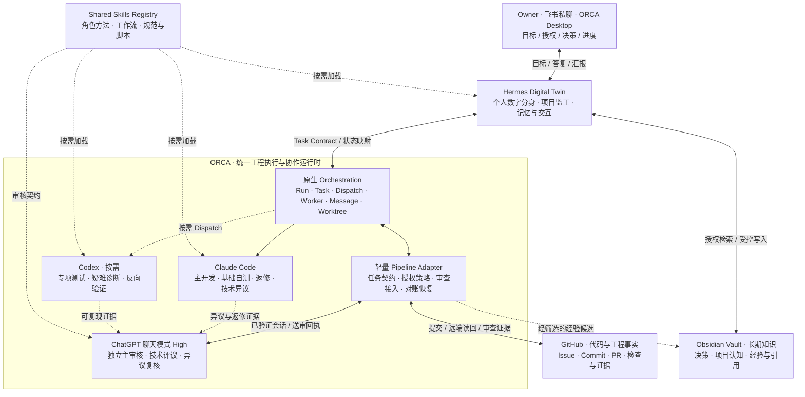
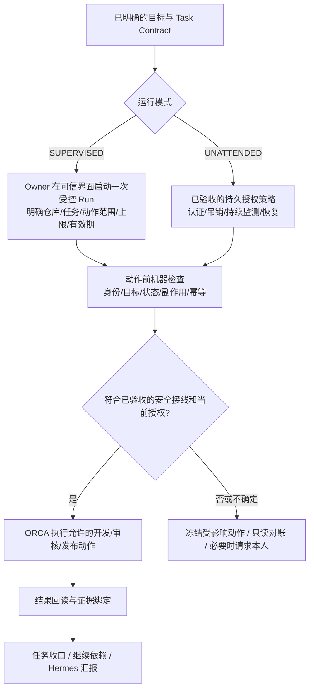
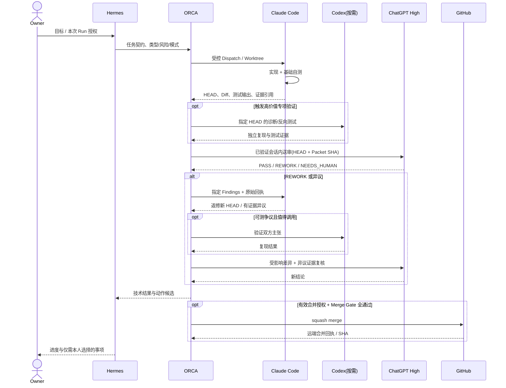
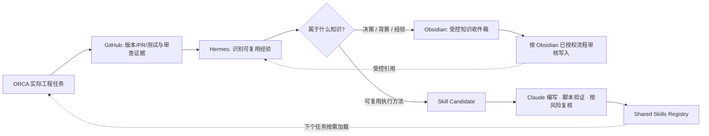

# Hermes Digital Twin × ORCA｜数字分身工程化整合总架构

> **项目代号**：DT-ORC  
> **架构版本**：**V3.1.0 · A+**（有人值守快速工程 + 无人值守可信自治）  
> **发布日期**：2026-11-02  
> **唯一正式路径**：`docs/DT-ORC/ARCHITECTURE.md`  
> **文档属性**：唯一工程架构基线（Architecture Baseline / Living Standard；待 GitHub 合并生效）  
> **版本状态**：**A+ 工程共识定稿，待 GitHub PR 合并后生效**。已吸收 Claude 的 R1–R5 意见及 ChatGPT High 的定向审查意见；历史评审留存仓库。本文是目标架构与执行约定，**不代表任何真实功能已安装、验收或取得操作授权**。  
> **适用边界**：仅限**个人 Hermes Digital Twin、ORCA、个人 Obsidian 知识库及其个人工程协作链**；**不适用于企业数字分身、企业业务数据或企业营销/多维表格项目**。

> **一句话架构**：**Owner 定目标和权限；Hermes 监工、记账和协调；ORCA 负责工程运行；Claude Code 主开发和技术异议；ChatGPT 聊天模式 High 主审；Codex 按需专项诊断与验证；GitHub 保存工程事实；Obsidian 保存长期知识；Skills 沉淀成熟方法。**

---

## 0. 文档地位、决策和边界

### 0.1 本版的正式架构选择

本版吸收了 2026-10-30 V1.0、Claude 2026-11-02 V2.0、ChatGPT V3.0 以及 Claude 对 V3.0 的同版本评审建议，作出以下**架构决议**：

1. **采用 A+ 双运行模式**：同一套 ORCA 工程链支持 `SUPERVISED`（有人值守快速工程）与 `UNATTENDED`（无人值守可信自治）；二者使用相同的 Task、证据、Review 和 Recovery 契约，**但授权和启动条件不同**。
2. **先完成有人值守的真实工程闭环**：不把完整 Secure Enclave / Touch ID / 签名登记工程作为所有低风险开发的通用前置条件；同时不绕过已经确认的隔离、幂等与发送安全缺陷。
3. **保留低风险自动合并的目标**：在经明确批准的范围策略、有效独立审核、独立合并资格核对和可确认外部副作用条件全部满足后，L0–L2 可自动合并；不能仅凭 `PASS` 或本架构文档自动获取许可。
4. **Codex 为按需专项验证专家**：不是所有提交必经的全量测试站；Claude 承担自测，机械回归由确定性脚本执行。
5. **唯一总纲固定为 `ARCHITECTURE.md`**：后续以同一文件的 PR、ADR、版本号升级，不另起平行“最终方案”。
6. **不将生产/知识库/企业权限混同**：各系统的正式写入、凭据和通知按各自授权边界实施。

### 0.2 本文不等于操作授权

**文件批准/合并 ≠ 启动 Worker、发送 ChatGPT 消息、推送、合并其他 PR、部署、清理文件或操作正式 Vault 的执行许可。**

本文件规定的是**允许建立何种授权策略以及必须满足什么技术条件**。实际授权必须由可信来源形成明确、可查的 `run_authorization` 或 `policy_authorization`，且执行端必须验证。此前在某些会话中对自动合并的原则性许可，需被转化为明确适用仓库、路径、动作与有效期的策略记录后，才能由脚本实施。

### 0.3 规范等级

- **MUST**：不满足则相应操作不得执行；
- **SHOULD**：默认采用，可以有记录的技术理由进行调整；
- **MAY**：根据价值与风险选择；
- **NO-GO**：尚未验收或授权；不能以模型推断、模拟测试或设计文档代替放行。

**真实验收的三个层级不可混淆**：`IMPLEMENTED`（已实现）→ `REVIEWED`（指定版本已独立审查）→ `OPERATIONALLY_VERIFIED`（真实受控运行并核对结果）。

---

## 1. 北极星目标与设计原则

**目标**：让 Owner 用自然语言设定个人项目目标，Hermes 以长期记忆和项目账本组织工作，ORCA 以原生运行时持续调度，Claude 编写及返修、ChatGPT High 独立审核、Codex 按需查证；在授权范围内自动推进，异常可恢复，经验可积累，关键决策才打扰 Owner。

**七条设计原则**：

1. **专业分工**：一个任务有明确主责；不因为存在多个模型就机械安排多模型会审。
2. **ORCA 原生优先**：复用 Run / Task / Dispatch / Worker / Message / Worktree，少建重复状态机。
3. **技术事实优先于模型权威**：ChatGPT 主审但可被 Claude 以证据质疑，Codex 可以独立验证。
4. **速度与安全不对立**：减少反复人工审批，保留短小、确定性、可测试的技术检查。
5. **双模式、同契约**：有人值守优先解决真实闭环，无人值守逐步加强持续授权与恢复。
6. **知识不等于运行状态**：GitHub、Obsidian、Skills 各司其职，与 ORCA/Hermes 不重复保存权威事实。
7. **渐进迁移，不推倒重建**：现有已合并资产保留，未验收资产不能为了清理积压而一并合并。

**非目标**：让 Hermes 成为最高技术裁判；将 Codex 固定为全职测试；把 ChatGPT High 替换为 Work/API/Codex；重造 ORCA 编排；让 Obsidian 成为运行数据库；将本项目延伸到企业数字分身。

---

## 2. 总体架构与事实真源

### 2.1 全景图



**图不是固定的逐框串行流水线**：Claude 与 ChatGPT High 构成研发主线，Codex 不固定介入；GitHub、Obsidian、Skills 是可访问的不同资源与真源。

### 2.2 事实所有权

| 平面 | 权威组件 | 负责的事实 | 不负责 |
|---|---|---|---|
| 个人业务管理 | Hermes `twin_state` | Goal、业务 Task、优先级、授权决策引用、项目收口 | 复制 ORCA Worker 状态机 |
| 工程执行 | ORCA Runtime | Run、执行 Task、Dispatch、Worker、状态、消息、工作树 | 业务审批及长期知识 |
| 工程交付 | Git / GitHub | HEAD/base、代码 Diff、Issue、PR、测试与审核证据引用、实际合并 | Hermes 的业务判断 |
| 长期知识 | Obsidian | 决策缘由、项目背景、跨任务经验、可检索知识 | 实时进程、完整敏感日志 |
| 可复用方法 | Skills Registry | 工作方法、触发条件、标准脚本、参考资料 | Task 状态、授权令牌 |

**只同步 ID、摘要、事实快照与证据位置**。目标与执行状态矛盾时标记 `UNRECONCILED`，不由模型“选一个看起来合理的”覆盖。

### 2.3 必须有的跨系统映射

`project_id / goal_id / hermes_task_id / orca_run_id / orca_task_id / dispatch_id / head_sha / pr_ref / review_packet_sha256 / review_verdict / approval_ref / knowledge_ref`

映射不是另一个调度状态数据库。使用 Hermes 现有 External Reference 机制或经过批准的轻量索引，不新增与 ORCA 重叠的 Run / Worker 状态表。

---

## 3. 固定角色与责任边界

| 角色 | 职责定位 | 主责 | 禁止替代的职责 | 主要产出 |
|---|---|---|---|---|
| **Owner** | 目标与权限所有者 | 定方向、重要取舍、范围许可、高影响动作审批 | 模型之间的人工复制/机械接力 | 决策、运行授权或有效策略 |
| **Hermes** | PM / 监工 / 个人数字分身 | 接需求、查重、排队、催进度、记录、报告、自动选已授权默认项 | 主体编码、独立技术裁决、越权审批 | Task Contract、项目账本、决策请求 |
| **Claude Code** | Lead Developer | 技术方案、编码、必要自测、返修、提交、对审核的证据异议 | 自我宣布独立验收、无授权部署、篡改独立测试证据 | Commit/HEAD、Diff、自测、返修与异议 |
| **ChatGPT 聊天模式 High** | Principal Reviewer | 独立技术审核、架构评议、风险、复核异议 | 自动授予合并权限、代替用户做风险取舍、直接修改实施代码 | PASS / REWORK / NEEDS_HUMAN、Findings |
| **Codex** | Verification & Diagnostics Specialist | **按需**独立测试、复杂 Bug 复现、并发/安全/恢复专项验证、争议取证 | 全量常驻回归、最终技术主审、默认改业务代码 | 绑定 HEAD 的实际测试/诊断证据 |
| **ORCA Runtime** | Execution Runtime | 执行生命周期、Worker、资源、消息、Task 依赖 | 技术方案价值判断、长期个人记忆 | Run/Task/Dispatch 与回执 |

### 3.1 Codex 额度和测试职责（正式冻结）

- **Claude 必须做开发自测**。已有 `unittest` / `pytest` / `swiftc` / `git diff --check` 等机械操作由受控脚本执行，不要求每次调用 Codex Agent。
- **Codex 按需优先场景**：疑难缺陷、并发/幂等、安全边界、性能定位、重要里程碑、Claude 与 ChatGPT 有可验证的事实争议。
- **普通小改默认不调 Codex**；额度充足时可提高专项覆盖，但不以耗尽额度为考核目标。Hermes 不得编造剩余额度。
- Codex 可在独立 Worktree 修改测试、夹具和诊断脚本；默认不改 Claude 的业务实现。测试本身出错时走变更记录，不由 Claude 偷偷覆盖独立证据。

### 3.2 Hermes 的智能边界

Hermes 可按**明确规则**决定任务排序、重试符合白名单的可确认幂等操作、整理低优先级技术债和发送已授权通知。高复杂度技术取舍交给 Claude/ChatGPT；业务/风险偏好不清则整理为简洁选择题交给 Owner。

**Hermes 是业务协调者；实际 ORCA Coordinator/运行循环可由确定性 Adapter 和 ORCA 原生功能承担**，不要求 Hermes 自己维持脆弱的实时 supervised loop。

---

## 4. 三维执行模型：类型 × 风险 × 运行授权

### 4.1 五条任务泳道（决定做什么步骤）

| 泳道 | 典型任务 | 默认方法 |
|---|---|---|
| `DEV` | 新功能、重构 | Claude 开发/自测 → ChatGPT 审；Codex 按需 |
| `BUG` | 修复、异常恢复 | 取得失败证据 → Claude 定向修复 → 回归/必要 Codex 复现 → ChatGPT 审 |
| `DESIGN` | 需求分析、架构、UI/UX、ADR | Claude 设计 → 必要的 ChatGPT 评议 → Owner 对重大取舍拍板 |
| `OPS` | 安装、部署、迁移、权限及外部动作 | 变更单/回退 → 隔离演练 → 审核与有效授权 → 动作/回读 |
| `KNOWLEDGE` | Obsidian 知识、Skill | Hermes 识别候选 → Claude 整理/实现 → 验证 → 按现有知识权限写入 |

### 4.2 四档风险（决定审核深度）

| 等级 | 含义 | 默认审核要求 |
|---|---|---|
| `L0` | 不改变代码行为的管理与低风险文档 | 直接处理和机械检查，通常免多模型审核 |
| `L1` | 小范围低风险代码 | Claude 自测 + ChatGPT High 增量审查 |
| `L2` | 标准研发、跨文件非敏感功能 | Claude 设计/编码、自测/回归 + ChatGPT High 主审，Codex 按需 |
| `L3` | 身份、安全、持久状态、正式系统、不可控副作用 | 设计/威胁与回退分析、必要专项验证、独立技术审核、动作授权 |

**级别不是授权**。例如 L1 修改如果触碰生产凭据，受影响动作按 L3/权限规则处理。路径和标签可自动**上调**风险，但不能仅凭“代码不到 200 行”下调风险。

### 4.3 两种运行模式（决定哪些真实动作可开始）

- `SUPERVISED`：有人值守的**单次受控工程 Run**。Owner 通过 5.2a 规定的可信来源明确启动、看到当前仓库/任务/允许动作/有效期与上限；只要具体动作具备已审查的安全接线并落在批准范围内，Run 内可自动连续推进，不逐轮问人。**看见 ORCA 窗口、聊天里的普通“继续”、或本文被合并都不单独构成这项批准**。
- `UNATTENDED`：已验收的持久策略自动触发，可在 Owner 离开后继续工作；需要额外证明授权来源、策略有效期与撤销、无人值守恢复、身份和发送可靠性、常驻服务安装等。**目前未达到自动放行条件**。

两模式共享同一任务与证据协议，而非复制两套开发系统。

### 4.4 不增加“工作流 W0–W4”第二套未定义编号

本项目**只正式使用 `DEV/BUG/DESIGN/OPS/KNOWLEDGE`、`L0–L3` 和 `SUPERVISED/UNATTENDED` 三维标签**。早期草稿中的 W0–W4 如在 Skill/文档引用，应在迁移时明确映射或替换，避免与 L0–L3 造成术语混乱。

---

## 5. A+ 双模式授权与执行策略（本版核心）

### 5.1 双模式一图说明



**核心原则**：没有必要先完成所有无人值守身份工程才能开展 `SUPERVISED` 受控试点；但是任何具体真实动作**仍不能调用一个尚未验收的危险执行桥**，也不能通过人为改配置或绕过代码门禁假装“快速模式”。

### 5.2 有人值守快速工程通道的最小准入

首次 `SUPERVISED` 真闭环不依赖完整 B6–B11 Secure Enclave 体系，但**必须**满足：

1. **可信启动与可见范围**：只由 5.2a 列出的来源创建 `run_authorization`，明确本次任务、仓库、运行时、动作上限和有效期；不能用普通模型文本冒充。
2. **受限环境**：使用独立 Sandbox/Worktree；禁止生产 Vault、企业数据、正式数据库和已安装 Hermes 配置的隐性访问；对涉及的状态目录做目录/文件级链接隔离或采用已验收且不触及缺陷路径的替代通道。
3. **受控 Worker**：启动前验证目标 Run/Task/Worktree 与当前授权；失败或返回未知时使用 ORCA `request-show` / `worker-show` 对账，不重复盲启。
4. **受控 ChatGPT High 会话**：确认具体聊天 URL、页面、聊天模式和 High 强度，绑定送审包 SHA-256/HEAD；发送前再核对；不明确是否已发就只收取，不重发；维护同页租约。
5. **受限代码发布**：push/PR 只能写批准的个人仓库及分支范围；合并前独立验证完整 HEAD/base、测试、审核与有效合并策略；不得触发未获授权的部署/外部副作用。此前本仓库的分支保护 API 返回 403。Agent deny 规则和 `merge_gate.py` 是必要检查，但**不等于不可绕过的强制隔离**：自动 push/merge 只能由经审查的受限发布通道执行，执行 Worker 不得同时持有可绕过它的等效写权限；达不到这一条件时保留人工发布，不阻断开发和审核。
6. **审计与停机**：动作记录最小 ID/摘要/时间/结果；Owner 可以停止后续动作。终止进程不等于取消已经发生的副作用，需事后对账。

**当前实现若仍将 `LIVE_ACTIONS_ENABLED=False` 或真实后端硬拒绝，则保持禁用。** 只有经独立审核的最小受监督执行桥/白名单机制实际落地并通过相应测试，才可启用该路径；不允许仅凭本文件改为 `True`。

如初期自动接线尚未通过验收，可以由 Owner 在 ORCA/ChatGPT 界面**直接执行一次明确授权的动作**完成受监督 E2E，准确标注“人工触发”，不能汇报为“全自动闭环”。这是尽快取得真实证据的降级路径，不应被复杂身份证明工程无限阻塞。**人工直控试点（Owner 亲手执行 `worker-start` 与 ChatGPT 发送）不使用合成状态根和 fake 传输，不经过 M1 所修的代码路径，因此可与 M1 并行**；自动接线的 M2 仍以 M1 验收为前提。

### 5.2a SUPERVISED 的可信签发来源（Owner 2026-11-02 选定）

`SUPERVISED` 的 `run_authorization` **只接受**以下两种来源，**不要求 Secure Enclave、Touch ID 或签名挑战**：

| 来源 | 适用场景 | 要求 |
|---|---|---|
| **(a) 本机授权命令** | Owner 在电脑前 | Owner 通过**独立于 Agent 自动操作的交互入口**亲自运行授权命令，核对任务、仓库、允许动作、上限和有效期，由确定性脚本落盘。仅有“同一 macOS 用户的终端输入”不足以证明本人授权；若无法区分 Owner 与 Agent 操作，只采用本人手动直控，不签发自动运行许可 |
| **(b) 飞书私聊确认** | Owner 不在电脑前 | 仅接收**真实且经平台认证的飞书事件**，校验 Owner 的 `open_id`、个人猛鬼兽私聊及消息 ID，并防重放；通过已部署的 `twin_identity` 核验后记录来源。不得接受模型自报 ID、伪造事件、群聊或企业数字分身渠道 |

- 两种来源生成同一 `dt-orc.run-authorization/1` 记录，带一次性动作消耗账本与有效期；过期、超额或来源无法核验时拒绝。
- **威胁模型边界**：`SUPERVISED` 的目标是防止模型自报、文本冒充、重放和超范围动作；只有相应的授权签发与执行隔离**实际验收后**才能声称达到该目标。**它不防同一 macOS 用户下的恶意本地进程**。后者归 `UNATTENDED`（M4）处理，B6–B11 的设备绑定与签名方案作为其候选素材。
- (b) 依赖猛鬼兽网关在线；网关断线时该来源不可用，只能使用 (a)，不得降级为接受未核验的消息。

### 5.2b SUPERVISED 的最小执行桥

- **Worker**：以固定 argv 白名单直接调用本机 `orca orchestration worker-start / worker-show / request-show / worker-stop`，每次调用前核对并消耗 `run_authorization` 中的对应次数。`worker-start` 只在 ready 时返回 0；失败或 `outcome_unknown` 时按其回执中的 `failedStage`、`residualResources` 和恢复命令，以及 `request-show` 只读对账，不重复启动（7.3）。
- **ChatGPT 发送**：沿用已合并的 RELAY-01 `chatgpt_relay.py`，要求固定会话 URL、模式与 High 强度核对、页面租约、结果不明只 collect 不重发（5.2 第 4 条）。
- **不要求**复用 B6 `pilot_gate` / B7 `pilot_executor`；二者只接受测试替身证明，归入 `UNATTENDED` 候选素材。
- 启用上述执行桥本身是一次代码变更：须经 ChatGPT High 审核并通过反向测试后，才能把对应真实动作从硬禁用改为“仅在有效 `run_authorization` 下允许”；不得直接把 `LIVE_ACTIONS_ENABLED` 改为无条件 `True`。

### 5.3 无人值守自治通道的附加门禁

在满足 5.2 的共通安全不变量基础上，`UNATTENDED` 还必须完成：

- 可验证、可吊销的持续授权策略及身份/设备/来源绑定；
- 无人在场时的 Worker、ChatGPT 页面/会话、发送与回执的可靠唤醒；
- 进程/机器重启后的幂等恢复、不确定动作冻结、资源回收与审计；
- 最小权限常驻触发服务的独立安装和撤销验证；
- 被明确界定的无人值守外部副作用，以及敏感动作的额外人工门禁。

B6–B11 的 Secure Enclave、签名挑战、状态根设计可作为该方向的候选素材，**不得整体认定为必须采用的唯一实现**，也不得因快速通道存在而自动废除其中已确认的安全修复。

### 5.4 运行授权记录的最低契约

执行器应从**可信交互/策略验证器**取得类似如下的结构化记录；以下只是**数据契约样例，不是一份生效授权**：

```json
{
  "schema": "dt-orc.run-authorization/1",
  "mode": "SUPERVISED",
  "project": "digital-twin",
  "repo": "Natsukashii1997/digital-twin",
  "orca_run_id": "<ORCA_RUN_ID>",
  "scope": {"task_ids": ["<TASK_ID>"], "allowed_paths": ["orca/**", "docs/DT-ORC/**"]},
  "actions": {"worker_start_max": 1, "review_send_max": 1, "push_branch": false, "create_pr": false, "squash_merge": false},
  "issued_at": "<RFC3339>",
  "expires_at": "<RFC3339>",
  "issuer_proof_ref": "<TRUSTED_SOURCE_REF>",
  "policy_version": "<APPROVED_POLICY_SHA>"
}
```

实际实现还需要：签发来源限定为 5.2a 的 (a)/(b)、禁止凭调用方自报、一次性动作消耗账本、跨进程并发限制、审计和撤销语义。**JSON 自带的 `issuer_proof_ref` 字符串不是身份认证**；未经验证的外部输入仍然拒绝。

### 5.5 低风险自动合并的精确政策

**目标许可**：在 Owner 明确批准并且已验收的有限策略生效后，`SUPERVISED` 下符合 L0–L2 规则的 PR 可在 ChatGPT High PASS 后**自动 squash 合并**；`UNATTENDED` 另需持续授权门禁验收。

合并必须同时满足：

1. **绑定正确**：当前远端 PR 仍是已审核的完整 HEAD/base，任务契约和送审包 SHA-256 未改变；
2. **测试与审核成立**：所需机械回归通过，ChatGPT High 对同一版本 `PASS`；Codex 如按触发规则要求介入，其关键验证已完成；
3. **范围受限**：仅批准的仓库、PR、分支、目录和任务等级；禁止敏感路径、凭据、安装/部署/配置/正式数据及范围外变更；
4. **授权可验**：存在有效的范围策略或本次 Run 授权，且该记录**明确包含合并权限**；`PASS`、架构文档批准、模型自报均不是许可；
5. **副作用已知**：合并可能触发的 CI、发布、部署和通知已被核对，不能用“可 revert”代替风险评估；
6. **环境确认**：远端 PR 状态、保护规则和合并权限现读无冲突，成功后回读目标主分支及合并 SHA。保护规则不可读取（如 API 403）时必须记录“不可依赖远端保护”；**不能把 Agent 本地 deny 规则当作等价保护**。未验收受限发布通道、Worker 仍有绕过权限时，不启用自动合并，改用人工合并。

不满足任何一项时**停在“技术 PASS / 待合并授权”**，其他无依赖任务可以继续。L3 默认不自动合并，除非另有明确且独立审查的专项策略。

`merge_gate.py` 等现有工具需要扩展为区分 **`owner_direct` 单次许可** 与 **`owner_approved_policy` 范围许可**。在扩展通过独立测试/审查之前，必须遵守当前工具更严格的合并拒绝语义；**不能用修改 JSON 字段冒充授权**。

### 5.6 动作与模式矩阵

| 动作 | SUPERVISED | UNATTENDED |
|---|---|---|
| 只读检查、非敏感合成设计 | 依既有访问权限 | 依既有访问权限 |
| 隔离代码开发、Claude 自测 | 在本次授权范围内自动 | 在持续策略范围内自动 |
| Codex 专项调用 | 预算与风险触发 | 同左，受策略额度/任务上限约束 |
| ORCA Worker-start/stop | 仅在本次 Run 授权且 5.2b 执行桥验收后自动；否则人工直控 | 还须可信持久授权与恢复验收 |
| ChatGPT High 发送 | 仅在本次会话/消息授权且 5.2b 发送桥验收后自动；未知不重发 | 还须可信会话唤醒与持续授权验收 |
| push 分支 / 开 PR | 明确允许的个人仓库、分支范围内自动 | 持续策略内，且外部副作用已审查 |
| L0–L2 squash merge | 通过 5.5 全条件才自动 | 通过 5.5 + 无人值守门禁才自动 |
| 正式安装/配置/迁移、删除或大规模清理 | 单独授权和验证 | 默认仍需专项授权，不由持续策略泛化 |
| 正式 Obsidian Vault 写入 | Obsidian 主线独立授权 | 同左，不沿用 ORCA 授权 |
| 企业飞书/企业数据 | **禁止跨域** | **禁止跨域** |

---

## 6. 开发、审核、异议与收敛

### 6.1 主流程序列



L0 管理文档可直接处理，不强制每次送 ChatGPT；L1/L2 研发以 Claude + ChatGPT High 为固定主线；Codex 不是固定第三站。

### 6.2 审核契约

每份送审包至少绑定：`task_contract_version`、ORCA Run/Task、完整 `HEAD SHA`、相关 `base SHA`（如为 PR）、送审包原始字节 SHA-256、变更范围、测试证据、已知问题与审核范围。回执 `PASS / REWORK / NEEDS_HUMAN` 只能对该精确版本生效。

Findings 分开记录**严重度**和**证据可信度**：

- `P0`：破坏授权/数据完整性/安全边界或重大外部副作用；
- `P1`：违反核心验收、功能错误或重要回归；
- `P2`：可维护性、范围外优化、独立技术债。

`proven / probable / hypothesis` 是可信度，不是严重度。**第二轮新发现可信的 P0/P1 不能因代码未改就强制降为 P2**；但必须说明其与当前任务/动作的直接关系，避免无依据扩展审核范围。

### 6.3 Claude 对 ChatGPT 的校正机制

Claude 对阻断项选择：`ACCEPT`（修复+新 HEAD）、`CHALLENGE`（指明错误前提及证据）、`NEED_EVIDENCE`（提出可验证问题）。若是可测事实，优先使用确定性脚本；需要独立复杂诊断时才调用 Codex。ChatGPT High 根据实际证据维持、撤回、降级或更新结论。**两方不能凭模型票数放行安全风险。**

默认**一次正式异议与一次证据复核**；有真实新证据可额外延长。高风险重大设计分歧可另启不带开发过程上下文的 Claude 会话提供第二意见，但**不对每个 L3 子任务强制执行**。

### 6.4 返修范围与上限

- L1 默认最多 1 轮自动返修，L2/L3 默认最多 2 轮；此为**自动循环预算上限**，不是安全问题可以忽略的上限。
- 第二轮优先审新增 Diff、未关闭 Finding 和直接受影响的相邻模块；不得自动追加无关的新范围。
- 超限时 Hermes 向 Owner 汇总**当前已知缺陷、已尝试措施、是否存在替代方案**，其他无依赖任务继续。
- 旧 PASS 在 HEAD/base/任务契约变化后失效；不能为了减少审核耗时而重用过期结论。

---

## 7. ORCA 原生运行、恢复与状态对账

### 7.1 原生优先映射

| 需求 | 优先使用 ORCA | 只补必要的外层能力 |
|---|---|---|
| 执行 Task 与依赖 | `task-create`、Run/Task/DAG | Hermes 的业务排序/映射 |
| 起停 Worker、核对状态 | `worker-start`、`worker-show`、`worker-stop`、`request-show` | 已授权动作约束、身份与不确定结果对账 |
| Worktree 隔离 | ORCA 新子工作区或受控独立 Worktree | 沙盒边界、安全产物来源 |
| Agent 交接 | ORCA `send/check/ask/reply`、`worker_done`（依本机版本核对） | 最小交接契约 |
| 决策挂起 | ORCA gate 与 Hermes 飞书交互 | 可信来源及决策引用 |
| ChatGPT 审查 | 经确认的 ORCA 浏览器页面 + relay | 唯一会话身份、High 强度、租约与回执 |
| GitHub 工程事实 | Git / GitHub 现读与 PR | 范围合并授权、版本证据 |

所有命令、字段、资源生命周期必须以**实际安装的 ORCA 版本只读查询和受控实测**为准。不能以文档中出现的命令名字推定当前已经能安全调用。

### 7.2 最小 Task / Handoff 契约

| 对象 | 必填字段 |
|---|---|
| Task Contract | `task_id / objective / scope / acceptance / dependencies / risk / mode / allowed_actions` |
| Claude 交接 | `task_id / orca_task_id / dispatch_id / head_sha / changed_paths / test_summary / known_issues / evidence_ref` |
| Codex（触发时） | `target_head / test_scope / actual_command / actual_result / reproduction / evidence_ref` |
| ChatGPT 审核 | `task_id / head_sha / base_sha / packet_sha256 / verdict / findings / evidence_ref` |
| 动作结果 | `action_id / authorization_ref / request_id / result / remote_readback / side_effects` |

不要为了每张小任务生成一份长 PRD；完整背景保留在 GitHub/Obsidian，需要时按引用读取。

### 7.3 不确定结果处理（不可删的安全底线）

| 情况 | 正确动作 | 禁止行为 |
|---|---|---|
| `worker-start` 返回不明 | `request-show` / `worker-show` 只读对账，记录占位 | 再起一个可能重复的 Worker |
| 终端存活但 Agent 状态不明 | 交叉核对 Dispatch/Worker/Task 证据 | 把“终端还在”当“任务正在运行” |
| ChatGPT 点击结果不明 | `collect` / 核消息、冻结租约 | 换会话盲目重发同一份包 |
| 审核包或远端 HEAD 改变 | 原 PASS 作废、重新审核相关版本 | 复用旧 PASS 合并新代码 |
| 跨系统账本冲突 | `UNRECONCILED`、停止受影响动作 | 模型自信选择其中一个 |
| 普通任务失败 | 停本任务及依赖，其他继续 | 把局部失败升级为全局停 |
| 身份/权限/证据完整性破坏 | 冻结相关共享安全域 | 以提高效率为由忽略 |

---

## 8. Obsidian × GitHub × Skills 的持续积累闭环

### 8.1 三类资产明确分开

- **GitHub**：Issue/PR/Commit/ADR、可入库的测试、验收结果和工程证据引用。敏感密钥、真实状态库、私人 Vault 正文不得入库。
- **Obsidian Vault**：项目认知、经验、决策缘由、知识索引和长期复用的背景。正式 Vault 的读写受 Obsidian 主线已有权限、收件箱和审核约束。
- **Skills Registry**：经过检验可复用的操作方法、角色工作流、工具脚本和参考资料。Skill 不是另一个 Agent、状态机或新的执行授权来源。

### 8.2 知识与方法闭环图



不是每次完成任务就必须写 Vault 或创建 Skill。优先去重、更新现有条目；长期记忆保留**为什么、是什么**，Skill 保留**怎样做**，GitHub 保留**哪个版本实际发生了什么**。

### 8.3 初期六个精简 Skills

| Skill | 使用者 | 关键任务 |
|---|---|---|
| `dt-orchestrate` | Hermes | 识别任务类型/风险/模式、调度、状态对账与汇报 |
| `dt-develop` | Claude | 设计、编码、自测、交接、返修 |
| `dt-verify` | Codex 按需 | 独立诊断、异常复现、反向测试 |
| `dt-review` | 审核通道与 ChatGPT High | 送审包、版本绑定、Findings 与回执 |
| `dt-dispute` | Claude/ChatGPT/Codex | 技术异议、取证、纠偏与收敛 |
| `dt-closeout` | Hermes | 项目收口、依赖释放、知识/Skill 候选 |

Skill 包含 `SKILL.md`（YAML name/description）、可选 `references/`、`scripts/`、`assets/`；按需加载。真实外部动作仍由代码和可验证授权检查实现，**不能因为 Skill 写了“可以执行”就跳过安全门禁**。

Registry 采用**一个权威版本来源**，个人工作台/Claude/Codex/Hermes 通过受控引用或安装关联。跨项目复用时必须审查权限差异，严禁将个人 ORCA 权限默默用于企业业务。

---

## 9. 工程现状：事实快照，不得冒充当前运行实时状态

> 本节只记录此前已见到的 2026-11-02 核验材料。后续需要以当前 HEAD、真实运行记录和独立审核更新 `CURRENT.md`。不因本文件发布而视为已完成。

| 资产 | 证据状态与处理 |
|---|---|
| Hermes B0–B2.2 状态、事件和调度基础 | 已有真实安装/对账的历史成果；维持业务真源及已批准运行边界 |
| RELAY-01 | 历史已合并；保留，但继续校验真实页面/会话和运行版本 |
| PR #40 RELAY-02 / PR #42 | 历史检查时仍为 OPEN；实施前必须现读远端状态，不因本文件自动合并 |
| Framework V2 B1–B5 | 多批隔离测试及审查成果；按 ORCA 原生对照后精简复用，不能直接批量合并 |
| B6–B11 | 离线授权、安全观察与硬禁用执行桥的技术素材；按“快速模式必要防护 / 无人值守高级认证”分类保留 |
| **B11-R5** | 历史 Python 3.9.6、3.14.5 各 347 项通过，但独立评审仍为 **REWORK**；状态文件/锁文件符号链接问题未关闭；当时 R5 修改未形成新 HEAD |
| relay 页面租约历史误写事件 | 隔离测试曾意外触及正式用户 relay 租约目录；未经独立授权不得直接清理 |
| Obsidian K1/K2、Hermes G5 | 各自独立工作流和审批条件；ORCA 不继承它们的真实操作权限 |

**重点判断**：B11 的实证安全问题必须修，但**不应强制等完整的 Secure Enclave/Touch ID 体系完成后才开始有人值守试点**。对于任何存在路径逃逸或副作用不明的具体代码路径，不能因“有人在旁边”而跳过修复。

---

## 10. 迁移路线：最短可信路径，而非无限加关口

### 10.1 实施次序

| 里程碑 | 工作包 | 真实验收定义 | 是否必须串行 |
|---|---|---|---|
| **M0 · 基线统一** | V3.1 精确文件经双方复核；确定唯一 `ARCHITECTURE.md`，AGENTS 指向；现有仓库/分支/Worktree/授权盘点 | 同一内容摘要、两份真实评审、可追溯 GitHub PR；未擅自合并生产代码 | 先做 |
| **M1 · 最小安全收口** | 定向修复 B11-R5 指出的文件级链接问题（范围见 10.3）；按 5.2a/5.2b 实现 `run_authorization` 与最小执行桥 | 相关反向测试、双 Python 回归、独立审核，正式状态未被触及 | 与 Skills 文档、人工直控试点并行 |
| **M2 · SUPERVISED 首次真实闭环** | ORCA 原生 Worker/消息 → Claude 开发 → ChatGPT High 真实送审 → 返修/回执 → Hermes 结算；Codex 有价值时介入 | 真实 Run/Task/Dispatch、固定 HEAD、送审 ACK、动作次数及恢复证据；人工操作如实标注 | M1 必要接线验收后 |
| **M3 · 有人值守持续接力** | 多个无依赖任务、局部失败、正确排队；经批准的 push/PR/L0–L2 自动合并 | 至少多任务受控运行与有效合并策略测试，记录等待和人工干预 | M2 后 |
| **M4 · UNATTENDED 升级** | 可信持续授权、真实会话唤醒、幂等恢复、常驻服务及回退 | 按现有/优化后 G 闸门真实测试并单独批准正式安装 | M3 后，不阻塞 M2 |
| **M5 · 知识/Skills 长期闭环** | Hermes/Obsidian 受控检索及 Skill 迭代，双向引用与可重复调用 | 成功引用案例、按权限写入证据、Skill 复用记录 | 非敏感准备可并行 |

**M2 不依赖 M4 的完整人类在场/身份工程；自动接线的 M2 必须满足 M1 的受监督真实动作最小安全准入。** 人工直控一次性试点不经过 M1 所修路径，可与 M1 并行（5.2），须严格标注“人工触发”，以尽早暴露真实运行问题，而不是继续无限堆积 Fake E2E。

### 10.2 资产治理，不允许“顺手合并/清空”

- `RELAY-02`、Framework V2 和各 B11 返修分支：**逐项读取完整 HEAD、Diff、测试与审核结论**，确定保留、返修、简化或存档；**不得为了让未合并 PR 数量下降而直接批量合并**。
- `work_queue.py` 与 ORCA 原生 Task/DAG 重叠处可逐步删除，但必须有兼容和崩溃恢复测试。审查租约、真实授权、跨系统幂等可能仍需薄适配器。
- 旧 `dispatch.py` / `run_worker.py` 保留为 Legacy，直到已批准的迁移和回滚演练完成。
- G5、Obsidian K1/K2 按各自主线授权独立推进，不被本项目“自动接力”越权触发。
- 历史未提交 Worktree、审计证据与正式目录误写租约**不主动清理**；需要单独确认归属和授权。

### 10.3 第一张明确施工工单

**`DT-ORC-M1-B11-FILE-ISOLATION`**：Claude 定向修复 `delivered/` 等合成状态目录内的 `.json`、`.lock` 文件级符号链接和安全打开，Codex 仅在复杂独立复现确有增益时介入；ChatGPT High 审核指定 HEAD。所有反向测试指向私有 Sandbox 替身，不碰正式状态目录。未经单独授权不得推送、合并、安装、操作生产 DB/Vault 或调用真实 ChatGPT 发送与 Worker-start。

**范围冻结与退出条件**：M1 的 B11 部分只修 B11-R5 独立复核（基于 `c060df8`，`orca-b11-r5-evidence-20261101/independent-review.txt`）指出的“合成 `delivered/`、`sending/` 目录内 `.json` / `.lock` 文件级符号链接跟随”一项及其反向测试。审查轮数按 6.4 的 L2（最多 2 轮）。复核中发现范围外新问题，不自动扩大本工单；但若有可靠证据表明属于 **M2 实际执行路径的 P0/P1 缺陷**，须另建工单并阻断受影响动作。其余记入待办；超过本工单返修预算时由 Owner 决定拆分或继续。

**M2 的最小试点工单**须独立说明实际动作及授权，不能由 M1 的开发许可推导。

---

## 11. Definition of Done 与效率度量

### 11.1 分层完成标准

| 层级 | 必须满足 |
|---|---|
| 开发完成 | Task Contract 明确；代码与 Worktree HEAD 可查；Claude 自测与必要机械测试通过 |
| 技术验收完成 | 指定 HEAD/base/包经 ChatGPT High 有效审核；P0/P1 有关闭证据；专项测试如被触发已完成 |
| 工程操作完成 | 当前动作有可信授权；远端回执及状态回读；必要的回滚/恢复证据 |
| 项目阶段完成 | Hermes 核对全部依赖与交付；剩余风险、外部阻塞和技术债各有明确归属 |
| 无人值守可用 | 持续授权、唤醒、真实恢复、安装/回退等验收全部成立，绝不由受监督试点推定 |

### 11.2 不追求虚假的固定时长

关注 `lead_time`、`execution_time`、`waiting_time`、`first_pass_rate`、`review_finding_quality`、`rework_rounds`、`Codex_verification_value`、`manual_interventions`、`resume_success`、`duplicate_external_effects`、`Skill_reuse`。先测实际基线，再给改善目标，不用 Fake 时钟数据宣称真实提速。

Hermes 日报/周报应明确**最新 SHA、PR/ORCA Run、已开发/已审/已真实执行的区别、阻断、下一工单、仅需 Owner 决定的事项**。“巡检运行正常”不能计为“项目推进完成”。

---

## 12. GitHub 唯一基线、旧版归档与变更控制

### 12.1 建议目标目录

```text
digital-twin/
├── PRD.md                         # 产品/业务目标与验收边界
├── CURRENT.md                     # 随实际证据更新的项目状态
├── AGENTS.md                      # 必须指向本文件
├── docs/
│   └── DT-ORC/
│       ├── ARCHITECTURE.md         # 唯一持续演进的总架构（本文）
│       ├── adr/                    # 核心技术与权限决议
│       ├── reviews/                # 精确 SHA 的审核材料索引
│       ├── history/                # V1.0 / Claude V2.0 / Framework V2 等旧方案
│       └── migration/              # 各阶段实施、兼容、回退与验收
├── hermes/                        # 个人数字分身业务控制
├── orca/                          # 原生执行适配与必要安全校验
└── ops/                           # 授权运维工具

# Shared Skills Registry 由独立的个人 Skills 仓库维护；本仓库锁定使用版本。
```

这属于目标组织方案，**不是指令要求立即移动全部目录**。旧文档只有在已核对 Git 记录、引用、当前未提交 Worktree 后才迁至 `history/`，注明“被 `ARCHITECTURE.md` 取代”，不能破坏现有审核证据的可访问性。

`AGENTS.md` 应加入简短入口：

> `DT-ORC 的唯一工程架构基线为 docs/DT-ORC/ARCHITECTURE.md；实施需遵守其中角色分工、A+ 双运行模式、版本绑定和现行授权边界。具体能力是否已放行，以 CURRENT.md 和当前独立验收/授权证据为准。`

### 12.2 核心 ADR 决议

| 编号 | 不变原则 |
|---|---|
| ADR-001 | ORCA 只服务个人数字分身/个人项目；企业数字分身完全独立 |
| ADR-002 | Hermes 是监工、记录、协调者，不是最高技术裁判 |
| ADR-003 | ORCA 原生 Run/Task/Dispatch/消息/Worktree 是执行真源 |
| ADR-004 | Claude Code 主开发、返修、基础自测，并可提出证据异议 |
| ADR-005 | ChatGPT **聊天模式 High** 为默认独立主审，可被事实纠正 |
| ADR-006 | Codex 为**按需**专项验证与诊断，不是固定全量测试站 |
| ADR-007 | 类型 × 风险 × 模式/动作授权共同决定流程 |
| ADR-008 | A+ 采用 SUPERVISED 与 UNATTENDED 同契约双模式，**不相互越权** |
| ADR-009 | GitHub / Obsidian / Skills 按权威事实分工，不重建运行时 |
| ADR-010 | 低风险自动合并是**有范围策略的目标能力**，PASS 不是授权 |
| ADR-011 | 不确定外部结果不得重复执行；身份与版本校验是硬约束 |
| ADR-012 | 任何新功能优先简化既有 ORCA 能力，不用加关口替代技术证据 |

### 12.3 版本管理

- **PATCH 3.1.x**：错别字、引用或不改变行为的澄清。
- **MINOR 3.x**：流程、技能、适配器、准入规则与实现细化；需说明受影响的既有授权。
- **MAJOR 4.0**：角色主责、权威真源、执行架构、模式/授权体系重大变化；必须有明确 ADR、迁移和回滚计划。

版本号在文件头，Git 历史保存旧版；**禁止再创建 `ARCHITECTURE-V3.2.md` 这类平行长期总纲**。

### 12.4 最小修改/审批流程

1. 发起人提出当前问题、真实证据及拟改的章节/ADR。
2. 重大架构或权限变化由 Claude 评议、ChatGPT High 独立审查；纯文字修订只需差异核对。Codex 仅在专项可验证风险触发。
3. 记录 Owner 的必要决策及授权影响；技术 REVIEW PASS **不等于 GitHub 合并权限**。
4. 在实际有权的范围内提交/合并，更新 `CURRENT.md` 和所涉及的 Skill/Adapter；非实质性纯文字修改可采用简化审核。
5. **不能声称“Claude 和 ChatGPT 已共同认可”直到二者针对同一精确内容给出真实回执**。

**本次入库**：使用本文件直接开 PR，附已归档的 Claude 与 ChatGPT 审核记录，仅针对本次文字差异作必要核查；由 Owner 按仓库权限合并后成为唯一生效基线。`AGENTS.md` 的入口在同一 PR 中保持一致。后续变更只修改本文件，不再开启平行架构或重复全量评议。

---

## 13. 实施期间的收敛规则

架构在本次合并后固定。后续发现新问题，优先在 `CURRENT.md` 记录真实证据和下一工单；只有确实改变角色、真源、工作流或授权原则时，才按第 12 节更新本文件。**不以增加审批、重复全量评议或推翻已确认架构代替工程推进。**

---

## 附录 A. 已知引用与事实边界

- 历史参考：2026-10-30 DT-ORC V1.0、2026-11-02 Claude V2.0、ChatGPT V3.0、Claude 同版本评审反馈。
- 运行依据：仓库 `PRD.md`、`CURRENT.md`、`AGENTS.md`、`docs/DT-ORC/FRAMEWORK-V2.md`、RELAY-01/02 与独立验证回执；**必须以实际当前 HEAD 为准**。
- ORCA 命令：以本机安装版 `orca orchestration --help` 和真实受控调用为准，不依赖只读示例的固定版本。
- Skills 规范：<https://agentskills.io/specification>。

> **状态声明**：本文是 A+ 目标架构与验收契约，不是已经运行成功的声明。文件生效后仍需在批准范围内逐项实现和测试。所有未来重大变更以本文件的版本化修订为基线，不再创建相互竞争的平行总方案。
