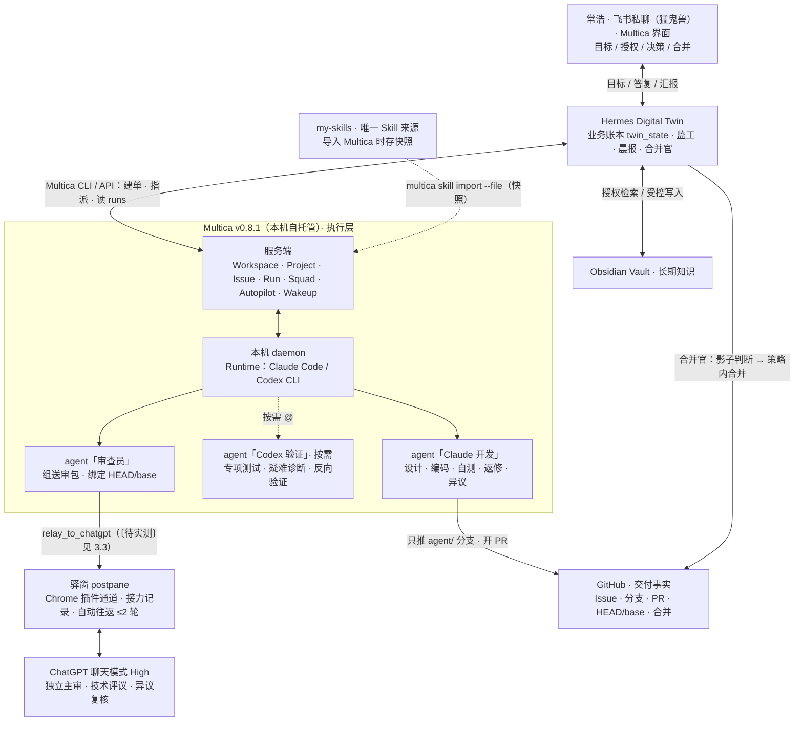
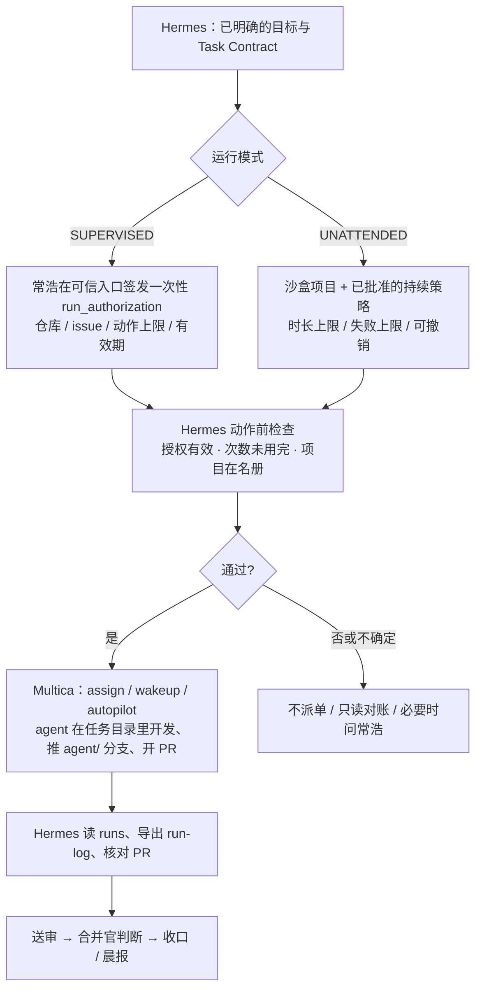
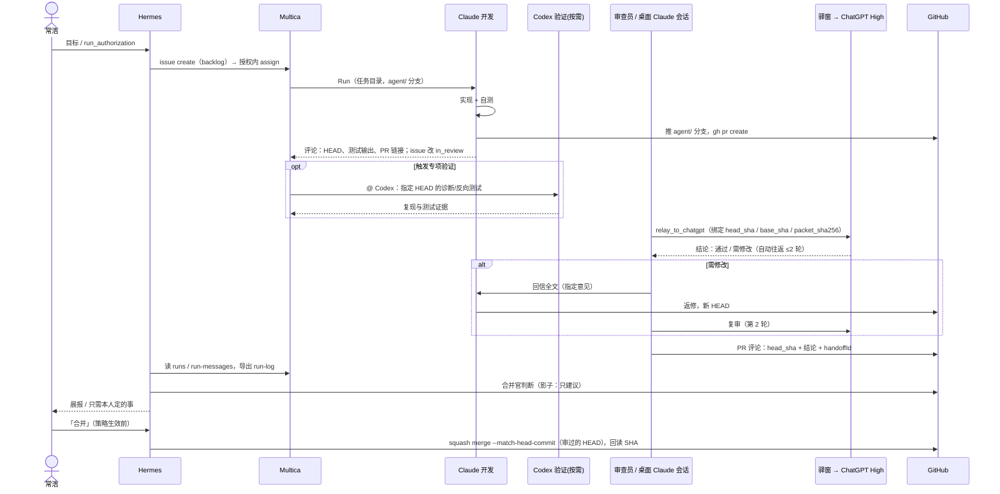
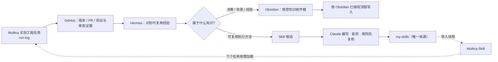

# Hermes Digital Twin × Multica｜数字分身工程化整合总架构

> **项目代号**：DT-ORC（沿用代号，不再指 ORCA）  
> **架构版本**：**V5.0.0**（新增托管状态 `custody_state`，与执行模式正交，ADR-014）  
> **发布日期**：2026-11-09（V5.0）  
> **唯一正式路径**：`docs/DT-ORC/ARCHITECTURE.md`  
> **上一版**：V4.0.0（2026-11-07，项目协同改用 Multica、ORCA 整体移除，ADR-013；原文见 Git 历史，最后一次修订提交 `e95bb4a`）；更早的 V3.1.0 · A+ 原件见 [`history/2026-11-02-V3.1-A+-基于ORCA的总架构.md`](history/2026-11-02-V3.1-A+-基于ORCA的总架构.md)  
> **决议**：[ADR-013 项目协同改用 Multica，移除 ORCA](adr/ADR-013-项目协同改用Multica.md)；[ADR-014 托管](adr/ADR-014-托管模式.md)（V5.0，2026-11-09，按 12.3 属 MAJOR：授权体系变化）  
> **版本状态**：**待 GitHub PR 合并后生效**。本文是目标架构与执行约定，**不代表 Multica 已部署、任何 agent 已建立、任何真实动作已放行**。  
> **适用边界**：仅限**个人 Hermes Digital Twin、本机自托管 Multica、个人 Obsidian 知识库及其个人工程协作链**；**不适用于企业数字分身、企业业务数据或企业营销/多维表格项目**。

> **一句话架构**：**常浩定目标和权限；Hermes 管业务、记账、汇报和合并判断；Multica 管执行（issue → agent → run）；Claude 主开发，Codex 按需验证，审查员经驿窗把送审包交给 ChatGPT 聊天模式 High；GitHub 保存交付事实；Obsidian 保存长期知识；my-skills 保存成熟方法。**

---

## 0. 文档地位、决策和边界

### 0.1 本版的正式架构选择

V4.0 是一次 MAJOR 变更（按 12.3：执行架构变化），决议见 ADR-013：

1. **执行层从 ORCA 换成本机自托管 Multica，锁定 v0.8.1**；Multica daemon 原生跑在 Mac 上，拉起本机的 Claude Code、Codex CLI。ORCA 不再是任何流程的依赖，按 10.3 退役。
2. **ChatGPT 送审改走驿窗（postpane）的 Chrome 插件通道**（`relay_to_chatgpt`，自动往返按风险级给预算，见 3.3、6.4），不再走 ORCA 内嵌浏览器。
3. **事实所有权三分**：Hermes `twin_state` 管业务，Multica 管执行，GitHub 管交付（2.2）。
4. **Multica 不推送也不合并**：agent 只推自己的 `agent/` 分支并开 PR；合并归 Hermes 合并官加策略记录（7.2、5.5）。
5. **保留 V3.1 中与执行平台无关的部分**：A+ 双模式、`run_authorization` 签发与消耗规则、L0–L3 风险分级、审核契约、异议机制、不确定结果不重发、低风险自动合并的六项条件（本版扩为八项，见 5.5）。
6. **唯一总纲仍是本文件**：后续以本文件的 PR、ADR、版本号升级，不另起平行总方案。

V5.0 是一次 MAJOR 变更（按 12.3：授权体系变化），决议见 ADR-014：新增托管状态 `custody_state`，与执行模式正交（4.3）；托管期间猛鬼兽以常浩身份决策，只对受限会话送达，三道闸，托管合并另成一条路径（5.5、5.7）。以上 1–6 不变。

### 0.2 本文不等于操作授权

**本文件批准或合并 ≠ 部署 Multica、建立 agent、指派 issue、开启 Autopilot / Wakeup、发送 ChatGPT 消息、推送、合并其他 PR、卸载 ORCA 或操作正式 Vault 的执行许可。**

本文规定的是**允许建立何种授权策略、必须满足什么技术条件**。实际授权必须形成明确、可查的 `run_authorization` 或 `owner_approved_policy`，并由执行端核验。部署与卸载是 OPS 变更，各自走变更单。

### 0.3 规范等级

- **MUST**：不满足则相应操作不得执行；
- **SHOULD**：默认采用，可以有记录的技术理由调整；
- **MAY**：按价值与风险选择；
- **NO-GO**：尚未验收或授权；不能以模型推断、模拟测试或设计文档代替放行。

**真实验收的三个层级不可混淆**：`IMPLEMENTED`（已实现）→ `REVIEWED`（指定版本已独立审查）→ `OPERATIONALLY_VERIFIED`（真实受控运行并核对结果）。

### 0.4 Multica 事实的标注

本文引用的 Multica 命令、状态名、环境变量，均按 **tag `v0.8.1`（commit `b1ea927`，2026-11-06 发布）** 的源码与官方文档（仓库内 `apps/docs/content/docs/*.mdx`，即 multica.ai/docs 的源文件）逐条核实，出处见 [`migration/2026-11-07-Multica-v0.8.1-事实核实.md`](migration/2026-11-07-Multica-v0.8.1-事实核实.md)。

- 未加标注的 Multica 命令和名称：**已按 v0.8.1 核实**。
- 标 **〔待实测〕** 的：文档和源码里查不到定论，或取决于本机组合（驿窗、Claude Code 版本、权限设置），**批 E 首跑前不得当作已成立**。
- Multica 的 CLI 没有 `--json` 参数，统一用 `--output json`；界面上的 **Run** 在 CLI 参数和 JSON 字段里叫 `task_id`；Wakeup 命令挂在 `multica issue wakeup` 下，不是顶层命令。

---

## 1. 北极星目标与设计原则

**目标**：让常浩用自然语言设定个人项目目标，Hermes 以长期记忆和项目账本组织工作，Multica 以 issue 和 agent 承载执行，Claude 编写及返修、ChatGPT High 独立审核、Codex 按需查证；在授权范围内自动推进，每次运行都留下可读的记录，异常可恢复，经验可积累，关键决策才打扰常浩。

**七条设计原则**：

1. **专业分工**：一个任务有明确主责；不因为存在多个模型就机械安排多模型会审。
2. **Multica 原生优先**：复用 Project / Issue / Agent / Run / Runtime / Squad / Autopilot / Wakeup，不自建平行的任务队列和调度状态机。
3. **技术事实优先于模型权威**：ChatGPT 主审但可被 Claude 以证据质疑，Codex 可以独立验证。
4. **速度与安全不对立**：减少反复人工审批，保留短小、确定性、可测试的技术检查。
5. **双模式、同契约**：有人值守先跑出真实闭环，无人值守只在沙盒里逐步放开。
6. **知识不等于运行状态**：GitHub、Obsidian、Skills 各司其职，与 Multica、Hermes 不重复保存权威事实。
7. **证据随机制出生**（agent-kit《工程流程》第 8 节）：每个循环从第一次运行起就有 run-log，每条规则有命中记录，Hermes 的每类判断有一致率。

**非目标**：让 Hermes 成为最高技术裁判；让 Hermes 成为 Multica 里的 agent；把 Codex 固定为全职测试；把 ChatGPT High 替换为 Work/API/Codex；在 Multica 之外再造编排层；开启 Multica 自带的飞书等渠道；让 Obsidian 成为运行数据库；把本项目延伸到企业数字分身。

---

## 2. 总体架构与事实真源

### 2.1 全景图



**图不是固定的逐框串行流水线**：Claude 与 ChatGPT High 构成研发主线，Codex 不固定介入；Hermes 不在 Multica 里面，它从外面用 CLI/API 操作 Multica。

### 2.2 事实所有权

| 平面 | 权威组件 | 负责的事实 | 不负责 |
|---|---|---|---|
| 个人业务 | Hermes `twin_state` | Goal、业务 Task、优先级、`run_authorization` 签发与消耗、合并判断与策略记录引用、项目收口 | 复制 Multica 的 issue 执行状态和 run 状态 |
| 工程执行 | Multica | Issue 的执行状态与指派、Agent 配置、Run 及其消息、Runtime、Squad、Autopilot、Wakeup | 业务审批、合并、长期知识 |
| 工程交付 | Git / GitHub | 分支、HEAD/base、Diff、GitHub Issue、PR、审核证据引用、实际合并 | Hermes 的业务判断、Multica 的执行状态 |
| 审核往返 | 驿窗 `handoffs.json` | 接力的阶段、每步时间、送出原话摘录、回信、结论 | 合并许可 |
| 长期知识 | Obsidian | 决策缘由、项目背景、跨任务经验 | 实时进程、完整敏感日志 |
| 可复用方法 | my-skills | 工作方法、触发条件、标准脚本 | Task 状态、授权令牌 |

**只同步 ID、摘要、事实快照与证据位置**。业务目标与执行状态矛盾时标记 `UNRECONCILED`，不由模型“选一个看起来合理的”覆盖。

### 2.3 V3.1（ORCA）→ V4.0（Multica）对象映射

| V3.1 ORCA 对象 | V4.0 Multica 对象 | 说明 |
|---|---|---|
| （无对应） | **Workspace** | 一个本机工作区承载全部个人工程项目；issue 标识形如 `<前缀>-<序号>`，前缀只能是大写字母和数字、最长 10 位，批 E 建工作区时定 |
| Run（一次受控工程运行） | **Project** + **父 Issue** | Project 对应名册里的一个仓库；一次运行（含一夜长跑）= 一个父 issue，下挂若干子 issue（`multica issue create --parent`） |
| Task | **Issue**（子 issue = stage） | 内置 7 个状态：`backlog / todo / in_progress / in_review / done / blocked / cancelled`；工作区可自定义状态，本项目不自定义 |
| Dispatch | **指派**：`multica issue assign <id> --to <agent 或 squad>` | 指派给 agent 且 issue 不在 `backlog` 时立即排队产生一次 Run；在 `backlog` 的 issue 离开 `backlog` 时才开跑；指派给 squad 先唤醒 leader 再分派 |
| Worker | **Run**（CLI 字段 `task_id`） | 8 个状态：`deferred / queued / dispatched / waiting_local_directory / running / completed / failed / cancelled` |
| Worker 的宿主进程 | **Runtime** | 本机 daemon 在 PATH 上发现的 AI CLI，一个 CLI 一个 runtime；`multica runtime list` 查看 |
| Worktree | daemon 的**任务目录** | 位于 `MULTICA_WORKSPACES_ROOT`（默认 `~/multica_workspaces`）；是共享 bare 仓库的 `git worktree`，分支名 `agent/<agent 名>/<issue 标识小写>`（如 `agent/j/mul-6881`），同一 issue 的后续 run 续用同一分支 |
| Message（send/check/ask/reply） | **Issue 评论** + **Run 消息** | `multica issue run-messages <run-id> [--since <seq>]` 增量读一次 run 的消息 |
| gate（决策挂起） | Issue 状态 `in_review` / `blocked` + Hermes 飞书私聊决策 | Multica 里不放审批；审批只在 Hermes |
| Coordinator | **Squad**（leader 必须是 agent） | `multica squad create --name --leader`；SUPERVISED 下只在一次性授权里列明时使用 |
| ORCA 自动化 / 定时 | **Autopilot** | cron（5 段加 IANA 时区）、webhook、手动；模式 `create_issue` 或 `run_only` |
| Worker 完成后续跑 | **Wakeup**（含系统内置的 **Child-Done** 规则） | 挂在 issue 上的规则，类型 `event / at / every / cron` 或 `--until-*` 条件；条件满足时唤醒指定 agent 在该 issue 上开一次普通 run；agent 可在 run 里给自己排下一次。父 issue 有子 issue 时自带系统规则：某个 stage 的子 issue 全部关闭时唤醒父 issue 的负责人（7.3） |
| ORCA 的 Skill 加载 | **Skill** | 主文件 `SKILL.md`，可挂到多个 agent；来源只认 my-skills（8.4） |

### 2.4 必须有的跨系统映射

`project_id / goal_id / hermes_task_id / multica_issue / multica_parent_issue / multica_run_id(task_id) / agent / head_sha / base_sha / pr_ref / handoff_id / review_verdict / approval_ref / knowledge_ref`

映射不是另一个调度状态库。用 Hermes 现有的 External Reference 机制或经批准的轻量索引，不在 Hermes 里新建与 Multica 重叠的 issue/run 状态表。Multica 侧可用 issue 的 metadata 存 `hermes_task_id`（`issue list --metadata k=v` 可过滤；写入方式〔待实测〕）。

---

## 3. 角色即 agent：固定角色与责任边界

| 角色 | 在 Multica 里是什么 | 主责 | 禁止替代的职责 | 主要产出 |
|---|---|---|---|---|
| **常浩** | 工作区 owner（成员） | 定方向、重要取舍、授权、合并拍板（策略外）、OPS 批准 | 模型之间的人工复制接力 | 决策、`run_authorization`、策略记录 |
| **Hermes** | **不是 agent**；用自己的令牌经 CLI/API 操作 | 接需求、建单、指派（在授权内）、读 runs、导出 run-log、晨报、合并官判断 | 主体编码、独立技术裁决、越权审批 | 业务账本、派单记录、晨报、合并建议 |
| **Claude 开发** | agent，runtime = Claude Code | 技术方案、编码、自测、返修、提交、开 PR、对审核的证据异议 | 自我宣布独立验收、合并、部署、篡改独立测试证据 | `agent/` 分支 HEAD、PR、自测输出 |
| **Codex 验证** | agent，runtime = Codex CLI；按需 @ | 独立测试、复杂 Bug 复现、并发/安全/恢复专项、争议取证 | 全量常驻回归、最终技术主审、默认改业务代码 | 绑定 HEAD 的测试/诊断证据 |
| **审查员** | agent，runtime = Claude Code（〔待实测〕见 3.3） | 组送审包、绑定 HEAD/base、经驿窗送 ChatGPT High、把结论回写 PR 与 issue | 自己下审核结论、改代码、合并 | 送审包、`handoff_id`、结论回执 |
| **ChatGPT 聊天模式 High** | 不在 Multica 里；经驿窗通道 | 独立技术审核、架构评议、复核异议 | 授予合并权限、代替常浩做风险取舍、改代码 | 「结论：通过 / 需修改」与编号意见 |
| **Multica** | 平台 | Issue/Run 生命周期、runtime 调度、工作目录、run 记录 | 推送、合并、业务审批、长期记忆 | Run 记录与消息 |

### 3.1 Codex 额度和测试职责（沿用 V3.1）

- **Claude 必须做开发自测**。`unittest` / `pytest` / `swiftc` / `git diff --check` 等机械检查由确定性脚本跑，不要求每次 @ Codex。
- **Codex 按需优先场景**：疑难缺陷、并发/幂等、安全边界、性能定位、重要里程碑、Claude 与 ChatGPT 有可验证的事实争议。
- **普通小改默认不 @ Codex**；Hermes 不得编造剩余额度。
- Codex 可在自己的任务目录里改测试、夹具和诊断脚本；默认不改 Claude 的业务实现。

### 3.2 Hermes：不当 agent，从外面用 Multica

Hermes 不注册为 Multica agent，理由：Hermes 是常驻的业务协调者，有自己的记忆、身份和飞书入口；Multica 的 agent 是“被触发才执行”的配置、不是常驻进程，把 Hermes 做成 agent 会让业务判断和执行状态混在一处。

Hermes 对 Multica 只做下列动作，全部经 CLI（或同等 API），并记入业务账本：

| 动作 | 命令 | 是否消耗授权 |
|---|---|---|
| 建单 | `multica issue create --title … --description … --project … [--parent …]` | 否（`backlog` 状态不触发执行） |
| 指派、开跑 | `multica issue assign <id> --to <agent>`；改状态 `multica issue status <id> todo` | **是**，消耗 `run_authorization` 的指派次数（5.2b） |
| 读执行状态 | `multica issue get <id>`、`multica issue runs <id> [--active] [--siblings] --output json` | 否 |
| 读运行消息 | `multica issue run-messages <run-id> [--since <seq>] --output json` | 否 |
| 停止 | `multica issue cancel-task <run-id>` | 否（停止永远允许，但停止不等于撤销已发生的副作用） |
| 长跑接力 | `multica issue wakeup create …`、`multica autopilot …` | **是**，只在 UNATTENDED 授权且项目在沙盒名册时（5.3） |

- **Hermes 的 Multica 令牌**：`multica login --token` 使用的个人访问令牌（PAT）单独签发、只存 Hermes 的本机配置，不入库、不进日志；能否限定到单个工作区〔待实测〕。
- **晨报**：Hermes 读 7.4 的 run-log 生成晨报，写清时长、做了什么、出错与处理、待常浩定的事。
- **飞书只走猛鬼兽一个机器人**。Multica 自带飞书/Lark、Slack 等渠道在自托管下**默认关闭**（不设 `MULTICA_LARK_SECRET_KEY` / `MULTICA_SLACK_SECRET_KEY` 就不开），本项目**保持关闭**；需要通知常浩的一律经 Hermes。

Hermes 可按**明确规则**排序任务、重试白名单内可确认幂等的操作、发送已授权通知。高复杂度技术取舍交给 Claude/ChatGPT；业务或风险偏好不清时整理成选择题给常浩。

### 3.3 审查员 agent 与驿窗通道

**通道**：`chatgpt.com 标签页（插件内容脚本）⇄ 插件后台 ⇄ Chrome Native Messaging ⇄ 转接程序 ⇄ 驿窗（本机套接字）`。协议以 postpane 仓库 `docs/chatgpt-channel.md` 为准，本文只引用与架构相关的约定：

- `relay_to_chatgpt {title, summary?, brief, risk?, extra?}` 是驿窗 MCP 的工具（`risk`、`extra` 自 postpane#233 起）；驿窗只认调用方自报的 `CLAUDE_CODE_SESSION_ID`，**非 Claude Code 客户端一律拒绝**；单条文字上限 768 KB。
- 每次送审是一条「接力」，记录在驿窗数据目录的 `chatgpt/handoffs.json`：阶段 `sending → delivered → working → replied → returned`（另有 `ended / failed`），每一步带时间。
- **自动往返按风险级给预算**（postpane#233，对齐 multi-agent MA-02 契约）：调用时 `risk` 填任务的 L 级。L1 审 1 轮，回「需修改」就转回 Claude 改完、在 PR 写「补改未复审」后结束；L2、L3 自动最多 2 轮，不填按 2 轮；L0 驿窗拒收。同一个 PR（brief 里第一个 PR 链接）的轮数跨 Claude 会话累计，另开一单不清零。回「结论：通过」自动结束；预算内回「需修改」转回 Claude 返修；预算用完、或回信没写结论，停下交还常浩，常浩授权再审一次时调用带 `extra`（谁授权、为什么）。回信倒数第二行可写「审查出口：通过 / 返修 / 证据不足暂停 / 决策升级」：证据不足暂停转回取证后自动续上，决策升级交常浩，和结论对不上也交常浩。这与 agent-kit《工程流程》第 8 节第 3 条一致。
- ChatGPT 30 分钟没回信、Claude 2 小时没交回复审，驿窗都停下交还常浩。

**送审包必须绑定版本**（6.2）：brief 第一段固定写 `repo / PR / head_sha（完整 40 位）/ base_sha（完整 40 位）/ multica_issue / packet_sha256`。审查员把驿窗返回的 `handoffId` 和最终结论，以「`head_sha` + 结论 + `handoffId` + 审核模式」写进 PR 评论和 Multica issue 评论，作为**索引**；合并官据 `handoffId` 回到驿窗接力记录核实，PR 评论本身不是证据（5.5 第 1 条）。HEAD 一变，旧结论作废（6.4）。

**「High」目前没有机器核对**：V3.1 的 RELAY-01/02 在发送前核对聊天模式并把思考强度调到「高」；驿窗通道的协议里没有这一步，新会话按驿窗设置放进登记的 ChatGPT 项目，模型和思考强度取决于常浩在 ChatGPT 侧的默认设置。在驿窗补上“发送前核对模型与强度、写进接力记录”之前，送审回执**不能证明**是 High 审的，一律记为 `REVIEW_MODE_UNVERIFIED`；常浩人工确认过的记为 `HIGH_OWNER_CONFIRMED` 并留确认记录（5.5 第 8 条）〔待驿窗补〕。

**三项〔待实测〕，首跑前必须逐项验证**：

1. **审查员 agent 能否挂上驿窗 MCP**。Multica 在 agent 带托管 `mcp_config` 时，给 Claude Code 传 `--mcp-config <临时文件> --strict-mcp-config`，此时只加载这份配置里的 MCP；不带托管配置时不加严格模式，Claude 会继承本机用户自己的 MCP（含驿窗）。V4.0 要求**审查员 agent 必须用托管 `mcp_config`，只列驿窗一个 MCP**（格式 `{"mcpServers": {…}}`，stdio 条目写 `command/args/env`）。驿窗 MCP 在严格模式下能否启动并连上驿窗〔待实测〕；连不上就改走驿窗本机工具通道〔待实测〕。
2. **调用方身份能否成立**。Multica daemon 会从子进程环境里过滤掉外层的 `CLAUDE_CODE_SESSION_ID`，由它拉起的 Claude Code 自己生成会话 id；这个 id 能否传到驿窗 MCP、被驿窗接受〔待实测〕。
3. **回信能否回到 Multica**。驿窗的「转回 Claude」经 Claude Code 桌面插件把回信送回发起会话；Multica 拉起的是一次性的 Claude 进程，run 结束后没有会话可接。可选做法：(甲) 驿窗新增「回信写成 Multica issue 评论」，再由 issue 上的 `event` 类 Wakeup 唤醒开发 agent 返修；(乙) 驿窗提供只读查询接口，审查员 agent 用 `every` 类 Wakeup 定期 `checkin`。两者都需要驿窗侧改动，另开 postpane issue，本文不定。

**实测通过之前的做法（现行）**：送审由**常浩桌面上的 Claude Code 会话**调 `relay_to_chatgpt` 发起，`risk` 填任务的 L 级（本 PR 即如此），自动往返在这个会话里完成；结论按上面的三项写进 PR 评论和 issue 评论。审查员 agent 先不建；以后建时，它的送审调用同样要带 `risk`（任务的 L 级），派单单据里的 L 级就是它的来源。

---

## 4. 三维执行模型：类型 × 风险 × 运行授权

### 4.1 五条任务泳道（决定做什么步骤）

| 泳道 | 典型任务 | 默认方法 |
|---|---|---|
| `DEV` | 新功能、重构 | Claude 开发/自测 → ChatGPT 审；Codex 按需 |
| `BUG` | 修复、异常恢复 | 取得失败证据 → Claude 定向修复 → 回归/必要 Codex 复现 → ChatGPT 审 |
| `DESIGN` | 需求分析、架构、UI/UX、ADR | Claude 设计 → 必要的 ChatGPT 评议 → 常浩对重大取舍拍板 |
| `OPS` | 安装、部署、迁移、权限及外部动作 | 变更单/回退 → 隔离演练 → 审核与有效授权 → 动作/回读。**Multica 部署、升级、ORCA 卸载都属于 OPS** |
| `KNOWLEDGE` | Obsidian 知识、Skill | Hermes 识别候选 → Claude 整理/实现 → 验证 → 按现有知识权限写入 |

泳道、风险、模式写进 Multica issue 描述的首行（如 `lane: DEV · risk: L1 · mode: SUPERVISED`），供 agent instructions 和合并官读取；改用 issue 属性承载〔待实测〕。

### 4.2 四档风险（决定审核深度）

| 等级 | 含义 | 默认审核要求 |
|---|---|---|
| `L0` | 不改变代码行为的管理与低风险文档 | 机械检查，不送 ChatGPT High（《工程流程》第 8 节第 3 条）；但写进架构基线的执行身份、授权、合并规则不算 L0 |
| `L1` | 小范围低风险代码 | Claude 自测 + ChatGPT High 增量审查 |
| `L2` | 标准研发、跨文件非敏感功能 | Claude 设计/编码、自测/回归 + ChatGPT High 主审，Codex 按需 |
| `L3` | 身份、安全、持久状态、正式系统、不可控副作用 | 设计/威胁与回退分析、必要专项验证、独立技术审核、动作授权 |

**级别不是授权**。路径和标签可自动**上调**风险，不能仅凭“代码不到 200 行”下调风险。

**文档的级别不传给它的落地工单**：本文 V4.0、V5.0 作为文档变更按 DESIGN / L2 审（V5.0 的托管落地工单同样按 L3）；把它落成真实执行权限的工单（10.1 的 M1 部署、M2 首跑、M4 合并策略、M5 无人值守）涉及执行身份、持久状态和外部副作用，按 **L3** 评定。

### 4.3 两种运行模式（决定哪些真实动作可开始）

| 模式 | Multica 里的形态 | 前提 |
|---|---|---|
| `SUPERVISED` | 常浩在场时**手动指派**（在 Multica 界面指派，或由 Hermes 按本次授权调用 `issue assign`）；或一次性授权里列明的 squad | 有效的 `run_authorization`（5.2a 来源）；实现之前只允许 5.2a 末条的“人工指派例外”；首跑另需 5.2c |
| `UNATTENDED` | **Autopilot**（定时 / webhook）和 **Wakeup**（事件 / 定时唤醒）自动开跑 | 只限名册里登记为沙盒的项目（《工程流程》第 8 节第 5 条）+ 持续策略 + 5.3 全部门禁 |

两模式共享同一 issue、证据和审核协议，不复制两套开发系统。**看见 Multica 界面、聊天里的普通“继续”、或本文被合并，都不单独构成授权。**

**托管状态与执行模式正交**（V5.0，ADR-014）：`execution_mode = SUPERVISED | UNATTENDED` 管「执行怎么开跑」，`custody_state = off | on | draining | frozen` 管「谁替常浩做决定」（5.7）。二者是两个字段，不是三选一；托管开着时，任何执行准入都要**同时**满足本表对应执行模式的前提和 5.7 的限制，托管不替代、不放宽执行模式。

### 4.4 不增加第二套编号

只正式使用 `DEV/BUG/DESIGN/OPS/KNOWLEDGE`、`L0–L3`、`SUPERVISED/UNATTENDED` 三维标签（`custody_state` 是独立的状态字段，不是第四维标签，也不是第三种执行模式）。Multica issue 的状态是执行状态，不是第四维标签。

---

## 5. A+ 双模式授权与执行策略

### 5.1 双模式一图说明



**核心原则**：不必先完成全部无人值守身份工程才开展 `SUPERVISED` 试点；但任何真实动作都**不能借道一个未验收的执行桥**，也不能靠改配置、绕过检查假装“快速模式”。

### 5.2 有人值守的最小准入

首次 `SUPERVISED` 运行**必须**满足：

1. **可信启动与可见范围**：只由 5.2a 的来源签发 `run_authorization`，写明仓库、issue、允许动作、次数上限和有效期；模型文本不能冒充。
2. **受限环境**：`MULTICA_WORKSPACES_ROOT` 设为单独目录（不与个人项目目录、Vault、`~/.hermes` 重叠）；只接项目名册里登记的仓库；agent 不接触正式 Vault、企业数据、正式数据库和已安装的 Hermes 配置。
3. **agent instructions 写明边界**：只在任务目录里工作；只推 Multica 给的 `agent/` 分支；不推 main、不合并、不改凭据、不安装、不部署；超范围时把 issue 改为 `blocked` 并留评论说明，然后结束本次 run。instructions 是约束不是隔离，见 14 节 R4。
4. **受控送审**：按 3.3 的现行做法，送审包绑定 HEAD/base；结果不明只看接力记录，不重发。
5. **受限发布**：agent 只开 PR；合并由合并官判断、常浩或策略执行（5.5）。仓库分支保护 API 此前返回 403，**不能把 agent 的自觉当作远端保护**。
6. **审计与停机**：每次 Hermes 动作记录最小 ID/摘要/时间/结果；常浩随时可 `cancel-task` 或停 daemon。停止进程不等于撤销已发生的副作用，需事后对账。

### 5.2a SUPERVISED 的可信签发来源（沿用 V3.1，常浩 2026-11-02 选定）

`run_authorization` **只接受**以下两种来源，不要求 Secure Enclave、Touch ID 或签名挑战：

| 来源 | 适用场景 | 要求 |
|---|---|---|
| **(a) 本机授权命令** | 常浩在电脑前 | 常浩经**独立于 agent 自动操作的交互入口**亲自运行授权命令，核对任务、仓库、允许动作、上限和有效期，由确定性脚本落盘。无法区分常浩与 agent 操作时，只采用本人手动指派，不签发自动运行许可 |
| **(b) 飞书私聊确认** | 常浩不在电脑前 | 只接收经平台认证的飞书事件，校验常浩的 `open_id`、猛鬼兽私聊及消息 ID，并防重放；经 `twin_identity` 核验后记录来源。不接受模型自报 ID、伪造事件、群聊或企业数字分身渠道 |

- 两种来源生成同一 `dt-orc.run-authorization/1` 记录，带一次性动作消耗账本与有效期；过期、超额或来源无法核验时拒绝。
- **威胁模型边界**：防模型自报、文本冒充、重放和超范围动作；**不防同一 macOS 用户下的恶意本地进程**。
- (b) 依赖猛鬼兽网关在线；断线时只能用 (a)，不得降级为接受未核验的消息。
- 截至本版，`run_authorization` **尚未实现**（main 上没有相应代码，见 9 节）。
- **人工指派例外**（实现之前唯一允许的 SUPERVISED 形态）：常浩在 Multica 界面亲手把**一张** issue 指派或移出 `backlog`，这是一次独立的人为授权，**只授权这一次指派**；它不产生任何可供 Hermes 或 agent 复用的授权凭据，不授权该 run 之外的指派、Wakeup、Autopilot、合并或部署；“常浩在场”本身不是动作许可。run-log 和晨报如实标注“人工触发”。首跑仍须满足 5.2c。

### 5.2b SUPERVISED 的最小执行桥（替代 V3.1 的 ORCA 执行桥）

- **执行桥 = Hermes 侧一个确定性脚本**，以固定 argv 白名单调用 `multica issue assign / status / get / runs / run-messages / cancel-task`；每次 `assign` 或把状态改成 `todo` 前核对并消耗 `run_authorization` 中的指派次数。
- **Multica 本身不认识 `run_authorization`**。授权只约束 Hermes 发起的动作；agent 在 run 里拿到的任务级令牌（`MULTICA_TOKEN`，`mat_` 前缀）同样能调 Multica CLI（建单、指派、排 Wakeup）。因此 SUPERVISED 下 agent instructions **禁止** agent 自行指派其他 issue 或创建 Wakeup / Autopilot；Hermes 读 runs 时核对有无越界动作，发现即停该 issue 并报告。
- **结果不明**：`assign` 返回不明时，用 `multica issue runs <id> --active --output json` 只读对账，**不重复指派**（7.6）。
- 启用执行桥本身是一次代码变更（Hermes 侧），须经 ChatGPT High 审核并通过反向测试后才能接真实 Multica；不得用一个“总开关”无条件放开。

### 5.2c 首跑执行环境的硬前提（M2 之前必须成立）

5.2b 的授权只管住 Hermes 发起的动作；进入 agent 执行后，Multica 以 `bypassPermissions` 拉起 Claude Code，agent 继承运行它的系统用户的全部本机权限和 git/gh 凭据，并持有 `MULTICA_TOKEN`。instructions 和 Hermes 的事后核对都不能撤销已发生的副作用。因此 **M2 首跑（以及之后任何 Multica agent 运行）MUST 满足**：

1. **受限执行身份**：daemon 不以常浩的日常 macOS 用户运行，二选一：(a) 单独的 macOS 用户，其主目录里只有沙盒仓库和本次所需的 CLI 登录；(b) 容器或虚拟机（2026-10-16 试装用的就是容器执行器）。该身份**拿不到**常浩的个人 git/gh 凭据、SSH agent、Vault、`~/.hermes`、驿窗数据目录和其他正式项目。
2. **受限仓库凭据**：该身份的 GitHub 凭据只对首跑仓库有写权限（fine-grained token 或仓库级 deploy key）；首跑仓库是专用沙盒仓库，或名册里登记 `sandbox: true` 且只授予该仓库凭据的项目。首跑仓库的 main 由远端分支保护或规则集拒绝直接推送；该仓库做不到时换一个做得到的沙盒仓库〔待实测〕。
3. **权限矩阵实测**（结果写进 `migration/`，作为 M2 的准入证据），逐项给出实际命令与结果：
   - agent 读写任务目录之外的文件（常浩主目录、其他仓库）→ 必须被操作系统拒绝；
   - agent 推 main、推非 `agent/` 分支 → 必须被远端拒绝；
   - agent 用 `MULTICA_TOKEN` 指派其他 issue、创建 Wakeup / Autopilot、改其他 issue 状态 → 记录能否被拒绝；**不能被拒绝时**，首跑必须放在只含沙盒项目的专用 Multica 工作区，越权只能波及沙盒，并由 5.3a 的停机检查兜底；
   - 本机 Claude Code 的 deny 规则与 hook 在 `bypassPermissions` 下是否生效（只记录，不作为防线）。
4. **未成立时的降级**：以上任一条未成立，只允许常浩人工操作的最小沙盒试验（人工指派例外 + 沙盒仓库 + 无个人凭据），**不得让 Multica agent 运行在带常浩正式个人凭据的环境中**。

### 5.3 无人值守的附加门禁

`UNATTENDED`（Autopilot、Wakeup 自动开跑）在 5.2 的基础上还必须：

- **只在沙盒项目**：项目名册 `projects.json` 中登记 `sandbox: true` 的项目（字段在批 E 加，加之前确认 `roster_lookup`、`check_repos` 对未知字段不报错）；首批只登记 postpane 或 github-center 之一。独立任务目录，只推 `agent/` 分支，不碰 main、凭据、正式数据、安装和部署。
- **持续策略写明上限**：时长上限、失败上限（同一子 issue 连续 2 次 `failed` 即停整条长跑）；自建的 Wakeup 一律带期限（`--expires-in` / `--expires-at`，CLI 不会自动加），重复型再加 `--max-fires`；可撤销（`multica issue wakeup disable`、`multica autopilot update --status paused` / `delete`）。注意 `--until-status` 是**唤醒条件**（“等到 issue 变成某状态时唤醒”），不是终止参数；issue 进入 `done / cancelled` 时 Multica 才自动关掉它的全部 Wakeup 并撤回未开始的 run，`blocked` 不会。
- **独立停机检查**（5.3a）已上线并演练过。
- **结果不明只收回执，不重发**（《工程流程》第 8 节第 5 条）。
- **机器条件**：电脑不睡、Chrome 和驿窗开着（送审依赖它们，见 14 节 R7）；不满足时长跑只做到“开 PR 待审”，不送审。
- **常驻服务**：`multica daemon autostart enable`（launchd `ai.multica.daemon.plist`）是 OPS 安装，首跑后再定，单独批准。

V3.1 中 B6–B11 的 Secure Enclave、签名挑战、状态根设计仍可作为持续授权的候选素材，不认定为唯一实现。

### 5.3a 独立停机检查（不依赖 agent 自觉）

agent instructions 里的停机条件（7.3）只在 agent 还活着时有效；run 因进程崩溃、CLI 异常或 daemon 中断失败时，agent 没机会执行它。因此 M5 无人值守试跑前 MUST 有一个**独立于 agent 的确定性停机检查**，由 Hermes 侧的监控脚本承担（与 5.2b 执行桥同一处，不另建编排平台）：

1. **对账**：定时读 `multica issue runs <父> --siblings --output json` 和授权记录，算出连续失败次数、累计运行时长、授权是否过期；计数持久化在 Hermes 状态里，进程或机器重启后从持久记录恢复，不清零。**run 记录不完整**（`--siblings` 到 20 行上限且逐个子 issue 也取不全、序号有缺口）、因而核不清失败次数时，按触发上限处理并记 `UNRECONCILED`，不按“没超限”继续。
2. **触发上限后的动作**，按顺序：
   - 禁用这条长跑上的全部自建 Wakeup（`multica issue wakeup list` 后逐条 `disable`），关掉父 issue 的系统 Child-Done 规则〔命令待实测；做不到时把父 issue 改为 `cancelled`，由 Multica 关闭其全部 Wakeup 并撤回未开始的 run〕；
   - 相关 Autopilot 改 `paused`；
   - 对处于**全部 5 种非终态**的 run 逐个发 `multica issue cancel-task <run-id>`：`deferred`（到点会进队列）、`queued`、`dispatched`、`waiting_local_directory`（目录锁释放后会继续跑）、`running`。前两种之外的状态能否被取消〔待实测〕；
   - 把还在 `backlog / todo` 的子 issue 留在原处不再推进，当前子 issue 改 `blocked` 并评论原因；
   - 回读确认。
3. **停机成功的判定**：相关 run 全部处于终态 `completed / failed / cancelled`，**且**后续触发源（自建 Wakeup、系统 Child-Done 规则或其 `cancelled` 回退、Autopilot）都已停用并回读确认，**且**执行器里已没有 agent 派生的进程（到执行器里独立回读，不以 Multica 的 run 状态代替）。缺任何一项都不算停机成功，不得在晨报或 run-log 里写“已安全停机”。
   - 为什么要第三条（M5 首夜演练实测，digital-twin #97）：取消 run 只结束 agent 主进程所在的进程组，agent 放到后台、另开会话的进程会被执行器的 init 收养、继续运行，并仍持有 agent 的凭据。Multica 显示 `cancelled` 不等于执行器已停。
   - 授权过的停机脚本可以先结束这些残留进程（先 TERM 后 KILL），再独立回读；结束动作要写进运行计划，并经 Hermes 或常浩批准。停机后给远端（分支、PR）拍快照，release 前持续比对，远端还在变就告警。
4. **未达成停机成功**（命令超时、回读仍有任一非终态 run、触发源状态读不到、run 记录不完整、执行器里仍有 agent 进程或读不清）：进入冻结——停执行器并独立回读确认它已停、不会自动重启（执行器在容器里时：去掉容器的自动重启并停容器，再用 `docker inspect` 回读；daemon 直接跑在本机时：`multica daemon stop`，并 `disable` 开机自启），记录 `UNRECONCILED`，飞书私聊常浩，**不自动继续、不自动重试**；冻结期间执行器不得重启，由常浩核对后才恢复，避免重启后把残留的 `queued / deferred` run 接着跑掉。
5. 每次触发都写进 run-log（触发原因、执行的命令、每个 run 的回读状态、判定结果）。

SUPERVISED 下的多 stage 运行也应开着这个检查；它在 M2 期间先以“只告警”方式试跑。

### 5.4 运行授权记录的最低契约

以下只是**数据契约样例，不是一份生效授权**：

```json
{
  "schema": "dt-orc.run-authorization/1",
  "mode": "SUPERVISED",
  "project": "digital-twin",
  "repo": "Natsukashii1997/digital-twin",
  "multica": {"workspace": "<WORKSPACE>", "parent_issue": "<PREFIX-N>", "issues": ["<PREFIX-N+1>"]},
  "scope": {"allowed_paths": ["docs/DT-ORC/**"]},
  "actions": {"issue_assign_max": 1, "wakeup_create_max": 0, "autopilot_create_max": 0, "review_send_max": 2, "push_agent_branch": true, "create_pr": true, "squash_merge": false},
  "limits": {"max_duration_min": 120, "max_failed_runs": 2},
  "issued_at": "<RFC3339>",
  "expires_at": "<RFC3339>",
  "issuer_proof_ref": "<TRUSTED_SOURCE_REF>",
  "policy_version": "<APPROVED_POLICY_SHA>"
}
```

实现还需要：签发来源限定为 5.2a 的 (a)/(b)、一次性动作消耗账本、跨进程并发限制、审计和撤销语义。**`issuer_proof_ref` 字符串本身不是身份认证**。

### 5.5 低风险自动合并的精确政策

**目标许可**：常浩明确批准、且合并官影子运行达标后，`SUPERVISED` 下符合 L0–L2 规则的 PR 可在 ChatGPT High「结论：通过」后由 Hermes **自动 squash 合并**；`UNATTENDED` 另需 5.3 门禁。

**合并官**（`merge_officer.py`，批 D 在做）**先影子运行**：只给「建议合并 / 退回 / 问常浩」，不执行，由常浩决定；同类累计 20 次、一致率 ≥ 90%，才申请把这一类写成 `owner_approved_policy` 策略记录（《工程流程》第 8 节第 4 条）。每次被常浩推翻，写一条带版本号的规则补丁并回放历史重算一致率。

合并必须同时满足（第 1–6 条沿用 V3.1 并改写第 1 条，第 7、8 条为本版新增）：

1. **绑定正确、来源可信**：远端 PR 仍是已审核的完整 HEAD/base；送审包 SHA-256 未变；合并官**从驿窗的接力记录**（而不是 PR 评论）核实该 `handoffId`：送出那一步的原话里有同一 `head_sha / base_sha / packet_sha256`，回信那一步结论为通过，回信时间晚于该 HEAD 的提交时间。PR 评论只是索引，任何人（包括开发 agent）都能写，**不作为证据**；
2. **测试与审核成立**：机械回归通过；Codex 如按规则被触发，其关键验证已完成；
3. **范围受限**：只限策略里的仓库、分支（`agent/` 前缀）、路径和风险档；禁止敏感路径、凭据、安装/部署/配置/正式数据及范围外变更；
4. **授权可验**：存在有效的 `owner_approved_policy` 或本次 `run_authorization`，且**明确包含合并权限**；「结论：通过」、本文件批准、模型自报都不是许可；
5. **副作用已知**：合并会触发的 CI、发布、部署、通知已核对；
6. **环境确认**：现读远端 PR 状态与合并权限。保护规则读不到（API 403）时记录“不可依赖远端保护”；
7. **合并操作本身带 HEAD 校验（原子性）**：合并命令必须携带审过的 HEAD，由 GitHub 在服务端拒绝不匹配的 HEAD，例如 `gh pr merge <号> --squash --match-head-commit <审过的 head_sha>`（REST 合并接口的 `sha` 参数同义）。GitHub 报 HEAD 不匹配就停止，**不自动重试**；base（目标分支）在审核后变化的，按 6.4 旧结论失效，先重新核对再走流程。合并后回读 main 和合并 SHA，只用于确认结果，不能代替事前的版本约束；
8. **审核模式可证**：回执的审核模式记为 `HIGH_VERIFIED`（驿窗在发送前机器核对了模型与思考强度并写进接力记录）、`HIGH_OWNER_CONFIRMED`（常浩人工确认，记录确认人、确认的接力 `handoffId`、时间和适用范围）或 `REVIEW_MODE_UNVERIFIED`。**`REVIEW_MODE_UNVERIFIED` 不能放行自动合并**，只能由常浩说「合并」；`HIGH_OWNER_CONFIRMED` 只作临时替代，适用范围写在确认记录里。

任一不满足时**停在“技术通过 / 待合并授权”**，其他无依赖任务继续。L3 默认不自动合并。

驿窗当前的接力记录只保留最新 200 条，送出那一步只存原话摘录、不存完整送审包的 SHA-256，也不记审核模式。第 1、8 条要求的可信核对，需要驿窗补上“完整送审包指纹 + 审核模式写入记录 + 超出保留上限前归档”（另开 postpane issue）。**补齐之前，合并官只能影子运行，自动合并不启用。**

**托管合并（`custody_state = on`，ADR-014）是另一条路径，不替代上面的策略路径。** 托管期间，猛鬼兽以常浩的身份合并，同时满足才合，否则挂起：

- 合并官对该「PR × HEAD」判「建议合并」，风险档 L0–L2；
- **第 2 条成立**（机械回归通过；按规则触发的 Codex 验证已完成）；
- **审核凭证**：L1–L2 须第 1 条成立，或有等效的可信审核凭证。等效凭证至少绑定：完整送审包 SHA-256、PR、HEAD、base、可信回执的来源及其结论（通过），并校验回执晚于该 HEAD 的提交时间、审核针对的正是待合并的 HEAD 和 base；由确定性送审工具写入，不是 PR 评论、不是模型自报。凭证缺失、任一项不匹配或核不清就挂起。L0 只限托管策略列明的路径白名单，按 L0 机械检查验收；
- **当前 HEAD 的必需 CI 全部通过**（没有 CI 的仓库：在干净副本里 `setup` + `test` 通过），检查结果绑定待合并的 HEAD；失败、未完成或结果不可确认就挂起；
- **副作用已核实且可回退**（比第 5 条更严）：仓库在托管策略的「可托管合并仓库」清单里，清单逐仓库记录了合并到 main 会触发的全部工作流和外部动作，且已核实只有可安全回退的副作用（没有部署、发布、外部通知、数据迁移）；PR 改动了工作流或副作用配置的，或核实不了的，挂起；
- 第 3、5、6、7 条照旧（范围受限、副作用已知、现读远端、`--match-head-commit`）；
- 第 4 条的授权由「托管开着 + 有效的已签托管策略写明允许合并」满足，额度在执行前原子预占；
- **只由合并执行器执行**：合并凭据只在独立的合并执行器（5.7 第 4 条）；任何 Claude / Codex 会话都拿不到能合并或推 main 的凭据。

托管合并**只豁免第 8 条（审核模式可证）和影子门槛**。托管合并在 `agreement.csv` 记 `owner=custody`，**不计入影子一致率**，也不作为任何类别升档的证据。

### 5.6 动作与模式矩阵

| 动作 | SUPERVISED | UNATTENDED | 托管开着时（`custody_state = on`，叠加在左两列之上，5.7） |
|---|---|---|---|
| 只读检查、`issue get / runs / run-messages` | 依既有访问权限 | 依既有访问权限 | 依既有访问权限 |
| 建单（`backlog`） | Hermes 可做 | Hermes 可做 | Hermes 可做 |
| 指派 / 改 `todo` 开跑 | 仅在本次授权次数内（5.2b）；授权未实现前只允许人工指派例外（5.2a），且执行环境满足 5.2c | 只在沙盒项目、持续策略内 | 托管本身不开单；D23 没回复时只执行此前已逐项有效授权的项，并仍满足左两列对应执行模式的前提 |
| Autopilot / Wakeup 创建 | 默认不用；一次性授权列明才可 | 只在沙盒项目、持续策略内 | 不因托管放宽 |
| agent 开发、自测（任务目录内） | 授权范围内自动 | 策略范围内自动 | 不因托管放宽 |
| @ Codex 验证 | 按风险触发 | 同左，受策略额度约束 | 同左两列 |
| ChatGPT High 送审（驿窗） | 现行由常浩桌面 Claude 会话发起；审查员 agent 待 3.3 实测 | 3.3 实测通过且机器条件满足才可 | 同左两列；受限会话请求送审时由猛鬼兽代答 |
| 推 `agent/` 分支 / 开 PR | 授权内自动 | 策略内自动 | 同左两列 |
| 推 main / 推非 `agent/` 分支 | **禁止** | **禁止** | **禁止**（执行防线拦） |
| L0–L2 squash merge | 合并官 + 5.5 全部 8 条（含 `--match-head-commit`）；策略生效前、或审核模式为 `REVIEW_MODE_UNVERIFIED` 时，由常浩说「合并」 | 5.5 + 5.3 全条件 | 5.5「托管合并」全部条件，只由合并执行器执行 |
| Multica 部署/升级、daemon autostart、ORCA 卸载 | OPS 变更单 | 不由持续策略泛化 | 挂起 |
| 正式 Obsidian Vault 写入 | Obsidian 主线独立授权 | 同左 | 挂起 |
| 企业飞书 / 企业数据 | **禁止跨域** | **禁止跨域** | **禁止跨域** |

### 5.7 托管（`custody_state`，ADR-014）

规格：[`docs/托管模式-设计.md`](../托管模式-设计.md)。本节只写约束，实现细节以规格为准。

1. **定义**：`custody_state = on` 期间，猛鬼兽以常浩的身份替常浩回复会话、答批准卡、按 5.5 托管合并；底线之外自己判断；每个决定记账；托管结束、排空后汇报，常浩可以逐条推翻。`custody_state` 与执行模式正交（4.3）。
2. **来源**：开启只认猛鬼兽飞书私聊（5.2a (b) 同一核验）和已签托管策略的默认时段；驿窗开关只能关闭（5.2a (a)：分不清是不是本人点的）；任何入口都可以关闭。托管状态只有一处真源（Hermes 侧 `custody.py`），驿窗只读。托管策略的签署绑定版本（单调递增）、完整内容 SHA-256、签署消息 ID、核验身份和有效期；不许有未填项；每次使用都重算哈希，不一致、过期或被撤销即视为无策略。
3. **底线**：常设授权清单 D 档 + 一切撤不回的动作，一律挂起；拿不准也挂起；Hermes 回退到备用模型期间只许规则判，需要模型判断的一律挂起。
4. **先限住会话能做什么**：
   - 以常浩身份送达只对**受限会话**：会话跑在 5.2c 式受限执行身份下（拿不到常浩的个人 git/gh 凭据、SSH agent、Vault、`~/.hermes`、驿窗数据目录）、没有合并和推 main 的凭据、执行点钩子通过第 7 条的反向测试。其余（**全权会话**，含常浩日常身份下持有完整凭据的会话）一律不送达，待决事项挂起；Codex 通过同等验证前一律视为全权会话。
   - **合并凭据只在独立的合并执行器**；任何 Claude / Codex 会话都拿不到。
5. **三道闸**：
   - **出口闸**（Hermes 侧确定性脚本）：再核托管状态与策略；决定是结构化的（动作类型 + 对象 + 原文），按策略判，不过就改为挂起；
   - **送达闸**（驿窗）：托管开着、发件是猛鬼兽、决定号在账本里且未过期未作废、会话仍是受限会话、链未超上限，才送达；
   - **执行防线**：主防线是受限执行身份和受限凭据（越界被操作系统和 GitHub 拒绝）；执行点钩子按**白名单默认拒绝**，只作纵深，不作为唯一边界（5.2c 第 3 条已认定 `bypassPermissions` 下钩子不可靠）。
6. **身份形式**：以常浩本人身份提交，末尾附 `〔托管·猛鬼兽代发 d-编号〕`；标记只是记录，不是权限凭证。驿窗全局开关「以我的身份发送」不用于托管，托管期间保持关闭。
7. **落地验收（L3，反向测试必须全过）**：在受限会话里实测直接越界、间接越界（脚本、构建工具、`curl` 调 GitHub API、子进程派生）、权限绕过（改钩子配置、改权限模式、找其他凭据）、过期 / 作废的决定号、托管进入 `draining`、`frozen` 和 `off` 后继续越界、额度并发预占；逐项记命令和结果。
8. **额度与上限**：猛鬼兽的决定不清零来回计数；每条链、每次托管的决定数、合并数、派单数各有上限（写在策略里）；额度执行前原子预占，确认失败或决定作废时释放；**结果不明的合并，额度冻结**，不释放、不重用，直到只读对账确认（确认已合并计为已用，确认未合并才释放）。
9. **关闭与排空**：`on → draining → off`。排空期间：不收新事项；未送达的决定全部作废；已送达的会话让当前轮跑完、不再送决定；结果不明的合并只读对账（7.6，不重发），对账不清记 `UNRECONCILED`；**执行防线照旧生效**，全部对账完成才置 `off`。**排空有截止**（托管策略写明时长）：到截止仍有会话没结束或合并 `UNRECONCILED`，转 `frozen`——继续禁止新决定、新合并和重新开启托管，执行防线保持，立即飞书报告常浩并列出未解决事项，不得宣称安全结束；只有常浩在已核验私聊说「解除冻结」后才置 `off`。出口闸、送达闸、合并执行器每次执行前各自再核托管状态和策略。
10. **记账、汇报、撤回**：每个决定在 Hermes 状态库记一条 Event，原文另存，保留 90 天；每个决定记「撤回能力」（可纠正 / 可回退 / 不可撤回）和「处置状态」（未处理 / 已推翻·已记录 / 已纠正 / 已回退 / 回退失败）；推翻时按规格列出下游影响清单。合并的回退是开 revert PR，revert PR 的合并仍由常浩点卡片。
11. **托管期间派单**：D23 没回复时，只执行此前已逐项有效授权的项（常设授权清单第 5 节第 1 条）；托管策略不构成对未来未知仓库、issue 的写入授权。
12. **生效顺序**：ADR-014 与常设授权清单 v1 合并 → 落地工单逐批验收（按 L3，第 7 条全过）→ 常浩签托管策略。任一前置没完成，Hermes 不按托管行事；本节被合并本身不放行任何托管动作。

---

## 6. 开发、审核、异议与收敛

### 6.1 主流程序列



L0 管理文档不送 ChatGPT；L1/L2 研发以 Claude + ChatGPT High 为固定主线；Codex 不是固定第三站。

### 6.2 审核契约

每份送审包至少绑定：`task_contract_version`、`multica_issue`、完整 `head_sha`、完整 `base_sha`、送审包原始字节 SHA-256、变更范围、测试证据、已知问题与审核范围。结论只对该精确版本生效。

驿窗回信的结论行与审核结论对应：

| 驿窗回信 | 审核结论 |
|---|---|
| 「结论：通过」 | `PASS` |
| 「结论：需修改」 | `REWORK` |
| 没写结论 / 第 2 轮仍需修改 / 超时停下 | `NEEDS_HUMAN`（交还常浩） |

Findings 分开记录**严重度**和**证据可信度**：`P0` 破坏授权/数据完整性/安全边界或重大外部副作用；`P1` 违反核心验收、功能错误或重要回归；`P2` 可维护性、范围外优化。`proven / probable / hypothesis` 是可信度，不是严重度。第二轮新发现的可信 P0/P1 不因代码未改就降为 P2，但须说明与本任务的直接关系。

### 6.3 Claude 对 ChatGPT 的校正机制（沿用 V3.1）

Claude 对阻断项选择：`ACCEPT`（修复 + 新 HEAD）、`CHALLENGE`（指明错误前提及证据）、`NEED_EVIDENCE`（提出可验证问题）。可测事实优先用确定性脚本；需要独立复杂诊断时才 @ Codex。ChatGPT High 按实际证据维持、撤回、降级或更新结论。**两方不能凭模型票数放行安全风险。**

### 6.4 返修范围与上限

- 审查预算按风险级（《工程流程》第 8 节第 3 条、multi-agent MA-02 第 5 节）：L1 审 1 轮，需修改就改完在 PR 写「补改未复审」收口；L2、L3 自动最多 2 轮；L0 不送审。同一个 PR 跨会话累计，换 HEAD、另开一单都不清零。这是**自动循环预算**，不是安全问题可以忽略的上限。
- 第二轮优先审新增 Diff、未关闭意见和直接受影响的相邻模块；不自动追加无关范围。
- 超限时 Hermes 向常浩汇总已知缺陷、已尝试措施、是否有替代方案，其他无依赖任务继续；常浩授权专项续审的，送审带 `extra` 写明授权与理由。
- HEAD/base/任务契约变化后旧结论失效；不得重用过期结论。结论失效不等于轮数清零：新 HEAD 的复审仍计入同一个 PR 的预算。

---

## 7. Multica 运行、长跑与状态对账

### 7.1 原生优先映射

| 需求 | 用 Multica 原生 | 只补必要的外层能力 |
|---|---|---|
| 执行任务与依赖 | Issue、父子 issue（`--parent`） | Hermes 的业务排序与映射 |
| 派单、查状态 | `issue assign`、`issue status`、`issue runs`、`issue get` | 授权核验与消耗（5.2b） |
| 工作目录隔离 | daemon 任务目录（`MULTICA_WORKSPACES_ROOT`，`agent/` 分支） | 单独根目录、GC 调参（7.2、R5） |
| agent 交接 | Issue 评论、`issue run-messages` | 最小交接契约（7.5） |
| 决策挂起 | `in_review` / `blocked` | Hermes 飞书私聊决策 |
| 定时与续跑 | Autopilot、Wakeup | 沙盒限定与上限（5.3） |
| ChatGPT 审查 | — | 驿窗通道（3.3） |
| 交付事实 | Git / GitHub；Multica 的 GitHub 集成可把 PR 关联到 issue | 合并官、策略记录 |

所有命令以**本机安装的 v0.8.1 `--help` 与受控实测**为准；文中出现的命令名不等于已能安全调用。

### 7.2 推送与合并：Multica 不做

- **daemon 不推送、不合并**：v0.8.1 源码中 daemon 没有 `git push`；PR 由 agent 在 run 里自己 `gh pr create`，平台不替它定 `--base`。
- **agent 只推 Multica 分配的 `agent/<agent 名>/<issue 标识小写>` 分支**，开 PR 时显式写 `--base`（项目主分支）。不推 main、不推别的分支。
- **PR 与 issue 联动**：Multica 的 GitHub 集成在 issue 标识出现在**分支名或 PR 标题**时自动关联（分支名已含标识）；只写在 PR 正文时须紧跟 `Closes / Fixes / Resolves <前缀>-<号>`；commit message 不触发。PR 全部合并后 issue 默认移到 `done`。PR 正文同时写 GitHub 的 `Closes #<号>`（《工程流程》第 1 节）。是否接入 GitHub App 由批 E 定〔待实测〕。
- **合并归 Hermes 合并官 + 策略记录**（5.5）；策略生效前由常浩说「合并」，按《工程流程》第 5 节的顺序做。
- **对《工程流程》第 2 节分支命名的补充**：Multica agent 的分支用 Multica 生成的 `agent/…` 名，PR 描述写上 Multica issue 标识和 GitHub issue 号（与 Hermes 派单的 `hermes/<单号>` 同理）。本条在本 PR 合并后另向 agent-kit 提补丁。

### 7.3 长跑：父 issue + 分 stage 的子 issue + 系统 Child-Done 唤醒

一次长跑（如一夜）= **一个父 issue**，下挂若干**子 issue**，用 Multica 原生的 **stage**（`--stage 1/2/3…`）分批推进；每个子 issue 是一个能独立验收、独立开 PR 的小步。**接力用 Multica 内置的系统 Child-Done 规则，不自建“子 issue 完成”类 Wakeup**（官方文档明确要求不要为同一目的重复创建）。

v0.8.1 中该规则的行为（`issue-wakeups.mdx`「Wake the parent when sub-issues finish」）：父 issue 有子 issue 时自动带一条 System 规则；某个 stage 的子 issue 全部关闭（`done` 或 `cancelled`）且后面还有 stage 时，唤醒**父 issue 的负责人**，全部关闭时再唤醒一次；没有 stage 的子 issue 只在最后一个关闭时唤醒一次；负责人是 agent 就唤醒 agent，是 squad 就唤醒 leader，是成员就只发收件箱通知，没有负责人就不唤醒；父 issue 在 `backlog` 时不唤醒，离开后补上。默认指令是“检查依赖，把下一 stage 的子 issue 移出 `backlog`”。

1. **建单**：Hermes 建父 issue，再建子 issue：`multica issue create --parent <父> --stage <N> --assignee <agent> --status backlog …`。子 issue **预先指派好、停在 `backlog`**（指派给 agent 的 issue 只有离开 `backlog` 才开跑）；每张写清依赖、验收和下一步的 ready 判定。
2. **父 issue 的负责人决定谁来推进下一 stage**：
   - SUPERVISED：父 issue 指派给**常浩（成员）**——stage 关闭时只收到收件箱通知，由常浩或 Hermes（按授权）把下一 stage 移出 `backlog`。agent 不推进 stage，与 5.2b “agent 不得自行开跑其他 issue”一致。
   - UNATTENDED：父 issue 指派给一个专职推进的 agent（可用 squad leader），被系统规则唤醒后按默认指令检查依赖、推进下一 stage。父 issue 本身不进 `backlog`。
3. **开跑**：授权后把 stage 1 的子 issue 移出 `backlog`（`multica issue status <id> todo`，消耗授权，5.2b）。
4. **自建 Wakeup 只用于系统规则覆盖不到的事**（如定时自检），必须带 `--expires-in` / `--expires-at`，重复型带 `--max-fires`；不得与系统 Child-Done 规则做同一件事。注意 `--until-status` 是“等到某状态时唤醒”的条件，不是终止参数；Multica 还会在一小时触发超过 12 次或唤醒链绕回同一规则第三次时自动暂停规则，每个 issue 最多 32 条启用中的 Wakeup。
5. **停机**：两层。
   - agent instructions（每次 run 都会用）写明：超过授权时长、同一子 issue 连续 2 次 run `failed`、需要越界动作（推 main、改凭据、安装、部署、碰正式数据）、结果不明且核不清时，把当前子 issue 改为 `blocked`、评论原因和进度、不推进下一 stage。
   - 独立停机检查（5.3a）兜底：agent 没机会执行上面那条时（崩溃、daemon 中断），由 Hermes 侧按 run 记录停下整条长跑。`blocked` 不会关掉 Wakeup，真正的“停”以 5.3a 的禁用、取消和回读为准。
6. stage 1 → 2 的推进细节（预先指派的子 issue 移出 `backlog` 是否立即排队、系统规则能否用 CLI 关闭）在批 E 首跑前实测〔待实测〕。

### 7.4 运行记录：run-log.jsonl

《工程流程》第 8 节第 1 条要求循环从第一次运行起就有 run-log。导出方式：

```bash
multica issue runs <父 issue> --siblings --full-id --output json
multica issue run-messages <run-id> --output json   # 每个 run 一次，可用 --since 增量
```

- Hermes 侧导出脚本（批 E 实现）把每个 run 写成一行 JSON：`parent_issue / issue / run_id / agent / status / started_at / ended_at / duration_s / failure_reason / pr_ref / head_sha / summary / messages_ref`；这些字段在 v0.8.1 JSON 输出中的真实名字〔待实测〕。
- **边跑边导**：停机检查（5.3a）每次对账时顺带增量导出（`run-messages --since`），不等长跑结束，避免 GC 或中断前丢记录。
- **完整性检测**：`--siblings` 一次最多 20 行，超出时逐个子 issue 查；单个 issue 的 run 超过 20 次时能否取全〔待实测：`multica agent tasks` 或分页〕。导出后对账：每个子 issue 的 run 数与 Multica 界面一致、run-messages 的序号连续。有缺口就在该行写 `incomplete: true` 和缺口说明，**晨报不得把不完整的记录称为完整运行证据**。
- **GC 与证据保全**：M2 首跑期间设 `MULTICA_GC_ENABLED=false`（或把 `MULTICA_GC_TTL` 调到覆盖整个观察期）；重新打开 GC 前，逐个任务目录核对：没有未提交改动、`agent/` 分支已推到远端、run 状态已终结、run-log 已导出。核对不过的目录先手工保全再开 GC。
- 存放：`~/Library/Application Support/DigitalTwin/runs/<父 issue 标识>/run-log.jsonl`（本机，不入库）；原始消息另存同目录，按需引用，不整段进晨报。
- Hermes 晨报读 run-log：时长、做了什么、出错与处理、PR 和审核状态、记录是否完整、待常浩定的事。
- 审核往返的记录在驿窗 `handoffs.json`，run-log 里只记 `handoffId` 指针。

### 7.5 最小 Task / Handoff 契约

| 对象 | 必填字段 |
|---|---|
| Task Contract（issue 描述） | `objective / scope / acceptance / dependencies / lane / risk / mode / allowed_actions` |
| Claude 交接（issue 评论） | `multica_issue / run_id / head_sha / branch / pr_ref / changed_paths / test_summary / known_issues` |
| Codex（触发时） | `target_head / test_scope / actual_command / actual_result / reproduction / evidence_ref` |
| 审核回执（PR 评论，仅作索引） | `head_sha / base_sha / packet_sha256 / handoff_id / verdict / review_mode / findings` |
| 动作结果（Hermes 账本） | `action_id / authorization_ref / multica_run_id / result / remote_readback / side_effects` |

不为每张小任务生成长 PRD；背景放 GitHub/Obsidian，按引用读取。

### 7.6 不确定结果处理（不可删的安全底线）

| 情况 | 正确动作 | 禁止行为 |
|---|---|---|
| `issue assign` 返回不明 | `issue runs <id> --active` 只读对账，记录占位 | 再指派一次、可能起两个 run |
| run 长时间停在 `dispatched` / `waiting_local_directory` | 查 `runtime list`、`daemon status`、`daemon logs` | 把“还在队列里”当“正在运行” |
| 推送或开 PR 结果不明 | 现读远端分支和 PR | 重新推一遍或再开一个 PR |
| 驿窗送审结果不明 | 看接力记录的阶段（`delivered / working`），等回信或超时停下 | 换会话重发同一份包 |
| 审核包或远端 HEAD 改变 | 原结论作废、重新送审 | 用旧结论合并新代码 |
| 合并时 GitHub 报 HEAD 不匹配 | 停止，重新核对 PR 与审核 | 自动重试、去掉 `--match-head-commit` 再合 |
| 停机后回读仍有非终态 run（含 `deferred`、`waiting_local_directory`），或取消/禁用结果不明，或 run 记录不完整，或执行器里仍有 agent 进程 | 冻结：停执行器（容器或 daemon）且不重启、独立回读、记 `UNRECONCILED`、私聊常浩（5.3a 第 3–4 条） | 宣布“已停机”、自动继续下一 stage、重启执行器 |
| 跨系统账本冲突 | `UNRECONCILED`、停受影响动作 | 模型自信选一个 |
| 普通任务失败 | 停本 issue 及依赖，其他继续 | 局部失败升级为全局停 |
| 身份/权限/证据完整性破坏 | 冻结相关安全域，停 daemon | 以效率为由忽略 |

---

## 8. Obsidian × GitHub × Skills 的持续积累闭环

### 8.1 三类资产明确分开

- **GitHub**：Issue/PR/Commit/ADR、可入库的测试、验收结果和证据引用。敏感密钥、真实状态库、run-log 原文、私人 Vault 正文不入库。
- **Obsidian Vault**：项目认知、经验、决策缘由、知识索引。正式 Vault 的读写受 Obsidian 主线已有权限约束。
- **my-skills**：经过检验可复用的方法、角色工作流、脚本和参考资料。Skill 不是 agent、状态机或执行授权来源。

### 8.2 知识与方法闭环图



不是每次完成任务都必须写 Vault 或建 Skill。长期记忆保留**为什么、是什么**，Skill 保留**怎样做**，GitHub 保留**哪个版本实际发生了什么**，run-log 保留**这次跑了多久、出了什么事**。

### 8.3 初期六个精简 Skills

| Skill | 使用者 | 关键任务 |
|---|---|---|
| `dt-orchestrate` | Hermes | 识别类型/风险/模式、建单与指派、读 runs 对账、晨报 |
| `dt-develop` | Claude 开发 agent | 设计、编码、自测、交接、返修 |
| `dt-verify` | Codex 验证 agent | 独立诊断、复现、反向测试 |
| `dt-review` | 审查员 / 桌面 Claude 会话 | 送审包、版本绑定、驿窗送审、结论回写 |
| `dt-dispute` | Claude / ChatGPT / Codex | 技术异议、取证、收敛 |
| `dt-closeout` | Hermes | 收口、依赖释放、知识/Skill 候选 |

真实外部动作仍由代码和可验证授权检查实现，**不能因为 Skill 写了“可以执行”就跳过门禁**。

### 8.4 Skills 来源与快照

- **my-skills 是唯一来源**；Multica 里的 Skill 只是快照，**不在 Multica 里直接改 Skill**。
- 导入用 `multica skill import --file <打包的 .zip 或 .skill>`（不用 `--url` 拉线上最新版），冲突策略用 `--on-conflict fail`，避免静默覆盖。
- 每次导入记下 Skill 的版本（SKILL.md frontmatter 的 `metadata.version`，批 C 引入）和 my-skills 的提交号，写进该 Skill 的 CHANGELOG（“已导入 Multica：版本 / 提交 / 日期”）。
- 挂到 agent 用 `multica agent skills …`；跨项目复用前审查权限差异，不把个人权限用于企业业务。

---

## 9. 工程现状：事实快照（2026-11-07 核对）

> 本节只记录 2026-11-07 核对到的事实，不冒充实时运行状态；当前状态以 `CURRENT.md` 为准。

| 资产 | 事实与处理 |
|---|---|
| Hermes B0–B2.2 状态、事件和调度基础（`twin_state` 等） | 已在 main，已有真实安装与对账；继续作为业务真源 |
| `hermes/scripts/dispatch.py`、`run_worker.py` | 在 main；Hermes 现行派单（`hermes/<单号>` 分支）。V4.0 起标 **Legacy**，Multica 首跑成立前继续可用（10.2） |
| RELAY-01 `orca/chatgpt_relay.py` | 在 main；V4.0 起标 **Legacy**，ChatGPT 送审改走驿窗 |
| RELAY-02（PR #40，分支 `claude/37-relay-loop`） | 仍为 OPEN；按 10.2 以「被 V4.0 取代」关闭（本 PR 合并后、常浩同意再关） |
| **`merge_gate.py`（更正）** | V3.1 第 5.2、5.5 节把它写成现有工具，**实际从未进 main**：只在本地 `claude/37-framework-v2-*` 分支（引入提交 `20a1198`），远端也没有这些分支。V4.0 中它只是合并官的素材 |
| `run_authorization` | **未实现**；只存在于文档和 `CURRENT.md` 的计划中 |
| Framework V2 B1–B11 | 本地 `claude/37-framework-v2-*` 分支；B11-R5 独立评审仍为 REWORK。按“逐项读取”规则处理，这次不批量合并（10.2） |
| Multica 本机状态 | 2026-10-16 试装 **v0.6.2**（容器化服务端 + 容器内隔离 Codex 执行器），跑通一次虚构派单到写回；宿主机上的原生 daemon 没有启用；**未升级到 v0.8.1** |
| 驿窗 ChatGPT 通道 | postpane 已实现接力记录与自动往返（≤2 轮）；2026-11-07 第一单实测中碰到“Claude 桌面会话空闲后转回失败”，已改为排队待发 |
| ORCA | 本机仍安装；V4.0 合并后停用，按 10.3 卸载 |
| relay 页面租约历史误写事件 | 隔离测试曾触及正式 relay 租约目录；未经授权不清理（随 ORCA 退役变更单一并处理） |

---

## 10. 迁移路线与 ORCA 退役

### 10.1 实施次序

| 里程碑 | 工作包 | 真实验收定义 | 依赖 |
|---|---|---|---|
| **M0 · 基线** | 本文 V4.0 + ADR-013 经 ChatGPT High 审查（≤2 轮），常浩合并 | PR 合并；审查回执绑定同一 HEAD | 先做 |
| **M1 · Multica 部署**（批 E 1–3，**L3**） | 备份数据库卷 → 服务端升 v0.8.1，`MULTICA_IMAGE_TAG` 锁版本，设 `DO_NOT_TRACK=1`；按 5.2c 准备受限执行身份（单独 macOS 用户或容器）和只对首跑仓库有效的 GitHub 凭据，在该身份下装 CLI 与 daemon（安装方式以 v0.8.1 文档为准〔待实测〕），`multica login` 连本机服务；`MULTICA_WORKSPACES_ROOT` 设单独目录，首跑期间关 GC（7.4）；名册加 `sandbox: true` | `multica daemon status`、`multica runtime list` 正常；回读环境变量；**5.2c 权限矩阵实测全部记录在 `migration/`** | M0 后；OPS 变更单 |
| **M2 · SUPERVISED 首跑**（批 E 4，**L3**） | 建 agent（Claude 开发、Codex 验证）；拆 6 张 ready 单（分 stage，父 issue 指派给常浩），按人工指派例外开跑，常浩在场跑 2 小时；送审走桌面 Claude 会话 + 驿窗；边跑边导 run-log；5.3a 停机检查以“只告警”试跑 | run-log 有时长、做了什么、出错和处理，并标明是否完整；至少一单经驿窗「结论：通过」；Hermes 晨报读到 run-log。**通过只证明有人值守的这一次运行成立**，不等于全架构 `OPERATIONALLY_VERIFIED`，也不代表无人值守或 High 模式已验收 | M1 后，且 5.2c 成立 |
| **M3 · 审查员 agent** | 3.3 三项〔待实测〕逐项验证；需驿窗改动的另开 postpane issue | 审查员 agent 独立完成一次送审，并把结论写回 PR | M2 后，可与 M4 并行 |
| **M4 · 合并官与策略** | 合并官影子运行（批 D）；同类 20 次、一致率 ≥ 90% 后申请策略记录 | `agreement.csv` 一致率；策略记录经常浩批准 | 与 M2 并行起步 |
| **M5 · UNATTENDED 夜跑**（**L3**） | 沙盒项目 4 小时夜跑：父 issue 指派给推进 agent + 分 stage 子 issue + 系统 Child-Done 唤醒 | run-log 完整；5.3a 停机检查真实触发过或经演练验证，演练至少含三个反例：重启后计数不清零、有 run 停在 `waiting_local_directory`（等目录锁）时触发停机、停机冻结后 daemon 重启也不自动续跑；无越界动作 | M2 后两周内，且 5.3a 已上线 |
| **M6 · 知识/Skills 闭环** | Skill 快照导入、盲测、CHANGELOG（批 C） | 导入记录与复用记录 | 可并行 |

### 10.2 资产治理（不“顺手合并 / 清空”）

- **RELAY-02（PR #40）**：以「被 V4.0 取代」关闭。可复用的部分已写进本文：结果不明只收不重发 → 7.6；送审前核对聊天模式与 High 强度 → 驿窗通道尚无此步，暂由常浩确认 ChatGPT 默认设置，待驿窗补（3.3）；中断续跑不重复通知 → 7.3、7.4。关闭动作在本 PR 合并后、常浩同意时执行，关闭评论写明 `superseded by V4.0 / ADR-013`，保留原有审查记录，**不按“已完成验收”处理**。
- **Legacy**：`orca/chatgpt_relay.py`、`hermes/scripts/dispatch.py`、`hermes/scripts/run_worker.py` 自本版起标 Legacy：不再加功能，只修阻断性缺陷；M2 首跑成立且常浩同意后，另开 PR 删除或归档，删除前跑一次回退演练。
- **Framework V2、B6–B11 各分支**：逐项读取完整 HEAD、Diff、测试与审核结论，再定保留、返修、简化或存档；**不为让未合并数量下降而批量合并**。ORCA 专属的（ORCA worker 适配器、`pilot_executor` 等）存档；与平台无关的（`merge_gate` 判定、授权记录、文件隔离）作为合并官和 `run_authorization` 的素材。
- 历史未提交 worktree、审计证据、正式目录误写租约**不主动清理**；需单独确认归属和授权。

### 10.3 ORCA 退役

- **架构停用 ≠ 运行停机**：本文合并即在架构上停用 ORCA——不再为它写代码、不再把它接进新流程。真实运行中的 ORCA 进程、LaunchAgent、定时任务的停止，仍按 OPS 变更单操作，不因本文合并自动发生。
- **卸载的前提（缺一不可）**：① M2 首跑中至少一单经驿窗送审拿到「结论：通过」；② 下面的运行依赖盘点全部完成且无遗留；③ 常浩同意卸载变更单。
- **运行依赖盘点（变更单必查项）**：
  - ORCA 相关的运行进程、LaunchAgent、定时任务（launchd / hermes cron / crontab）和所有调用方（脚本、技能、Hermes 配置）逐项列出；
  - Legacy 脚本（`dispatch.py`、`run_worker.py`、`orca/chatgpt_relay.py`）是否仍隐式依赖 ORCA，依赖的写明卸载后的处置；
  - 活跃任务、未提交 worktree、relay 租约与审计记录已保全；
  - 用备份做一次恢复演练，证明回退可执行。
- **卸载方式（OPS 变更单）**：列出要删的 ORCA 应用、`/usr/local/bin/orca`、`~/.orca`；**先整体备份再删**（含 relay 租约目录）；删后回读确认。挂在 ORCA 工作区（如 `~/orca/workspaces/`）下的 git worktree 先按 10.2 盘点归属，不随卸载删除。
- **回退**：
  - Multica 首跑不成立（部署失败、run 不稳定、送审回不来）：回到**人工流程**——常浩在桌面 Claude 会话里开发，经驿窗送审，常浩说「合并」后按《工程流程》第 5 节合并；必要时 Hermes 继续用 Legacy 的 `dispatch.py` 派单。该流程不依赖 ORCA，也不依赖 Multica。
  - 确需 ORCA：从卸载前的备份恢复，按 history 中的 V3.1 原件执行，并开 ADR 说明。
  - Multica 升级出问题：用升级前的数据库卷备份和 `MULTICA_IMAGE_TAG` 回到 v0.8.1。

### 10.4 第一张施工工单

**批 E 首跑**（本 PR 合并后、常浩在场）：按 10.1 的 M1、M2 执行。部署和 autostart 属于 OPS，先给常浩看变更单，批准后再做；首跑前先完成 5.2c 的受限执行身份与权限矩阵实测，未成立就只做人工沙盒试验；首跑只在专用沙盒仓库或名册登记 `sandbox: true` 且只授予该仓库凭据的项目上进行；送审走桌面 Claude 会话 + 驿窗；不合并，等常浩说「合并」。

---

## 11. Definition of Done 与效率度量

### 11.1 分层完成标准

| 层级 | 必须满足 |
|---|---|
| 开发完成 | Task Contract 明确；`agent/` 分支 HEAD 与 PR 可查；Claude 自测与必要机械测试通过 |
| 技术验收完成 | 指定 HEAD/base/包经 ChatGPT「结论：通过」，且来源经驿窗接力记录核实；审核模式如实记录（`HIGH_VERIFIED` / `HIGH_OWNER_CONFIRMED` / `REVIEW_MODE_UNVERIFIED`），只有前两种可称“High 审核通过”；P0/P1 有关闭证据；专项测试如被触发已完成 |
| 工程操作完成 | 当前动作有可信授权；远端回执及状态回读；必要的回滚/恢复证据 |
| 运行可证 | **run-log 已导出，PR 正文写明记录在哪**（《工程流程》第 8 节第 1 条；没写的不合并） |
| 项目阶段完成 | Hermes 核对全部依赖与交付；剩余风险、外部阻塞和技术债各有归属 |
| 无人值守可用 | 5.3 门禁全部真实验收，绝不由受监督试点推定 |

### 11.2 不追求虚假的固定时长

度量：`lead_time`、`execution_time`（run 时长）、`waiting_time`（排队与等审）、`first_pass_rate`、`review_rounds`、`Codex_verification_value`、`manual_interventions`、`resume_success`、`duplicate_external_effects`、`merge_officer_agreement`、`Skill_reuse`。先测实际基线，再定改善目标；数据来源是 run-log、驿窗接力记录和合并官的 `agreement.csv`。

Hermes 晨报/周报写明**最新 SHA、PR、Multica issue 与 run、已开发/已审/已真实执行的区别、阻断、下一单、只需常浩定的事**。“巡检正常”不计为“项目推进”。

---

## 12. GitHub 唯一基线、旧版归档与变更控制

### 12.1 目录

```text
digital-twin/
├── PRD.md                         # 产品/业务目标与验收边界
├── CURRENT.md                     # 随实际证据更新的项目状态
├── AGENTS.md                      # 指向本文件
├── docs/
│   └── DT-ORC/
│       ├── ARCHITECTURE.md         # 唯一持续演进的总架构（本文）
│       ├── adr/                    # 核心决议（ADR-013 起单独成文件）
│       ├── history/                # 被取代的旧方案（含 V3.1 原件）
│       └── migration/              # 迁移、事实核实、回退与验收
├── hermes/                        # 个人数字分身业务控制（含 Legacy 派单脚本）
├── orca/                          # Legacy：RELAY-01，待退役
└── ops/                           # 授权运维工具
```

`AGENTS.md`、`CURRENT.md` 里写 ORCA 的入口说明，在本 PR 合并后另开 PR 更新（本 PR 只改 `docs/DT-ORC/**`）。

### 12.2 核心 ADR 决议

| 编号 | 不变原则 |
|---|---|
| ADR-001 | 本架构（Multica 工作区、agent、Hermes 工程链）只服务个人数字分身/个人项目；企业数字分身完全独立 |
| ADR-002 | Hermes 是监工、记录、协调者，不是最高技术裁判 |
| ~~ADR-003~~ | ~~ORCA 原生 Run/Task/Dispatch/消息/Worktree 是执行真源~~ → **被 ADR-013 取代** |
| ADR-004 | Claude Code 主开发、返修、基础自测，并可提出证据异议 |
| ADR-005 | ChatGPT **聊天模式 High** 为默认独立主审，可被事实纠正 |
| ADR-006 | Codex 为**按需**专项验证与诊断，不是固定全量测试站 |
| ADR-007 | 类型 × 风险 × 模式/动作授权共同决定流程 |
| ADR-008 | A+ 采用 SUPERVISED 与 UNATTENDED 同契约双模式，**不相互越权** |
| ADR-009 | GitHub / Obsidian / Skills 按权威事实分工，不重建运行时 |
| ADR-010 | 低风险自动合并是**有范围策略的目标能力**，「结论：通过」不是授权 |
| ADR-011 | 不确定外部结果不得重复执行；身份与版本校验是硬约束 |
| ADR-012 | 新功能优先复用 Multica 原生能力，不用加关口替代技术证据 |
| [**ADR-013**](adr/ADR-013-项目协同改用Multica.md) | **项目协同改用本机自托管 Multica（锁 v0.8.1）；Hermes 管业务、Multica 管执行、GitHub 管交付；Multica 不推送不合并；送审走驿窗；ORCA 移除** |
| [**ADR-014**](adr/ADR-014-托管模式.md) | **新增托管状态 `custody_state`，与执行模式正交：常浩不在场时猛鬼兽以常浩身份决策，只对受限会话送达；底线 = D 档 + 撤不回的动作；三道闸，主防线是受限执行身份；合并凭据只在合并执行器；托管合并只豁免第 8 条和影子门槛，不计入一致率；关闭有排空；事后汇报、逐条可推翻** |

### 12.3 版本管理

- **PATCH 4.0.x**：错别字、引用、〔待实测〕项实测后的事实更新（不改变规则的）。
- **MINOR 4.x**：流程、技能、适配器、准入规则与实现细化；需说明受影响的既有授权。
- **MAJOR 5.0**：角色主责、权威真源、执行架构、模式/授权体系重大变化；必须有 ADR、迁移和回退计划。
- **Multica 升级**（离开 v0.8.1）至少是 PATCH，并在 `migration/` 里补一份对应版本的事实核实；改变了本文引用的命令或语义的，按 MINOR。

版本号在文件头，Git 历史保存旧版；**禁止再创建 `ARCHITECTURE-V4.1.md` 这类平行总纲**。

### 12.4 最小修改/审批流程

1. 发起人提出当前问题、真实证据及拟改章节/ADR。
2. 重大架构或权限变化由 Claude 起草、ChatGPT High 经驿窗独立审查（≤2 轮）；纯文字修订只做机械检查（《工程流程》第 8 节第 3 条）。
3. 记录常浩的决策及授权影响；技术「结论：通过」**不等于合并权限**。
4. 常浩说「合并」后按《工程流程》第 5 节合并，更新 `CURRENT.md` 和涉及的 Skill/脚本。
5. **不声称“Claude 和 ChatGPT 已共同认可”，直到二者针对同一精确内容给出真实回执**。

---

## 13. 实施期间的收敛规则

架构在本次合并后固定。后续发现新问题，优先在 `CURRENT.md` 记录真实证据和下一单；〔待实测〕项实测后按 PATCH 更新本文；只有确实改变角色、真源、工作流或授权原则时，才按第 12 节升版本。**不以增加审批、重复全量评议或推翻已确认架构代替工程推进。**

---

## 14. 风险与对策

| 编号 | 风险 | 事实依据（v0.8.1） | 对策 |
|---|---|---|---|
| R1 | **许可证** | Multica License = Apache 2.0 + 附加条件（source-available）：单一组织内部自用不需商业许可；无商业许可不得给第三方托管或嵌入对外产品；带 UI 使用不得去掉 LOGO 和版权信息 | 只做个人自用；不对外提供实例；不改品牌标识；企业场景使用前另行评估 |
| R2 | **版本节奏快** | 2026-09-07 至 11-06 共 19 个 release，约 3 天一版 | 锁定 v0.8.1（服务端 `MULTICA_IMAGE_TAG`、CLI 固定版本）；升级走 OPS：先备份数据库卷、读变更、补事实核实（12.3），可回退 |
| R3 | **`MULTICA_TOKEN` 被子进程继承** | daemon 给每个 run 注入任务级令牌 `MULTICA_TOKEN`（`mat_` 前缀）及 `MULTICA_SERVER_URL` 等；agent 拉起的任何子进程都能拿到并调 Multica API | 该令牌按（agent, run）签发，不是 daemon 自己的令牌；它能调哪些接口、何时失效〔待实测〕。instructions 禁止外传与越权调用；Hermes 读 runs 核对越界动作；工作区里不放与个人工程无关的数据 |
| R4 | **agent 实际权限大于 instructions** | daemon 以 `--permission-mode bypassPermissions` 启动 Claude Code；agent 继承本机用户的 git/gh 凭据，技术上能推 main | **首跑硬前提 5.2c**：受限执行身份（单独 macOS 用户或容器）、只对首跑仓库有效的 GitHub 凭据、首跑仓库 main 由远端规则拒绝直推、权限矩阵实测记录在案；未成立只做人工沙盒试验。另外合并官审计「main 上出现不经 PR 的提交」并告警；本机 deny 规则与 hook 在该模式下是否生效只记录，不作为防线 |
| R5 | **GC 删除未推送的工作** | GC 删除过期任务目录时会丢弃“未提交或未推送”的工作，并对已无 worktree 的 `agent/` 分支执行 `git branch -D`；`MULTICA_GC_TTL` 默认 24h（issue `done / cancelled` 且闲置后） | M2 首跑期间关 GC（`MULTICA_GC_ENABLED=false`），重开前逐目录核对未提交 / 未推送 / run-log 已导出（7.4）；平时 instructions 要求每个小步提交并推 `agent/` 分支后才能结束 run，`MULTICA_GC_TTL` 调大并保持大于 `MULTICA_GC_INTERVAL`；run-log 边跑边导；`MULTICA_WORKSPACES_ROOT` 用单独目录 |
| R6 | **遥测** | 匿名部署遥测**默认开启**，每 UTC 日一次发往 `telemetry.multica.ai`；在 API 服务上设 `DO_NOT_TRACK=1` 关闭；PostHog 在 `POSTHOG_API_KEY` 为空时不发送，另有 `ANALYTICS_DISABLED` | 部署时设 `DO_NOT_TRACK=1`、`ANALYTICS_DISABLED=1`，并回读容器实际环境；不声称做过完整网络审计 |
| R7 | **驿窗依赖 Chrome 开着、电脑不睡** | 驿窗经常浩 Chrome 里登录的 chatgpt.com 送审；插件或页面掉线时通道不可用；页面改版时插件报 `no-composer` 等原因，驿窗退回半自动 | 无人值守长跑只做到“开 PR 待审”，送审在常浩在场或机器条件满足时进行；ChatGPT 30 分钟不回、Claude 2 小时不交回，驿窗停下交还常浩；未回信、接连 fail/stop 等问题以驿窗侧排查结论为准 |
| R8 | **调用方身份、回信回流、High 强度、审核证据未打通** | 见 3.3：三项〔待实测〕；驿窗发送前不核对模型与思考强度；接力记录只留最新 200 条、不存完整送审包指纹 | 实测前送审由桌面 Claude 会话发起；回执按 5.5 第 8 条标审核模式；合并官以驿窗记录（非 PR 评论）为证据，驿窗补齐前只影子运行、不自动合并；需驿窗改动的另开 postpane issue |
| R11 | **合并竞态** | 读 PR 与执行合并之间，agent 仍可能推新 HEAD | 合并带 `--match-head-commit <审过的 head_sha>`，不匹配即停、不重试（5.5 第 7 条） |
| R12 | **长跑停不下来** | agent 崩溃时执行不了 instructions 里的停机；`blocked` 不关 Wakeup | 5.3a 独立停机检查：禁用 Wakeup、暂停 Autopilot、取消全部 5 种非终态 run、回读；run 全部终态、触发源全停、执行器里没有 agent 进程才算停机成功，否则冻结且不重启执行器 |
| R9 | **数据与模型出境** | 本地部署不等于模型离线；任务、上下文和工具结果会送往 Anthropic / OpenAI | 工作区只放个人工程任务；不接企业数据、Vault 正文、凭据 |
| R10 | **Multica 飞书渠道被误开** | 自托管下设 `MULTICA_LARK_SECRET_KEY` 即开启 | 部署配置不设该变量；部署回读时检查 |

---

## 附录 A. 引用与事实边界

- 上一版：V4.0.0（Git 历史，最后修订提交 `e95bb4a`）；V3.1 原件 [`history/2026-11-02-V3.1-A+-基于ORCA的总架构.md`](history/2026-11-02-V3.1-A+-基于ORCA的总架构.md)；更早的 V1.0 / V2.0 / V3.0 见 `history/`。
- 决议：[`adr/ADR-013-项目协同改用Multica.md`](adr/ADR-013-项目协同改用Multica.md)、[`adr/ADR-014-托管模式.md`](adr/ADR-014-托管模式.md)。
- Multica 事实：[`migration/2026-11-07-Multica-v0.8.1-事实核实.md`](migration/2026-11-07-Multica-v0.8.1-事实核实.md)；上游 <https://github.com/multica-ai/multica>（tag `v0.8.1`：`CLI_AND_DAEMON.md`、`SELF_HOSTING.md`、`LICENSE`）与 <https://multica.ai/docs>。
- 驿窗通道：postpane 仓库 `docs/chatgpt-channel.md`。
- 流程：agent-kit《工程流程》（第 1、2、5、8 节）。
- 运行依据：仓库 `PRD.md`、`CURRENT.md`、`AGENTS.md`；**以实际当前 HEAD 为准**。
- Skills 规范：<https://agentskills.io/specification>。

> **状态声明**：本文是 V5.0 目标架构与验收契约，不是已经运行成功的声明。Multica 尚未按本文部署；所有〔待实测〕项在批 E 首跑中逐项验证，结果按 PATCH 更新本文。
