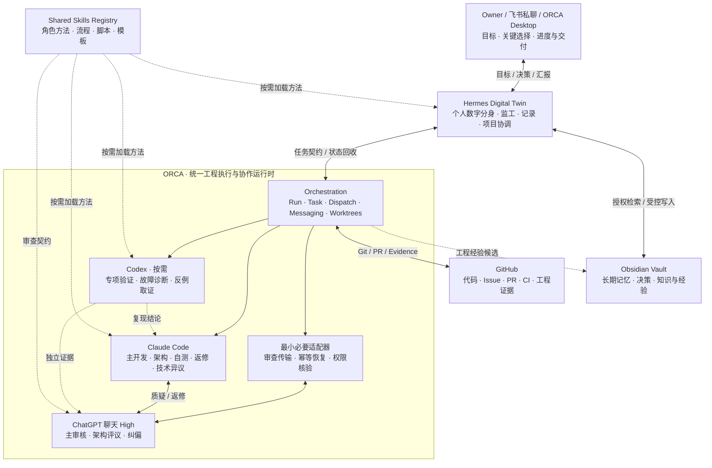
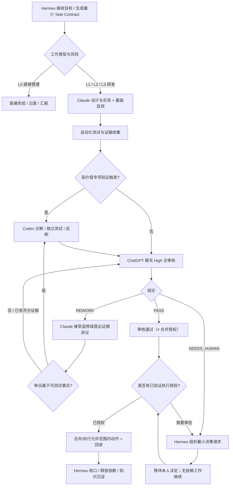
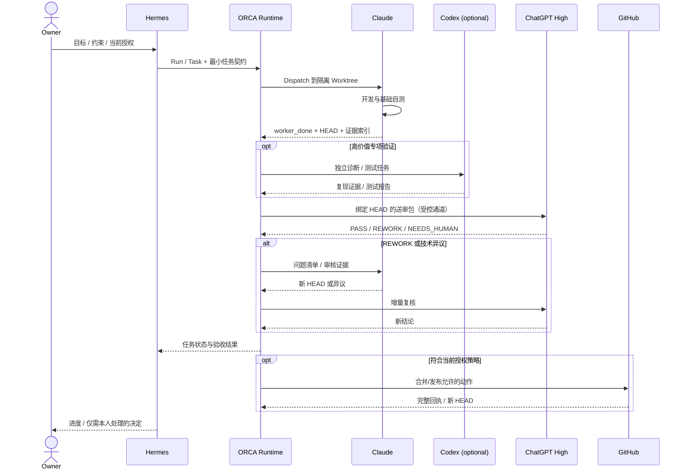
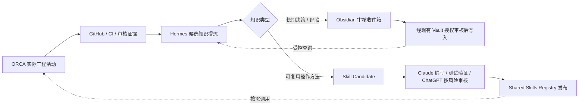

# Hermes Digital Twin × ORCA｜数字分身工程化整合总架构 V3.0

> **项目代号**：DT-ORC  
> **文档类型**：长期架构基线（Architecture Baseline / Living Standard）  
> **版本**：3.0.0  
> **编制日期**：2026-11-02  
> **推荐仓库位置**：`docs/DT-ORC/ARCHITECTURE-V3.0.md`  
> **状态**：**待 Owner 确认、Claude 同版本复核的基线候选**。在确认和合并前，此文档不构成任何新增真实操作授权。  
> **适用范围**：**个人数字分身 Hermes Digital Twin 及其 ORCA 工程协作链路**。不适用于独立的企业数字分身、企业营销项目和企业飞书多维表格业务线。

**一句话架构**：**Owner 决定目标与授权；Hermes 管项目、监工与记忆；ORCA 托管协作与执行；Claude Code 主开发并能提出技术异议；ChatGPT 聊天模式 High 主审核；Codex 按需做专项验证和诊断；GitHub 是代码与工程证据真源；Obsidian 是个人长期知识真源；Skills Registry 将成熟方法变成可复用能力。**

---

## 0. 文档性质与适用规则

### 0.1 本文件解决的问题

本文件既是面向使用者的**目标架构说明**，也是面向 Hermes、Claude Code、ChatGPT High 和 Codex 的**工程实施契约**。所有后续设计、开发、验收、自动推进与 Skill 化都应以它为基线，变更通过版本化 ADR/PR 而不是在不同会话中反复重定义角色。

该基线整合了：

- 《Hermes Digital Twin × ORCA 工程整合与实施总方案 V1.0》（2026-10-30）中关于事实真源、隔离、幂等、恢复和授权的原则；
- Claude《数字分身工程化整合方案 V2.0》（2026-11-02）中关于 Hermes 监工、ORCA 原生优先、按风险/类型分流、Skill 化和减少无效关口的方向；
- Owner 2026-11-02 最新确认的分工：Claude 主开发，ChatGPT 聊天 High 主审，Claude 可以反驳；Codex **额度有限、按需专项验证**；Hermes 不是最高技术裁判；Obsidian 与 GitHub 必须进入完整架构。

**本文件区分**：① 已冻结的架构决策；② 建议的实施规范；③ 尚待实证/授权的能力。不能把第三类写成已上线。

### 0.2 规范级别

- **MUST / 必须**：用于保护正确性、证据、权限与架构边界的最低要求。
- **SHOULD / 应当**：默认采用，偏离时留简要依据。
- **MAY / 可选**：依据任务风险、额度和实际收益启用。
- **NO-GO**：能力未通过对应验收或未获对应授权，必须保持禁用。

### 0.3 优先级与冲突处理

具体动作须同时满足：**Owner 对该动作的有效授权 + 已验收的技术条件 + 当前环境的真实约束**。本架构不能自动代替生产操作的专项授权。与已批准的 PRD、安全禁令或现行环境事实冲突时，先停止受影响动作，提交一个明确的 ADR / 决策请求；不能仅凭较新聊天或模型意见暗中覆盖限制。

本文件是**角色分工和协作框架的主基线**；具体项目需求以其 PRD、验收标准和经批准的 ADR 为准。设计文档、Skill、脚本与运行配置应遵循本文件，不得因简化流程降低已有安全不变量。

---

## 1. 北极星目标与非目标

### 1.1 北极星目标

让 Owner 用自然语言提出个人项目目标，由 Hermes 持续组织；由 ORCA 在**已有授权边界内**驱动 Claude 开发、ChatGPT High 审核、Codex 按需独立验证，自动返修与接力，并将工程事实和可复用经验沉淀到 GitHub、Obsidian 和 Skills。

成功标准不是“多少 Agent 同时工作”“多少测试通过”或“启动多少巡检”，而是：

1. **真实交付**：目标可分解为已验收的任务并持续收口；
2. **独立质量**：实现、测试、审核、技术异议相互制衡，争议能靠证据收敛；
3. **低摩擦**：在授权范围内不需要 Owner 反复复制粘贴或逐步许可；
4. **可靠恢复**：中断、超时、未知执行结果、旧回执不造成重复副作用或错误通过；
5. **持续积累**：项目决策、工程经验和成熟流程可以被再次找到并复用。

### 1.2 非目标

- 不以 Hermes 取代强技术模型做复杂架构裁决。
- 不给 Codex 配置“每次提交必测”的全职岗位，不以用光额度为目标。
- 不把 ChatGPT High 变成 ORCA 原生 Worker 或换成 API/Work/Codex 代审。
- 不再构建与 ORCA 原生 Run/Task/Dispatch 重叠的第二个完整执行运行时。
- 不把 Obsidian 变成执行数据库，也不把 Skills 当成状态机。
- 不因“自动推进”默认放开合并、部署、正式库、真实消息和其他外部副作用。
- **不接入企业数字分身体系**：企业业务线有独立数据、审批、飞书机器人和执行架构；ORCA 仅服务个人项目链路。

---

## 2. 一图总览



**读图规则**：这是职责/数据流图，不是所有任务都必须逐框串行执行。Claude 和 ChatGPT 构成常规研发主线；Codex 按风险与验证价值调用。Obsidian、GitHub、Skills 不在单一串行流水线上，而是作为不同事实来源和复用能力提供支持。

---

## 3. 角色职责：一个主责、清晰异议权

| 角色 | 固定定位 | 主要职责 | 不承担 | 交付物 |
|---|---|---|---|---|
| **Owner** | 方向和权限所有者 | 目标、优先级、风险偏好、必要审批、重大取舍 | AI 间的复制粘贴、常规任务逐轮确认 | 决策或预授权记录 |
| **Hermes** | 数字分身 / PM / 监工 | 目标与任务账本、依赖与顺序、进度、恢复协调、提醒、知识索引、汇报、授权内明确代选 | 主体编码、最深技术思考、以模型意见代替验证、越权审批 | 任务契约、状态映射、进度、决策请求 |
| **Claude Code** | 主开发 / Implementation Lead | 方案、架构、实现、基础测试、重构、返修、解释技术取舍、对审查提正式异议 | 自称独立验收 PASS、直接修改独立审查证据、无授权合并部署 | Commit、Diff、开发自测、返修说明、异议证据 |
| **ChatGPT 聊天 High** | 主审核 / Principal Reviewer | 独立评议架构、代码正确性、需求一致性、关键风险、验收证据；接受或驳回有证据的异议 | 直接改生产代码、自动取得权限授权、每轮无依据扩展任务范围 | PASS / REWORK / NEEDS_HUMAN 及证据关联 |
| **Codex** | 专项工程验证与诊断 Specialist | 复杂问题诊断、独立复现、边界/竞争/失败注入、关键模块专项测试、可测争议取证 | 全量常驻测试、每次提交固定介入、最终架构审核、默认修改生产代码 | 复现步骤、测试或诊断代码、实际测试输出 |
| **ORCA** | 统一执行运行时 | Run、Task、Dispatch、监督 Worker、消息、原生任务依赖、Worktree、运行资源与可读回执 | 业务价值判断、个人长期记忆、主审核判断 | 可查询运行状态与执行证据 |

### 3.1 不同的“权”不能混为一谈

- **业务选择权**：Owner；已明确授权的选择规则可交由 Hermes。
- **任务协调权**：Hermes 通过 ORCA 操作，但不代替运行时决定真实执行结果。
- **实现责任**：Claude。
- **审查主责**：ChatGPT High；主责不等于不可质疑的绝对权威。
- **事实检验**：Codex/确定性测试/CI；以可复现结果为准，而不是以 Agent 票数为准。
- **敏感动作授权**：Owner 或经单独验收的范围明确的可信授权策略。

### 3.2 Codex 的预算化调用

**默认不调用 Codex**：文案、文档、小型普通改动、已有自动测试足够覆盖的低风险任务。

**建议调用 Codex**：难复现 Bug、并发与幂等、重大架构边界、敏感代码变更、关键失败恢复、Claude/ChatGPT 对可测事实有分歧、重要里程碑前的专项验证。

**不消耗 Codex Agent 额度的工作**：现有 `unittest` / `pytest` / `swiftc` / 静态检查等机械测试由 ORCA 受控脚本或 CI 执行。Claude 为自己提交的代码保留基础自测责任。

Hermes 可记录当前可用额度信息及高价值待验证队列，实行“先高价值、再普通验证”的调度；不得凭估计值编造剩余额度，也不能为了消耗额度制造无价值测试。可配置预算预警、预留容量与降级规则，具体数值根据实际使用记录决定。

### 3.3 Claude 校正 ChatGPT 的边界

Claude 可以对审查意见提出正式异议，指出错误前提、过时代码、无效测试、过度设计或任务越界；但异议不自动将 REWORK 改为 PASS。ChatGPT 收到新证据后应重新评估，必要时撤回原意见。严重争议交给可复现验证、独立证据或明确的 Owner 取舍，不能以模型多数票放行高风险动作。

---

## 4. 四个平面与事实真源

### 4.1 层次及唯一权威

| 平面 | 组件 | 只负责的事实 | 不应复制的事实 |
|---|---|---|---|
| **个人业务管理** | Hermes `twin_state` | Goal、业务 Task、优先级、业务阻塞、决策、结果与项目关系 | 逐字复制 ORCA 的内部 Worker 状态机 |
| **执行运行** | ORCA Runtime | Run、执行 Task、Dispatch、Worker、消息、工作树及资源状态 | 代替业务目标审批或持久个人记忆 |
| **工程交付** | Git / GitHub / CI | Commit、分支、PR、差异、CI、发布记录、工程证据指纹 | 代替 Hermes 的业务目标关系或 Obsidian 知识结构 |
| **长期知识** | Obsidian | 决策缘由、项目知识、长期经验、已审核笔记 | 运行中的 Worker 状态、凭据或完整原始日志 |
| **复用方法** | Skills Registry | 怎样完成一类工作、脚本、参考资料、触发说明 | 具体任务的状态、权限令牌与审批执行记录 |

### 4.2 身份与关联映射（精简版）

建议用现有 External Reference / 映射机制维护：

| 项 | 示例格式 | 归属 |
|---|---|---|
| `project_id` / `goal_id` | Hermes 项目/目标标识 | Hermes |
| `hermes_task_id` | 业务任务 ID | Hermes |
| `orca_run_id` / `orca_task_id` | `run_...` / `task_...` | ORCA |
| `dispatch_id` | `ctx_...` 或 ORCA 实际返回值 | ORCA |
| `commit_sha` / `pr_number` | 完整 Git SHA / PR 编号 | GitHub |
| `review_packet_sha256` / `review_verdict` | 原始字节摘要 / 审核结论 | 审核证据账本 |
| `decision_ref` | Owner 授权及决策证据引用 | Hermes / 授权机制 |
| `knowledge_ref` | Obsidian 笔记 ID 或 URI | Obsidian |

**原则**：只保留 ID 映射和最小摘要，不另复制整套运行数据库；目标状态与执行状态由确定性适配器对账。相互矛盾时显示 `UNRECONCILED`，不能以 Hermes 文本自报覆盖 ORCA 事实，也不能以 Worker 自报覆盖 Git HEAD。

### 4.3 执行协调者的实现

Hermes 是**业务协调者**。ORCA 原生 Run + 协调者收件箱负责执行过程；轻量 `dt-pipeline`/Adapter 负责将业务策略转换为 ORCA 指令和收取回执。这个适配器应尽量简单，不再自建一套完整任务 DAG、Worker 进程生命周期和消息系统。

对于真实运行的能力，以**当前安装版本的 ORCA CLI 帮助和实际返回结构**为准；`worker-start`、`worker-show`、`request-show`、`check`、`gate-create` 等命令必须按当地版本验证后使用。不得使用已退役的 orchestration `run` 或 `coordinator-start` 作为真实执行入口。

---

## 5. 两轴工作流：任务类型 × 风险等级

### 5.1 两个维度分别判断

**类型泳道**决定*工作怎样做*：

| 泳道 | 典型任务 | 默认主体 |
|---|---|---|
| **DEV** 功能开发/重构 | 新功能、跨文件维护 | Claude 主开发 → ChatGPT High 审核；Codex 可选 |
| **BUG** 故障修复 | 可复现缺陷、异常恢复 | 先取得可观察失败 → Claude 修 → 必要时 Codex 专项诊断 → ChatGPT 审 |
| **DESIGN** 调研/设计 | 方案、ADR、UI/UX/技术取舍 | Claude 设计 → 需要技术评议时 ChatGPT High 审 → Owner 决定重大取舍 |
| **OPS** 运维/迁移/安全 | 部署、安装、正式库、权限、真实外部操作 | 设计和演练 → 独立审核 → 可信授权 → 受控动作 → 回读/回退核验 |
| **KNOWLEDGE** 知识/Skill | Obsidian 经验整理、Skill 构建 | Hermes 发现候选 → Claude 提炼/编写 → 按价值验证 → 授权知识写入 |

**风险等级**决定*需要多严的验证与授权*：

| 等级 | 解释 | 默认执行策略 |
|---|---|---|
| **L0** 管理/文档 | 不触及敏感数据或代码行为的说明与管理 | Hermes 或 Claude 直接处理，必要时轻量核对；无固定多模型会审 |
| **L1** 小范围低风险代码 | 范围明确、能快速回滚、有既有测试 | Claude 开发+自测 → ChatGPT High 轻量差异审核；Codex 不默认触发 |
| **L2** 标准研发 | 新功能、若干模块、非敏感集成 | Claude 方案/开发+自测 → 自动化测试 → ChatGPT High 完整审核；Codex 依触发规则介入 |
| **L3** 高风险 | 安全、持久状态、身份、正式配置、不可控外部副作用 | 受控设计/演练、必要的额外验证、ChatGPT High 审核、独立授权、恢复演练 |

**风险等级不能单靠改动行数或文件名判定**。路径/标签只能自动上调；认证、权限、外部副作用、依赖和真实环境才是最终评估依据。

W4/OPS 的授权覆盖可以施加在 L1/L2 任务的**特定外部动作**上，不必因此重跑整条开发流程。

### 5.2 主路径：不是每次都请齐三个模型



**主流程**：Claude 与 ChatGPT High 始终分别承担开发和主审；Codex 是独立验证的加速器，不是每次都要经过的审批站。现有 CI 和确定性测试可运行多次，不需要为重复执行启动多次 Codex 会话。

### 5.3 快速流的细化

- **L0**：非代码/低风险管理任务不强制主审。
- **L1**：小 Diff、短测试、一次 ChatGPT High 审核；Codex 仅因明确问题介入。
- **L2**：Claude 可与测试夹具准备并行，但同一文件/同一 Worktree 禁止并发写。审核提交统一证据包。
- **L3**：先形成架构与风险分析，必要时启动独立 Claude 复议和 Codex 专项验证；但不要求每个 L3 子任务机械增加一整套会审。

### 5.4 结果与阻塞矩阵

| 事件 | 处理原则 |
|---|---|
| 自动化测试失败 | 阻塞当前 Task，Claude 修；必要时调用 Codex 诊断；不停止所有无依赖任务 |
| ChatGPT REWORK | 修复已确认问题或给正式异议；只需要按变化范围重审 |
| ChatGPT NEEDS_HUMAN | 暂停受影响任务/动作，Hermes 汇总决定，不扩散为全局停工 |
| 返修无新增证据持续争论 | 避免无限往返；按预算收敛或提交明确选择题 |
| 任务超时或结果不明 | 只读对账；保留占位、租约或未定状态，不盲目重发/重起 |
| 权限/证据完整性破坏 | 对相应共享安全域全局暂停，独立核实并恢复 |
| 任一 Task PASS | 仅代表技术审查通过；是否合并/部署由授权策略独立判定 |

---

## 6. 独立审核、Claude 纠偏与 Codex 证据协议

### 6.1 审核身份与绑定

主审核者必须是**ChatGPT 聊天模式、思考强度 High**。传输使用经过验证的 ORCA 中受控会话/浏览器适配，不以换 Work 模式、Codex 或非指定 API 作为静默替代。

每份审核包最少绑定：`task_contract_version`、Task / Run ID、完整 `HEAD SHA`、相关 `base SHA`、送审包 SHA-256、变更摘要、自动测试结果、已知问题、审查范围。当前结论只对精确版本有效；新的 HEAD、base 或实质性契约变更必须重新核对。

### 6.2 审查报告标准

ChatGPT High 返回：

- `PASS`：当前任务契约满足，未发现阻断性证据；**不代表已经合并/部署许可**。
- `REWORK`：列出需要返修的 P0/P1，包含具体位置、复现路径或可审计的技术推导、预期/实际与验收标准。
- `NEEDS_HUMAN`：需求、风险偏好、权限或无法可靠核实的外部动作需要决定。

每条 Finding 必须**分别标明严重度与证据可信度**：

| 严重度 | 定义 | 处理 |
|---|---|---|
| P0 | 破坏权限/身份/数据完整性、安全边界，或造成重大外部副作用 | 确认风险前不可放行相应动作 |
| P1 | 违反核心验收、真实功能错误、重要回归 | 阻断对应 Task 验收 |
| P2 | 可维护性、可选优化、独立技术债 | 默认进入待办，不无限扩充当前范围 |

`proven / probable / hypothesis` 是证据强度，而不是自动降级依据。新发现的可信 P0/P1，即使在第二轮或未修改代码中发现，也**不能按轮次强制降为 P2**；但必须说明影响本 Task 的理由，防止泛化审查。

### 6.3 Claude 反驳协议

对阻断性问题，Claude 做三选一：`ACCEPT`（修复并给新 HEAD）/ `CHALLENGE`（异议及证据）/ `NEED_EVIDENCE`（提出可验证主张）。对无需修正的 P2 可直接纳入待办，不要求冗长回应表。

可测争议 → Codex 有预算且能增值时独立复现；否则优先使用现有自动测试、确定性脚本和日志验证。新证据 → ChatGPT High 复核并可撤销、降级或维持结论。架构偏好/产品取舍类争议由 Hermes 汇总选项，Owner 或已授权偏好策略决定。

默认只允许**一次正式异议 + 一次证据复核**。有实质性新事实可延长；反复重述观点、无新增证据不得无限循环。额外启动 Claude 的全新独立会话仅用于重大分歧或高风险专项第二意见，不为每个 L3 小步骤固定开新会话。

### 6.4 返修与重新审核

- 返修尽量只改确认问题，严禁擅改 Codex 原始独立测试证据；确有测试错误，作为独立修复与复核记录。
- 第二轮优先审核**新增 Diff、未关闭 Finding、受到影响的相邻代码和测试**。
- 默认 L1 1 轮、L2/L3 最多 2 轮自动返修；超过后交 Hermes 组织取舍。此为**防止无限循环的管理阈值**，不能代替必须完成的安全修复。
- 审核结论必须允许被事实证据纠正；不因保留“主审权威”而持续创造新阻断项。

---

## 7. ORCA 原生优先的执行协议

### 7.1 运行时最小闭环



### 7.2 原生能力优先清单

| 需求 | 优先采用 | 非原生部分仅补什么 |
|---|---|---|
| Task/DAG | ORCA orchestration task 与依赖 | Hermes 业务优先级与映射 |
| Worker 启停与状态 | ORCA supervised worker / Dispatch / worker-show | 不确定结果对账和外部权限策略 |
| 执行隔离 | ORCA Worktree/new-child | 敏感资源沙盒策略、证据验证 |
| Agent 间交接 | ORCA send/check/ask/reply、worker_done | 结构化审查/异议契约 |
| 决策阻塞 | ORCA gate-create / gate-resolve | Owner 身份校验、飞书交互桥 |
| ChatGPT High 主审 | 经验证的 ORCA 页面 + relay | 会话身份、审核租约、发送幂等、回执绑定 |
| 排队/恢复 | ORCA 原生状态 + 确定性适配器 | 跨系统对账、动作防重放、审查冻结 |
| 长期计划与知识 | Hermes + Obsidian | 受控检索/写入与知识审核 |
| 代码交付 | Git/GitHub/CI | 授权策略校验、回执同步 |

**禁止“为了可视化好看”而重建平行执行体系**。先验证原生能力在真实 ORCA 版本中的语义、重启行为及异常回执，再逐项替换已存在的 `work_queue.py`、`relay_loop.py` 等自建模块。每次替换必须提供与旧语义的兼容/回退测试。

### 7.3 轻量状态与交接模型

Task Contract 最小字段：`task_id / objective / scope / acceptance / dependencies / risk / allowed_actions / evidence_refs`；不用每张小任务卡都生产大篇 PRD。

开发交接最小字段：`task_id / orca_task_id / dispatch_id / head_sha / changed_paths / test_summary / known_issues / evidence_ref`。

Codex 报告最小字段：`target_head / test_scope / actual_command / actual_result / reproduction / evidence_ref`。

ChatGPT 报告最小字段：`task_id / head_sha / base_sha / packet_sha256 / verdict / findings / evidence_ref`。

所有证据必须能追溯到准确代码版本。模型叙述不是测试原始输出，不可替代 ORCA 回执和 GitHub 远端只读核对。

### 7.4 运行结果不明与恢复

- `worker-start` 结果未知：优先查当前 Request / Dispatch，不得不核实就发第二个 start。
- Worker 终端仍存在 ≠ Agent 仍健康；观察存在与任务结果需交叉核验。
- ChatGPT 发送结果未知：只 collect/对账，租约冻结，禁止直接再次点击。
- 对同一页面的审核任务实施全局串行租约；不可通过随意换状态目录绕过。
- `PASS` 旧回执在 HEAD/契约变更后不得复用。
- 有关重试、回滚与清理的步骤需根据**真实副作用是否已发生**判定；非幂等动作不自动重试。

---

## 8. 安全、授权与高效推进必须同时成立

### 8.1 权限不是一个任务等级

独立维护**动作授权**，不要只凭 L0–L3 就宣布全部操作允许。建议动作分类：

| 动作 | 默认策略 |
|---|---|
| 只读核验、本地合成数据设计 | 按现有访问授权执行 |
| 受控 Sandbox 改码/测试 | 经该工作区授权后可自主循环 |
| 真实 ORCA Worker 启动/停止 | 在相应可信执行门禁验收前遵循当前 H1 等精确授权；不能因“内部动作”自动放开 |
| 真实 ChatGPT UI 发送 | 在相应会话身份与 H2 证据验收前按精确授权执行，不重复发送 |
| GitHub push/PR | 按当前项目/仓库授权；不从模型文本推断允许 |
| GitHub squash merge | 需适用当前 HEAD/base/PR 的有效权限策略；PASS 本身不是合并许可 |
| 安装、正式配置、正式数据库、定时服务、对外消息 | 独立验收及明确授权；保持回滚证据 |
| Obsidian 正式 Vault 写入 | 遵守 Obsidian 主线独立的权限与收件箱/审核协议 |

**减少人工确认的正确方式**：未来在可信授权桥验收后，可定义**仓库/分支/动作/路径/次数/有效期**均受限的预授权策略，使重复的低风险动作无需再次请示。技术许可与用户许可两者必须同时满足。签名、身份与状态根机制可以**精简替换**，但不得在没有等效保护和测试时整体撤销。

### 8.2 不可取消的安全不变量

1. 未经验证的聊天文本或模型输出永远不算 Owner 授权。
2. 测试环境不能通过软链接、可控环境变量、PATH 伪装或状态文件分流触达正式状态；必要时采用目录句柄约束和拒绝跟随链接等确定性防护。
3. `CLAIMED / UNCERTAIN` 视为已经可能产生外部副作用，不盲目再次执行。
4. 审核仅对精确版本、范围和送审包生效；必须独立读取重要外部事实。
5. `PASS` 不是自动合并/部署权限；没有适用授权时保留可继续开发的其他无依赖任务。
6. 敏感凭据、正式 Vault 私人笔记、真实审批材料不得复制进 Git、测试包或未经授权的审核聊天。
7. 新增自动化服务或正式 LaunchAgent 不能从“持续推进目标”推导出安装许可。

### 8.3 当前 B11 阻断（截至 2026-11-02 的上次实际核验）

- B1–B10 已积累多批隔离代码及测试成果，但这不证明真实无人值守可用。
- B11-R5 两套 Python 各 347 项测试通过，**独立审核仍为 REWORK**；状态文件及锁文件级别的符号链接穿透边界仍需修复和复核。
- B11-R5 修改当时未形成新的提交，不能把基线 SHA 当作 R5 完成 SHA。
- 一次历史合成测试曾意外写入正式用户 relay 的合成租约；未获专项授权不得擅清。
- 真实 H1/H2、ChatGPT 会话身份、可信产物来源、授权根及完整 G1–G6 闸门仍需验收。当前真实动作开关不能因为本 V3.0 文档而打开。

**先关闭这些 P0/P1 类安全阻断，再谈真实闭环。** “安全只留在代码中、尽量少打扰人”是目标；“省掉必要安全验证”不是目标。

---

## 9. GitHub / Obsidian / Skills 的完整闭环

### 9.1 三类长期资产必须分开

| 资产 | 存放内容 | 不存放 |
|---|---|---|
| GitHub | 需求与 Issue、PR、Commit、ADR、可公开于该仓库的测试和审查证据索引 | 密钥、生产数据库、私人 Vault 正文 |
| Obsidian | 项目背景、长期决策、跨项目经验、知识引用与演化 | 实时 Worker 运行数据、全部原始输出、未授权敏感材料 |
| Skills Registry | 可执行方法、工具调用约定、模板、参考与可选脚本 | 具体项目的运行状态/令牌/一次性授权 |

### 9.2 知识转化链



**并非每个项目结束都写 Vault 或造 Skill**。只有高信噪比、跨场景可复用的经验才提炼；知识写入仍须符合 Obsidian 正式权限。Hermes 对知识检索和工程任务关联负协调责任，但不因此获得读取所有私人内容的无限权限。

### 9.3 最小 Skills 组合

以**少而实用**为原则，先构建/复用以下能力，成熟后再拆分：

| Skill | 主要角色 | 核心输出 |
|---|---|---|
| `dt-orchestrate` | Hermes | 风险/泳道选择、ORCA 任务建立、恢复与汇报 |
| `dt-develop` | Claude | 方案、代码、自测、版本绑定交接、返修 |
| `dt-verify` | Codex 按需 | 诊断、可复现测试、实际证据 |
| `dt-review` | ChatGPT 审核通道/适配器 | 有范围与版本绑定的审核包及结论 |
| `dt-dispute` | Claude / ChatGPT / Codex | 精简异议、取证、复核与收敛 |
| `dt-closeout` | Hermes | 状态对账、知识候选、依赖释放及项目汇报 |

`dt-review` 中真实的浏览器通信由审核适配器执行；**Skill 只规定方法和契约，不取代代码中的权限与幂等校验**。

Skill 采用 Agent Skills 约定：`SKILL.md`（含 `name`/`description` YAML 元数据）、可选 `references/`、`scripts/`、`assets/`，按需加载。优先使用个人共享技能仓库作为唯一版本来源，其他 Agent 用软链接/受控安装/只读同步，不复制成多个长期分叉版本。

### 9.4 推荐目录结构

```text
digital-twin/
├── PRD.md                          # 本项目业务目标、范围与关键需求
├── CURRENT.md                      # 当前工程状态快照（由真实证据更新）
├── AGENTS.md                       # 简短的全体 Agent 必守约束
├── docs/
│   └── DT-ORC/
│       ├── ARCHITECTURE-V3.0.md    # 本文：长期架构基线
│       ├── adr/                    # 重大变更决定（可逐步创建）
│       ├── reviews/                # 文档/代码评审索引（敏感原文不入库）
│       └── migration/              # 原生化改造、回退与验收计划
├── hermes/                          # 业务状态与现有个人数字分身逻辑
├── orca/                            # 最小必要的运行适配、验证、恢复
└── ops/                             # 经授权的运维工具/配置

# 共享 Skills Registry 在独立个人技能仓库；本仓库记录受控版本引用。
```

本目录为目标组织方式，不代表这些子目录目前全部已经存在或获准自动创建。

---

## 10. 可实施迁移路径：保留已有效成果，不推倒重建

### 10.1 现有资产分类

| 资产 | 方向 | 条件 |
|---|---|---|
| Hermes B0–B2.2 状态与事件底座 | **保留** | 业务真源，不重复 ORCA 任务运行细节 |
| 原 `dispatch.py` / `run_worker.py` | **保留 Legacy** | 当前正式工程兼容；经阶段迁移验收才切换 Backend |
| 已合并 RELAY-01 | **保留并验证** | 审查通道需持续校验页面身份/模式/强度 |
| PR #40 RELAY-02 / PR #42 等未合并内容 | **逐个核对** | 必须先重读远端 HEAD、审查和当前权限；不可因本文件直接合并 |
| FRAMEWORK-V2 B1–B5 队列、租约、Adapter | **优先精简复用** | 真实对比 ORCA 原生能力，保留外部审核/跨系统幂等的必要部分 |
| B6–B11 身份、H2 观测、安全加固 | **分类治理** | 存档未成熟方案；保留已必要的安全不变量，关闭 REWORK 后再逐步接入 |
| G5 通知链路 | **独立继续** | Hermes 主线自己的分阶段授权和验收，不因 ORCA 迁移跳过 |
| Obsidian K1/K2 | **独立继续** | 只能通过已批准的检索/写入接口与 Hermes 集成，不混验收证据 |

### 10.2 工作包顺序与验收

| 阶段 | 目标 | 必须交付的证据 | 放行条件 |
|---|---|---|---|
| **P0：事实与安全收口** | 核对最新分支/Run，关闭 B11 文件级隔离漏洞，列出各 PR/Worktree 归属 | 完整 SHA、Diff、两套 Python 与反例测试、独立审核、未改正式环境证明 | 阻断性问题关闭；不合并未验收内容 |
| **P1：角色与流程落地** | Hermes/Claude/ChatGPT High/Codex 权责及任务契约；Codex 按需触发 | Skill/Prompt/运行策略测试，W0–W3 的合成流程记录 | 不新增不必要的后台状态机 |
| **P2：ORCA 原生整合** | Task/Worker/消息原生化，薄适配器接收审核回执并恢复 | 真实 CLI 合同、模拟+只读 E2E、失败恢复/版本对账 | 保持 Legacy 兼容与回退 |
| **P3：一次性可信闭环** | 在专项授权后完成一次 Claude 开发—可选 Codex—ChatGPT High 审查—返修—收口 | 真实 Run/Task/Dispatch、固定 HEAD、送审包、ACK/回执、动作次数与无重放证据 | H1/H2 可信执行和必要 G 门禁验收通过 |
| **P4：持续自动接力** | 多任务 DAG、有界并发、局部失败、可靠唤醒与恢复 | 多任务实测、崩溃/恢复记录、真实耗时与人工介入指标 | 常驻服务/对外动作按独立授权上线 |
| **P5：知识与 Skills 闭环** | 将经验和成熟方法受控沉淀，接通 Obsidian 知识主线 | 实际检索引用、授权写入记录、Skill 调用成功率 | 不混用正式 Vault 与 Sandbox 权限 |

P1/P5 的非敏感文档与 Skill 设计可在 P0/P2 期间并行推进；但 P3 的真实执行不能绕过 P0 的安全阻断和必要独立授权。不要把所有阶段写成无理由的机械串行。

### 10.3 第一张可执行工单（建议）

**工单**：`DT-ORC-P0-B11-ISOLATION-CLOSEOUT`  
**Developer**：Claude Code  
**Verification**：Codex 仅在独立复现/故障测试确有增值且额度允许时介入；普通回归由测试脚本执行  
**Reviewer**：ChatGPT 聊天模式 High  
**范围**：只修 B11-R5 独立审核所指的状态文件和 `.lock` 文件符号链接逃逸问题，补同目录可控替身测试；不访问/修改正式 relay 状态目录。  
**验收**：先红后绿或等效反向验证、双 Python 全量、`git diff --check`、最新 HEAD 独立复核；任何 `REWORK` 不计关闭。  
**禁止**：真实 Worker-start、ChatGPT UI 发送、未经授权 push/merge/安装、正式状态库清理和正式 Vault 写入。

---

## 11. 日常运行、报告和优化度量

### 11.1 Hermes 应当汇报什么

Hermes 的日报/周报只关注**当前目标、已验收成果、真实阻塞、下一动作、需用户决定的事项**，不能把“巡检正常”“测试运行成功”冒充“项目已完成”。

标准状态行：

| 字段 | 示例内容 |
|---|---|
| 项目/目标 | DT-ORC / 当前里程碑 |
| 当前版本 | `head_sha` + 未提交状态 + PR URL |
| ORCA 运行 | Run / Task / Dispatch / 最近确认时刻 |
| 已完成 | 已合并、已独立验收、已真实运行：分别列明 |
| 阻塞 | P0/P1、外部依赖、审批、设备不可达 |
| 下一动作 | 单一优先工单及负责人 |
| 用户决定 | 一句话，附默认推荐与风险 |

### 11.2 核心效能指标（先建立基线）

| 指标 | 用途 |
|---|---|
| 目标/Task 端到端交付时间 | 判断整条链路是否真的更快 |
| 执行时间 vs 等待时间 | 找出是否卡在审核、额度、上下文或终端 |
| 一次主审通过率 / 有效 Finding 率 | 评估交付与审核质量 |
| 平均返修轮数 / 重复返修 | 防止无限反馈循环 |
| Claude 异议有效率 / ChatGPT 误报纠正 | 保证有纠偏且不变成争吵 |
| Codex 专项验证的真实缺陷收益 / 额度消耗 | 衡量按需调用价值 |
| 自动接力成功率 / 人工介入次数 | 评估无人值守程度 |
| 不确定动作恢复率 / 重复副作用事件 | 评估真实可靠性 |
| Obsidian 有效引用 / Skills 实际复用 | 评估长期知识积累效果 |

真实测量前，不设虚假的 L1/L2 固定完成时间或提升百分比。目标应基于基线和实际波动设定。

---

## 12. 变更控制：未来所有调整必须基于本文件

### 12.1 稳定不变的基线

以下决议是 V3.0 的**核心架构约定**：

- **ADR-001**：个人数字分身与企业数字分身物理/权限/业务边界独立，ORCA 仅属于个人链路。
- **ADR-002**：Hermes 是业务管理与监工，不是最高技术裁判。
- **ADR-003**：ORCA 是统一执行运行时，原生功能优先。
- **ADR-004**：Claude Code 是主开发与返修负责人，并拥有正式技术异议权。
- **ADR-005**：ChatGPT **聊天模式 High** 是唯一默认的主审核身份；可被证据纠正。
- **ADR-006**：Codex 是**按需**专项验证与诊断角色，不作固定全量测试站。
- **ADR-007**：以“类型 × 风险 × 当前动作授权”决定流程，不采用全任务统一重流程。
- **ADR-008**：Hermes、ORCA、GitHub、Obsidian、Skills 的事实真源与边界不混用。
- **ADR-009**：成熟方法 Skill 化，但不重造运行时或把每次交接做成一个新 Agent。
- **ADR-010**：最少必要人工打扰与可信权限/幂等/回滚必须同时满足。

### 12.2 版本升级

- **PATCH（3.0.x）**：排版、术语、证据引用、小型澄清；不得改变权限或角色。
- **MINOR（3.x）**：已验收的具体 Adapter、Skill、工作流参数调整；保持核心职责和安全不变量。
- **MAJOR（4.0）**：改变核心 Agent 主责、事实真源、审批模型、执行平面或知识边界；必须形成 ADR 和完整迁移/回退设计。

### 12.3 变更 PR 的最小模板

```markdown
## 变更原因与实际证据
- 现有问题：
- 相关 Issue / 实际运行记录：

## 变更范围
- 涉及 ADR：
- 受影响角色 / 工作流 / Skill / Adapter：
- 是否改变正式权限或外部副作用：

## 实施与回退
- 兼容性：
- 测试 / 反向验证：
- 回退方式：

## 独立评审
- Claude Code 技术实施意见：
- ChatGPT High 独立架构审查及结论：
- Codex 专项验证（触发时）：
- Owner 确认或范围内预授权引用：
```

**“Claude 与 ChatGPT 均认可执行”必须有针对**同一文件版本/同一 Commit**的真实反馈记录。任何模型单方面生成这份文档，都不能冒称另一模型已审查同意。首次激活本基线的顺序为：Owner 确认 → Claude 阅读并出同版本评审 → ChatGPT 独立复核差异 → 按实际仓库权限合并存档。其后所有调整复用同样的可验证版本链，不要求每次都重新请所有角色审核纯排版修改。

---

## 13. 工程验收定义（Definition of Done）

**技术任务完成**至少需要：

1. 任务范围和验收标准可追溯；
2. 修改版本有完整 SHA，Worktree 与 PR 状态可核实；
3. Claude 基础自测及被要求的确定性测试通过，必要时 Codex 有独立验证证据；
4. ChatGPT High 对对应版本给出有效 PASS，或按批准的特定免审规则处理 L0；
5. 阻断性 P0/P1 有关闭证据，无未解释的版本/身份/运行不确定状态。

**合并/部署完成**还需要：对应动作的有效授权、执行回执、远端版本回读及适当的回滚/恢复证据。**项目主线完成**还需要 Hermes 对全部依赖与目标状态进行对账，并把剩余问题区分为技术债、外部阻塞和需要用户决定的事项。

**最终成功**：不是“Agent 能聊天”，而是“在正确权限范围内，能持续完成真实任务、通过独立审查、处理技术分歧、可靠恢复，并把有价值的经验沉淀复用”，且比原流程减少无意义的人工作业和等待。

---

## 附录 A：引用与核验边界

**内部源**：

- `PRD.md`、`CURRENT.md`、`AGENTS.md`（以当前仓库最新受审版本为准）；
- 2026-10-30《Hermes Digital Twin × ORCA 工程整合与实施总方案 V1.0》；
- 2026-11-02 Claude《数字分身工程化整合方案 V2.0》；
- `docs/DT-ORC/FRAMEWORK-V2.md`、RELAY-01 / RELAY-02 文档与 B11 实证回执。

**外部规范（供后续实现核对）**：

- ORCA Orchestration 官方文档：<https://github.com/stablyai/orca/blob/main/docs/site/content/docs/cli/orchestration.mdx>。命令与合同必须同时以**本机版本实测**为准。
- Agent Skills 规范：<https://github.com/agentskills/agentskills/blob/main/docs/specification.mdx>。

**时效声明**：文中的“目前 B11 状态、PR 状态、测试数字”是截至 2026-11-02 的历史核验快照，后续必须通过当前 HEAD、原始日志和独立审核更新，**不得长期作为实时状态**。

---

**文档终止条件**：被 Owner 正式批准的更高主版本替换；旧版仍留 Git 历史供审计。任何尚未部署的方案都不因为写入本文件而自动上线。
