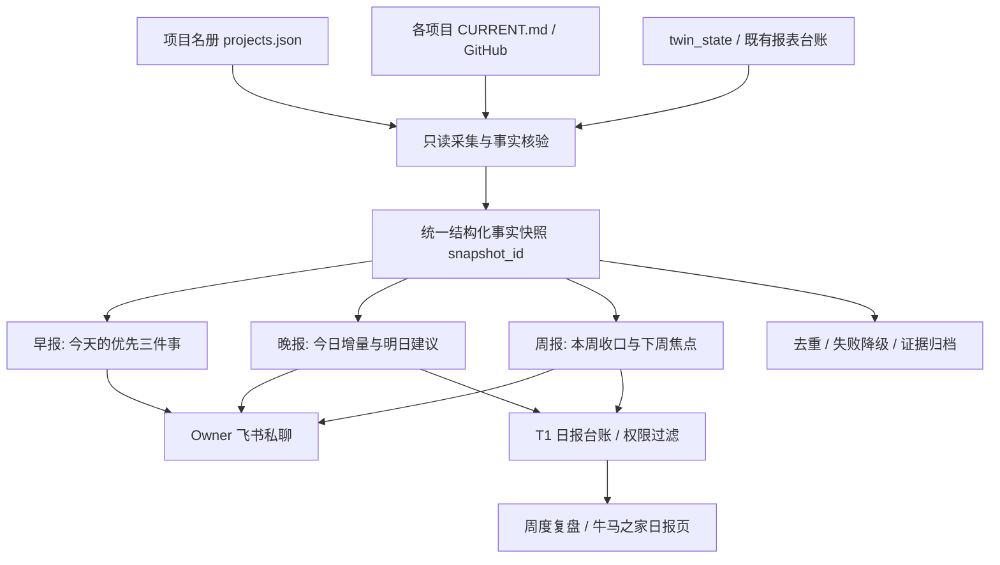

# Hermes Digital Twin · 主动运营与三报体系 V2.0

**状态：方案定稿，待工程实施**  
**日期：2026-11-02**  
**所属主线：私人数字分身「猛鬼兽」 / Hermes Digital Twin**  
**适用范围：个人项目运营、主动汇报、日常决策支持及经验沉淀。企业分身「亚古兽」及企业业务资料不纳入。**

> 本文整合 V1.0、V1.1、V1.2 及 Claude 两轮审核；Owner 已明确批准**周末不发早晚报**、**周五 18:00 周报代替当日晚报**。本文确定产品规则与实施路线，不代表已经修改 Hermes、Cron、飞书、PRD 或 ORCA 正式配置，也不构成任何夜间自主执行授权。历史系统状态仅代表 2026-11-02 的检查快照，施工前必须重新核验。

## 1. 执行结论

本阶段只建设 **08:00 早报、22:00 晚报、周五 18:00 周报** 三类固定主动报告，以可信项目事实、同源增量、清晰优先级和最少打扰为核心。晚报取代现有独立日报：同一事实快照生成私聊推送版和符合 T1 结构的台账版；周五周报代写当日台账。原晨报、周启、周五收口、当日截止提醒整合进三报，不再产生同质化独立报告。

**不施工范围**：夜间无人值守执行、夜推授权命令、夜间 Worker/控制器、自动派单、绕过 ORCA M4 及改变现有执行权限。远期设计仅列入附录，待 Owner 未来重新发起再评审。

### 1.1 固定节奏（已决定）

| 星期 | 08:00 | 18:00 | 22:00 | 规则 |
|---|---|---|---|---|
| 周一 | 早报 + 本周焦点 | — | 晚报 + T1 台账 | 周启并入周一早报 |
| 周二至周四 | 早报 | — | 晚报 + T1 台账 | 正常运行 |
| 周五 | 早报 | 周报 + 周五 T1 台账 | **不发** | 周五收口并入周报 |
| 周六、周日 | **不发** | — | **不发** | 不安排固定报告 |

每周工作日共 **5 份早报、4 份晚报、1 份周报**，即 **10 次固定主动推送**。巡检故障、安全异常等“立即级”告警不计入三报；普通提醒并入最近一份报告。法定节假日是否调整沿用现有工作日历配置，不擅自增加额外停发规则。

**时区规则**：采用经施工前回读的现有 Hermes/Cron 所属时区，并在任务配置、快照与报告中显式记录；不得未经核对根据操作系统或会话所在位置改变调度时区。

## 2. 目标架构与职责边界



- **猛鬼兽**：读事实、形成判断、解释优先级、推送报告和提出经验候选；不因本方案取得执行权限。
- **数据源**：继续使用现有 `projects.json`、各项目 `CURRENT.md`、GitHub 及适用的 `twin_state`；优先复用 `progress_data.py`、`report_data.py`、`report_publish.py`，但须实测实际字段、差分与幂等支持。
- **台账**：晚报或周五周报按既有 T1 模板持续积累事实；牛马之家日报页仍从既有台账渠道读取，不能从私聊反向复制所有内容。
- **ORCA**：仍由其既有架构管理工程执行与审核；本体系只读取已验证的状态，不另建任务执行队列或第二套控制器。

## 3. 三份报告的产品规格

### 3.1 早报｜每周一至周五 08:00

**回答的问题：今天最应该先推进哪三件事？**

| 模块 | 交付标准 |
|---|---|
| 今日优先 3 件事 | 每条含项目、具体动作、为何优先（关键依赖/截止/价值）、建议执行者或待决策人、建议通道、最近证据及日期；不足 3 条则按实际数量给出 |
| 触发提醒 | 到期前一天/当天、挂起满 4 周、同一阻断连续出现 3 份晚报、上期报告断档；与优先事项去重 |
| 周一焦点 | 直接承接上周五周报确定的下周焦点；有新事实需调整时标明变更缘由，不偷偷改写既定重点 |
| 隔夜变化 | 只写上份可信台账快照之后新发生且值得关注的增量；没有则省略 |

**依赖与失败口径**：早报优先读取上一份已成功写入的 T1 台账（周一承接周五周报台账）并复核 GitHub 等原始事实。若上期台账不存在或只有降级版，早报开头明确标记数据断档，从最新可信锚点重新取数，不将“缺失”当作“零进展”。周末相关增量可在周一早报提示，但不会替代周一晚报正式入账。

**输出示意（结构，不代表真实项目状态）：**

> **今日最重要的三件事**：① [项目] [动作]，优先原因：[依赖/截止]，依据：[证据及日期]；② …；③ …。  
> **需决策**：[不超过几项关键决策]。  
> **风险提醒**：[仅触发事项]。周一另列 **本周焦点**。

### 3.2 晚报｜每周一至周四 22:00

**回答的问题：从上一有效台账时点到现在，项目真正发生了什么？下一步做什么？**

一份结构化、不可变的事实快照派生两种输出：

1. **Owner 飞书私聊推送版**：全部纳管项目的实际增量及证据、主要阻断、下一步建议（最多 3 条），说明“为什么现在做、谁来做、用哪个通道、可交付到哪一步”。无重要变化的项目压缩为一句状态或省略。
2. **T1 台账版**：沿用“今天的变化 / 还开着的事 / 卡点 / 今天的决定 / 项目进展 / 下个工作日先推”六个字段，保留事实时间窗口、快照 ID 和来源。内容按台账实际读者权限过滤，不照搬 Owner 私聊内容。

**完成度口径**：严格区分“已开发 / 测试通过 / 独立审核通过 / 已合并 / 已部署 / Owner 已验收”。不得因测试通过就称“已交付”或编造项目完成百分比；不确定状态标记“待核验”。

**一稿双产**：禁止两次独立调用模型分别生成推送版和台账版的业务事实。应该先保存 `snapshot_id` 和结构化事件，再按读者权限与格式渲染输出；如一端投递失败，不重新采集另一份不一致的事实。

### 3.3 周报｜每周五 18:00（替代周五晚报）

**回答的问题：本周取得哪些有证据的进展、哪些事项仍未收口、下周聚焦什么？**

包含以下五部分：

1. **本周焦点回看**：对照上一周周报所定“下周焦点”，逐项标明达成、偏差和原因。
2. **本周项目进展**：由本周台账 + 周五 18:00 的原始实时增量生成；避免漏掉周五白天。
3. **周五收口**：所有本周仍未关闭的重要行动、责任或待决策人、阻断和后续建议；不再另发周五 16:00 提醒。
4. **下周焦点**：不超过 3 项，明确已决定还是建议；供下周一早报直接引用。
5. **可固化的工作方法**：最多 3 条，附至少两个任务的正向使用证据和适用条件；没有候选时不写。

**同步写台账**：周报 18:00 同时按 T1 日报结构发布周五的事实台账，将成功持久化的采集时点作为最新锚点。周五 18:00 之后的增量并入下周一 22:00 台账；周一早报可以先提示值得关注的周末增量，但不改写台账水位。

## 4. 时间口径、去重和一致性

### 4.1 正式台账不是自然日 00:00–24:00

以两次**成功持久化的台账快照**作为锚点：当前取数窗口为 `(T_prev_success, T_now]`。首次上线的基线窗口和事件去重策略须施工时一次性确认、保存审计记录，避免与旧日报重复。

| 场景 | 正式台账覆盖范围 |
|---|---|
| 普通周二晚报 | 前一次成功台账锚点至周二 22:00；正常连续运行时为周一 22:00 → 周二 22:00 |
| 周五周报代写台账 | 周四 22:00 → 周五 18:00（若前次任务失败则从更早有效锚点补起） |
| 下周一晚报 | 周五 18:00 → 下周一 22:00；包含周末和周一的全部增量 |
| 某次台账写入失败 | 不推进成功锚点；下次从最后成功锚点补取并去重 |

每条事件优先采用源系统稳定事件 ID + 版本/变更时间；无稳定 ID 的事件使用来源路径、对象及内容指纹的可验证组合。周五周报对周一至周四台账引用已入账事件，对周五新变化只入账一次。

**四种交付状态分开登记**：`事实已采集`、`台账已写入并回读`、`飞书发送已确认`、`接收端可见性已验证`。后两者不能因模型答复“发送成功”而推定。

### 4.2 去重规则

触发事项使用稳定的 `trigger_key = project + item + condition + applicable_period`；同一风险在同一适用窗口只进入一次报告，状态解除后再次触发按新事件处理。复用 PRD F4.3 的 notepad 机制，不能依赖模型的跨会话记忆执行去重。

### 4.3 工作日与时间异常

- 周末不运行固定早晚报，周五周报仍在周五执行。系统异常可即时告警。
- Cron 所在时区施工前实测固定；报告显示“计划时间、取数时间、实际送达时间、覆盖窗口”。
- 迟到超过 **15 分钟**在抬头标注迟到分钟数，属于运行指标而非允许延后 15 分钟才启动。
- 不能擅自改变 macOS 休眠与供电策略来保证报告准点。机器无法运行时必须留痕并在恢复后补报。

## 5. 可靠性、失败降级与发送保障

**已知历史事实（仅 2026-11-02 快照）**：当时存在 07:30 仅本地交付的并跑日报、周一 07:45 且因长时间等待模型失败的周报、09:50 的 no-agent 工程自检；曾出现网关长时间断线、DNS 异常导致告警无法送达。不可把这些历史配置写成当前生效状态；施工须回读 `hermes cron list`。

| 故障 | 设计行为 | 验收证据 |
|---|---|---|
| 模型超时或不可用 | 依据已经落盘的结构化事实生成脚本事实版，明确标注“分析降级”；不伪造优先级 | 真实或可控的故障注入与降级内容 |
| 网关 / 飞书 / DNS 不可达 | 本地持久保存发送失败和补发队列；网络恢复后对账并补发 | 失败日志、补发记录、消息 ID |
| 早报依赖的晚报缺失 | 首行提示缺失，从原始可信来源恢复增量 | 缺失样例、自动补取日志 |
| 部分项目数据不可读 | 标注来源、时间和不可读范围；其他有证据项目继续汇报 | 缺失标记与原始错误 |
| 发送 ACK 不明确 | 先只读查证，避免重复推送 | 幂等键、查询与处理记录 |
| 定时任务超过预期 | 记录计划/开始/完成/送达时间，超过 15 分钟提示 | 实际调度日志与报告抬头 |

三报正式任务均应设置故障投递；但 `--failure-deliver` 不等于自动生成完整降级版，降级实现须单独验收。早报、晚报、周报应共用取数与发布基础能力，报告内容生成失败不能阻断已经采集的事实持久化。

## 6. 内容边界与受众权限

| 投递位置 | 读者范围 | 允许内容及边界 |
|---|---|---|
| 猛鬼兽 Owner 飞书私聊 | 已核验的 Owner | 已授权访问项目的摘要、结论、受限资料指针；不无必要复述凭据或敏感原文 |
| T1 台账文档 | 施工前审计文档协作者、分享链接及可见性 | 仅写对该读者范围适宜的工作事实、状态、非敏感证据和受控引用；不写未分类 Vault 内容 |
| 牛马之家日报页 | 施工前审计真实使用者和数据展示权限 | 按实际用户范围过滤字段，不能假设本机页面只有 Owner 可读 |

同一事实快照可以因受众不同而呈现不同字段，但不能改变项目状态或制造相互矛盾的数字。公开程度较高的台账不应存放 Owner 私下评价、私人会话、未授权个人 Vault 内容或其他需要更严格访问控制的资料。

**施工阻断条件**：未完成台账文档及牛马之家日报页读者审计时，不得把受限项目详情写入该台账；允许只写非敏感最小摘要及授权链接指针。

## 7. 工作方法学习与持续进化

不额外设置第四份“主动思考报告”。重要任务后记录观察，周五周报内集中提出值得固化的做法。

| 发现 | 既有存储与升级渠道 | 生效规则 |
|---|---|---|
| 单项目经验、返修教训 | 对应项目 `docs/LESSONS.md` | 遵循项目审核规则 |
| 跨项目规律 | `agent-kit/LESSONS.md` G-xx | Owner 批准后升级 |
| 可复用执行方法 | `my-skills/skills/<name>/`、`links.tsv` | Skill 变更走 PR 与审核 |
| 个人决策背景或偏好 | Obsidian Vault 收件箱 `/kb-note` | 按 Obsidian 主线审查，不自动写正式 Vault |
| 尚未经重复验证的观察 | 既有证据目录 `observations.md` | 只记录，不转为全局规则 |

原则：同一种方法在**至少两个独立任务**中有正向证据，才作为“可固化候选”进入周报；重大安全异常可立即处理，不受次数规则限制。猛鬼兽可以提出候选，不擅自修改正式 SOUL、HERMES 或全局规则。

### 7.1 报告质量指标

- **有用率** = 获明确有效正向反馈的报告 ÷ 所有收到有效正负反馈的报告；目标沿用既有 PRD 的 **≥70%**。
- **反馈覆盖率** = 有效反馈报告 ÷ 实际确认送达的报告。两者必须同时呈现，并列样本量。
- 首选 Owner 给飞书报告点 👍/👎，脚本读取反应；**飞书应用是否可以按消息 ID、发送人准确读取 reaction 需要实测**。不可用时用简短文字反馈或台账勾选，避免增加独立催评消息。
- 其他运行指标：三报准时率、事实取数完整率、同快照一致率、补发成功率、重复提醒率、遗漏与误报数量。

## 8. 实施批次与验收门槛（唯一近期路线）

| 批次 | 工程范围 | 进入前提 | 退出门槛 |
|---|---|---|---|
| **第 0 批：可靠性底座** | 周报失败重试/事实版降级、本地失败事件与恢复补发、三报统一发送/取数契约、读者审计 | 再次只读核验现有 Cron、源码和 T1 台账 | 真实故障注入能生成降级版；本机失败记录与补发可核验 |
| **第 1 批：晚报** | 周一至周四 22:00 推送 + T1 台账双输出；周五代写台账所需通用接口；与现有日报按 PRD F2.4 并跑一周 | 第 0 批通过，台账/牛马之家读者审计通过 | 5 个适用工作日的真实报告验证（包含一个周五代写台账）；推送与台账同 `snapshot_id`、窗口连续、不重复主动推送 |
| **第 2 批：早报** | 周一至周五 08:00，前三优先事项、截止触发、周一焦点、缺晚报降级 | 至少一份可信晚报/周五台账链路 | 连续 5 个工作日送达；提醒不重；源缺失被清晰标记 |
| **第 3 批：周报** | 周五 18:00，周度收口、实时增量、代写 T1、下周焦点、工作流候选 | 第 1–2 批真实数据可用 | 连续 2 周送达；周五数据不漏不重；下一周一早报正确承接焦点 |
| **第 4 批：正式切换** | 在授权窗口内统一迁移 Cron：停旧 07:30 日报、调整周报、创建三报任务、清理重复提醒 | 0–3 批验收完成 + Owner 对正式配置变更的明确授权 | 回读 `hermes cron list`，验证时区、定时、私聊收件者、失败投递、旧任务停用及无重复消息 |

**补充说明**：第 1 批的“连续 5 个工作日”是验收观测窗口，并非自然日每天都发晚报；周五 18:00 由周报/代写台账机制补足正式记录。并跑期间旧日报可仅落文档，不得再额外向 Owner 推送同质化报告。

**施工与发布顺序**：先只读盘点 → 提交独立 PR → 隔离测试与真实故障注入 → 独立复核 → 获得对应生产写入授权 → 小范围真实投递 → 回读送达及台账 → 批次验收。开发与正式 Cron 切换不是同一个批准动作。

### 8.1 第 0 批首轮施工清单

- [ ] 回读所有 Hermes Cron 的 schedule、timezone、deliver、failure-deliver、workdir、enabled、最近五次运行与错误。
- [ ] 核对 T1 日报/周报真实字段、`report_publish.py` 发布协议、台账文档协作者、牛马之家日报页可见范围。
- [ ] 核对 `projects.json`、`progress_data.py`、`report_data.py` 的结构、增量差分、GitHub 访问失败行为及状态来源。
- [ ] 定义统一 `snapshot_id`、成功锚点、幂等键、发送状态与失败补发队列；先写测试，不立即切旧 Cron。
- [ ] 人工注入一次模型超时与一次消息发送失败，验收事实版降级、本地持久记录和恢复补发。
- [ ] 输出第 0 批证据包（配置前后差异、脚本测试、真实失败/恢复回执、残余风险）并独立审核。

### 8.2 切换与回滚

- 切换前备份 `jobs.json`、现有 Cron 描述、相关脚本/配置和接收者映射，不备份或传播明文凭据。
- 新任务至少满足“正确收件人、正确窗口、幂等、降级和监测”后才停旧任务；任何时刻只有一套向 Owner 主动发送同类报告的生产任务。
- 若出现重发、泄漏、连续无法投递或严重事实错报，暂停新报告投递并恢复已验收的旧模式；恢复旧 Cron 亦须遵守运维授权，保留失败审计和未完成的台账窗口。
- 迁移后及时回读实际任务列表与发送回执，不能只以命令退出码或模型宣称完成作为验收依据。

## 9. 最小数据契约与落地接口（建议，施工时映射现有结构）

**事实快照最低字段：**

```json
{
  "snapshot_id": "report-20261102T220000-<digest>",
  "report_type": "evening",
  "timezone": "<verified-timezone>",
  "window_start_exclusive": "<last-successful-ledger-anchor>",
  "captured_at": "<timestamp-with-timezone>",
  "projects": [{
    "project_id": "<projects.json-id>",
    "source_refs": ["<CURRENT-path-or-PR-URL>"],
    "source_observed_at": "<timestamp>",
    "events": [{"event_id": "<stable-source-event-id>", "status": "verified"}],
    "coverage": "complete"
  }],
  "missing_sources": [],
  "ledger_status": "pending",
  "delivery_status": "pending"
}
```

以上是建议的**数据语义**，不是声称现有 `report_data.py` 已支持的 JSON Schema。施工时应先映射既有 `twin_state`/报表数据，避免创造第二套事实账本。

**最小流程**：只读采集 → 固化快照 → 检查内容权限 → 生成两种渲染 → 写台账并回读 → 发送私聊并确认回执 → 仅在成功持久化后推进水位 → 更新 notepad 与审计日志。发送和台账允许分阶段重试，但必须按相同 `snapshot_id` 幂等恢复。

## 10. 运维管理与验收仪表盘

| 指标 | 指标含义 | 目标 / 判断标准 |
|---|---|---|
| 发送准时率 | 计划时点到确认送达的延迟 | 先观察 2 周；超过 15 分钟必须标记 |
| 报告有用率 | 有效正向反馈占有效反馈比例 | ≥70%，同时披露覆盖率和样本量 |
| 数据完整率 | 应纳管项目中有可信状态/明确缺失声明的比例 | 所有未知必须显式标记，不用编造补齐 |
| 台账连续性 | 成功锚点之间的事件是否重漏 | 0 个无说明的空档，0 个已知重复入账 |
| 同快照一致性 | 推送版与 T1 台账版使用同一来源 | 100% 快照 ID 可核对 |
| 故障补发完整性 | 本地待发送事件恢复后的交付状态 | 每条均可追踪至成功、取消或人工处理 |
| 决策有效性 | 早报前三建议是否真实可行动 | 报告可回溯到项目、负责人、依据和通道 |

异常告警以“立即 / 随报 / 周汇”三个处理档位实现，普通通知不得绕开三报制造额外固定消息。

## 11. 工程变更原则与真实状态说明

1. 本文件是 **Owner 确认的产品/实施方案**，不是对生产代码、Cron、网关、飞书权限、正式 Vault 或 ORCA 的直接修改授权。每次生产变更仍按已有闸门执行。
2. 优先修补已有报告脚本、`projects.json` 和 T1 台账；**不新建** Personal Project Operations 子系统或第二套 ORCA。
3. 2026-11-02 审核所引的 Hermes v0.22.2、07:30 日报、周一 07:45 周报和断网历史均作为基线调查线索；后续施工须以执行当天的实际读取结果为准。
4. 正式三报只推送至已核验的猛鬼兽 Owner 飞书私聊；不能因个人工程背景而借用企业数字分身亚古兽的应用、记忆或权限。
5. 迭代判断优先级以准确、可回溯的事实为基础。三报不是催促系统，不以连续有消息作为工作实际推进的证据。

## 12. 本阶段完成定义（Definition of Done）

- [ ] 正式 Cron 回读证明：周一至周五 08:00 早报；周一至周四 22:00 晚报；周五 18:00 周报；周末无固定早晚报；没有重复推送。
- [ ] 晚报推送与 T1 台账同一事实快照；周五周报代写 T1；下周一台账覆盖周五 18:00 后的增量。
- [ ] 报告准确区分真实完成、测试、审核、合并、部署、验收；推荐行动有项目与证据依据。
- [ ] 原独立日报、周启、周五收口、截止单推不再产生同质化单独报告；必要内容均并入三报。
- [ ] 模型异常、网关失联、网络失败均能留痕，降级与补发有真实验收证据。
- [ ] 台账与牛马之家实际读者已审计；不存在通过台账泄漏个人 Vault 或受限资料的情况。
- [ ] 至少 5 个适用工作日报表与 2 个周五周报样本达成批次验收；反馈覆盖率和有用率可以核算。
- [ ] 所有施工 PR、运行证据和正式配置回读已归档，经独立审核和 Owner 对必要生产操作的确认。

## 附录 A. 夜间自主执行：仅远期参考，不施工

Owner 已于 2026-11-02 明确：**暂时只做汇报体系，不研究有界夜推 ADR，不部署夜推控制器，不开启任何自动派单。** 未来如重新提出，必须以当时 `docs/DT-ORC/ARCHITECTURE.md` 的 M1–M4 验收状态为依据重新评审：Owner 不在场的执行仍属 `UNATTENDED`，不得因设置时间窗口、只改本地文件而视为 `SUPERVISED`。授权必须由可信非模型通道确认、绑定计划与原始身份事件，并进行真正权限隔离。仅改 Git pushurl、让模型写本地授权 JSON 或依靠提示词均不构成安全边界。历史 `LIVE_ACTIONS_ENABLED=False`、自动开单关闭等闸门不因本方案而改变。

## 附录 B. 方案与审核记录

- 《主动运营与夜间自主推进体系 V1.0》：提出完整闭环与八项主动能力。
- Claude《V1.0 审核意见》E1–E10：纠正无人值守闸门、授权可信性、Cron/Hooks/目标执行能力、可靠性和重复造轮子风险。
- 《主动运营与夜间推进体系 V1.1》：将夜推归入 M4，明确非模型授权与操作系统隔离。
- Claude《V1.1 复核》R1–R9：决定正文改为三报、晚报替代日报、同快照、周五/周末安排、按 0–4 批落地。
- Owner 最终补充决定：**周末不发早晚报；周五不发晚报，18:00 周报代写当日台账**。本 V2.0 已将两项建议转为确定规则，删除待 Owner 选择的两案。

**文件状态：V2.0 最终实施方案，允许后续据此组织工程任务；尚未执行任何生产变更。**
