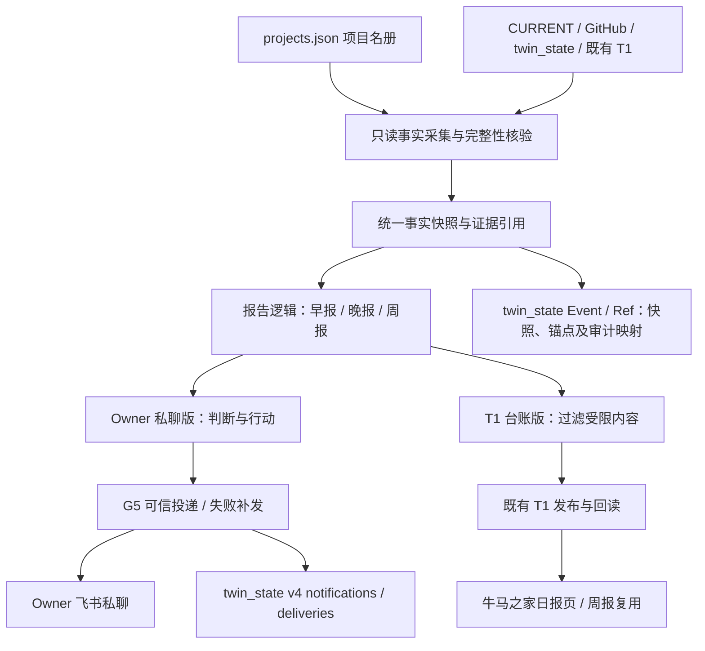

# Hermes Digital Twin · 主动运营与三报体系 V2.1

> **正式实施方案｜2026-11-02｜状态：产品规则已定稿；工程尚未实施**  
> **主线：私人数字分身「猛鬼兽」 / Hermes Digital Twin**  
> **范围：个人项目主动感知、早晚周报、工作台账、风险提醒与可复用经验沉淀。**  
> 企业数字分身「亚古兽」、企业业务资料、夜间无人值守执行、自动派单、ORCA 执行闸门调整均不在本次施工范围。

## 0. 执行摘要与决策状态

### 0.1 最终目标

把猛鬼兽建设为**持续掌握项目事实、形成优先级判断、主动给出精炼报告、保留可信工作记录、从实际工作中总结方法的私人数字分身**。本阶段不把主动汇报等同于主动执行，不创建新的 ORCA 调度系统。

三报的使用价值分别是：

| 报告 | Owner 需要得到的答案 | 固定时间（按已配置并核验的时区） |
|---|---|---|
| **早报** | 今天最值得先推进哪三件事？有哪些必须关注的风险？ | **周一至周五 08:00** |
| **晚报** | 今天各项目真正改变了什么？哪些事还没完成？ | **周一至周四 22:00** |
| **周报** | 本周真正完成了什么？下周聚焦什么？什么方法值得复用？ | **每周五 18:00** |

**Owner 已确定的规则：**

- **周末不发送固定早报和晚报**；不安排周末固定周报。
- **周五不发送 22:00 晚报**；18:00 周报同时产生周五的 T1 当日台账。
- 晚报接替原独立日报：同一份结构化事实快照生成 Owner 私聊推送版与按读者过滤的 T1 台账版。
- 原 09:00 晨报、周启、周五收口、到期单推等**合并进三报**，避免同类提醒重复发送；真正重要的系统异常告警另计。
- **近期只建设三报**；夜间无人值守推进暂不研究专项 ADR、不施工、不因本方案获得任何新的自动执行权限。

上述周末及周五安排由 Owner **2026-11-02 在 ChatGPT 当前会话**直接确认；不是 Claude 复核自行作出的决定。

**仍需另行决定的一项调度细则：法定节假日和调休。** 现有 Hermes 没有可直接复用的节假日日历。**在新增节假日日历获得批准之前，暂以星期一至星期五的 Cron 表达式为技术默认值**：法定节假日若落在工作日仍可能发报，调休工作日若落在周末仍不发报。这只是透明的过渡执行规则，**不代表 Owner 已确定节假日产品政策**；若需要严格按中国法定工作日运转，应另行维护并验收节假日/调休日历。

### 0.2 生效与授权

本文件是**最终产品与实施基线**，不是“已经部署”的声明。新增或修改正式 Cron、安装脚本、迁移正式状态库、改变飞书投递或停用旧任务，仍需走 Hermes Digital Twin 既有 PRD、G5/D1、独立审核与 Owner 对具体生产变更的授权程序。

**实施顺序为第 −1 步 → 第 0 批 → 第 1 批 → 第 2 批 → 第 3 批 → 第 4 批。** 每一批在进入真实运行之前，分别取得其正式配置变更授权；不能把第 4 批当作第一次创建生产 Cron 的阶段。

---

## 1. 运行架构：采集一次、判断一次、按受众分别投递

### 1.1 组件分工

| 组件 | 负责 | 不负责 |
|---|---|---|
| **Hermes（猛鬼兽）** | 项目事实梳理、专业判断、优先级、报告内容及方法候选 | 没有授权时自行开工、合并、部署或修改正式配置 |
| `projects.json` | 已纳管项目及权威状态来源 | 另建一套项目名册 |
| `progress_data.py` / `report_data.py` | 既有进度事实采集与转换；需核对实际支持范围 | 把模型生成的摘要冒充原始事实 |
| `report_publish.py` 与 T1 | 既有日报/周报文档写入与回读 | 重建一套平行的文档台账 |
| `twin_state` Event / Ref | 候选快照标识、成功台账锚点、项目与报告证据映射；实施前做字段映射 | 新建独立文件型事实总账 |
| **G5 `twin_notify.py` + v4 `notifications` / `deliveries`** | 通知指纹、状态、修订、投递记录及失败恢复（以实际验收接口为准） | 再开发第二套消息发送状态表和补发队列 |
| ORCA | 现有个人工程项目的执行、审核与证据来源 | 本次增加夜间自动执行 |

> **接口边界：** `snapshot_id`、成功锚点与 `delivery_id` 是需要满足的**业务语义**；不假设现有 G5 已实现全部字段。优先在 `twin_state` 已有 Event/Ref、现有报表数据与 G5 表之间建立映射；确有字段缺口时按既有 schema 迁移流程做最小扩展，不能另建第二套状态系统。

### 1.2 “一稿双产”的精确定义

1. **只读采集**：从权威来源读取状态和增量，记录来源、抓取时间、可信程度和缺失项。
2. **固化同一快照**：生成不可变的结构化事实及 `snapshot_id`；模型可以分析事实，但不能修改已验证的原始状态。
3. **生成共享判断**：在同一事实基础上形成结论、风险和建议；标记事实、推断、建议与待核实内容。
4. **按受众过滤并渲染**：Owner 私聊版可包含其有权查看的摘要与受控引用；T1 台账版按实际读者权限去除受限内容。两版事实口径和数字一致，详情范围可不同。
5. **分别持久化和投递**：T1 写入后回读，飞书由 G5 处理通知与发送回执。某端失败仅重试对应端，**不得重新取数生成内容不一致的“同一份报告”**。

两种输出共享快照、事件和判断，但**不必逐字相同**。内容过滤必须发生在持久化和发送之前。

---

## 2. 报告产品规格

### 2.1 早报｜周一至周五 08:00

**目标：Owner 一看就能决定今天先做什么。** 不以凑满三条为目标，不复述无变化的背景。

| 内容 | 输出要求 |
|---|---|
| 今日最重要的至多 3 项 | 项目、建议动作、优先原因（价值/截止/依赖）、建议执行者或待决策人、可行通道、证据链接和日期 |
| 关键触发提醒 | 截止前一日/当天、挂起满 4 周、相同阻断连续出现 3 份晚报、上期报告断档；与前三事项去重 |
| 周一本周焦点 | 优先承接**已成功形成的**上周五周报“下周焦点”；若尚无周五周报，则使用上一份已核验的周度目标或项目台账，并标注来源 |
| 隔夜/周末重要变化 | 仅列经过验证、影响今日决策的新增事实；与后续正式台账记账分离 |
| 缺失与降级 | 上一份晚报或台账缺失时，首行说明；直接从最新可信锚点及原始数据取数，不将“未读到”视为“没有变化” |

**过渡注意：** 第 3 批周五周报尚未上线前，不能假设现有周一 07:45 周报能在 08:00 前成功生成。若取数时未见已完成且可核验的周度目标，就给出**“本周焦点建议，尚未由正式周报确认”**；不阻塞早报，也不伪称已有决定。第 3 批上线后，改为直接承接周五周报。

### 2.2 晚报｜周一至周四 22:00

**目标：记录真实增量并给出明日推进建议，同时成为正式 T1 工作日志的来源。**

| 输出 | 内容与标准 |
|---|---|
| Owner 私聊版 | 纳管项目的今日增量、成果证据、风险与卡点、待决定事项、下一步建议（不超过 3 项）；每项推荐说明“为什么现在做、谁负责、通过什么渠道、能做到哪一步” |
| T1 台账版 | 复用既有 T1 六段：**今天的变化 / 还开着的事 / 卡点 / 今天的决定 / 项目进展 / 下个工作日先推**；保留时间范围、快照/证据引用，并执行读者过滤 |
| 完成口径 | 必须分清**已开发、测试通过、独立审核通过、已合并、已部署、Owner 已验收**；没有证据不得声称完成 |
| 无增量处理 | 如实说明关键项目未发生实质变化，可压缩内容，但不能把没有取到数据写成“零进展” |

**“今天”是 T1 报告期间的业务显示名称；底层统计以两次成功持久化的台账锚点之间的窗口为准，不强行按自然日 00:00 截断。**

### 2.3 周报｜每周五 18:00

**目标：本周收口、下周定焦点、积累可复用经验。**

| 模块 | 输出要求 |
|---|---|
| 本周焦点回看 | 对照上周已记录的焦点，说明实际结果、偏差与原因 |
| 项目成果 | 汇总本周已经写入的 T1 事件 + 周五 18:00 前的真实增量；不得遗漏周五白天 |
| 未关闭事项 | 合并旧“周五收口”，说明阻断、责任或待决策人、实际下一步 |
| 下周焦点 | 至多 3 项，标注“已决定”或“建议”，作为下周一早报的优先来源 |
| 可固化方法 | 最多 3 项，附两个以上独立任务的正向证据、适用条件；没有候选则不写 |
| **周五 T1 代写** | 同时把当天增量按 T1 六段结构写入台账；周五 22:00 不再运行晚报 |

**第 1 批先建设“周五 18:00 仅写 T1 台账、不推送周报”的基础能力；第 3 批才启用面向 Owner 的正式周报内容与投递。** 因此第 1 批可以独立验证周五记账，不存在依赖第 3 批的循环。

---

## 3. 数据时间轴、幂等与台账唯一写入方

### 3.1 以成功台账锚点为界

**正式台账窗口**：`(previous_committed_ledger_anchor, current_capture_time]`。只有 T1 写入**并经回读确认**后，才能推进成功锚点；发送消息成功不替代 T1 成功，模型写完文案也不替代 T1 成功。

| 场景 | 正式台账窗口 |
|---|---|
| 周二至周四晚报 | 上一个成功锚点 → 当晚 22:00 实际取数时刻 |
| 周五 18:00 台账 | 上一个成功锚点 → 周五 18:00 实际取数时刻 |
| 周一 22:00 晚报 | 周五 18:00（若成功）→ 周一 22:00；覆盖周五晚间、周末及周一全部增量 |
| 前次写入失败 | 锚点不动；下一次从最后成功锚点重新读取、用源事件 ID/指纹去重 |

首次切换时必须明确旧台账最后有效锚点、历史事件映射和开始覆盖时间，留下审计记录，避免新旧系统重叠或漏报。来源不完整时记录 `coverage=partial/unknown`，不得“以未取到为准”推进完整扫描的完成水位。

### 3.2 严格执行“一个台账，一个写入方”

**风险：** 本机 07:30 Hermes 日报与新的 22:00 晚报若同时写 T1 正式文档，会产生双重记录；云端日报机器人是另一条需要比较的并跑系统，不能混同为本机 07:30 日报。

**推荐迁移方式：先影子验证，再原子切换。**

1. **影子阶段**：新晚报/周五 18:00 台账写入**独立的试运行文档或隔离数据区**，不写正式 T1；旧 07:30 日报继续其已有正式写入。拿“晚报试运行 T1”与**云端日报机器人**按 PRD F2.4 比较结构、事实和覆盖区间。
2. **切换闸门**：影子验证合格、权限审计完成且 Owner 批准后，**同一个受控变更窗口**停用或改造原 Hermes 07:30 对正式 T1 的写入，再启用新晚报与周五 18:00 作为正式 T1 的唯一写入方。若还有其他实际写入者，必须在切换前一并梳理与处理。
3. **切换后**：仅一个被授权的发布流程可推进某一台账流的成功锚点；按写入目标、快照和窗口做幂等冲突检查。重复运行只能读回已写入内容或继续未完成交付，不能新增第二条同期间记录。
4. **回滚**：暂停新写入方，核对最近成功锚点和未完成投递；恢复旧写入方时也要取得适用运维授权，避免双写复发。

正式 T1 账号、文档、读取权限及牛马之家日报页对接方式必须以部署时审计结果为准，不自行推断。

### 3.3 去重与一致性

- 事件去重优先使用源系统稳定事件 ID、变更版本或时间；否则用来源、对象及内容指纹等可复核组合。
- 触发提醒使用稳定条件键（项目、事项、触发条件、适用期间），复用现有 notepad 去重机制；状态解除后再出现可形成新事件。
- 周五周报对周内已入账事件做**引用和复盘**，仅将周五新变化写入当天台账一次。
- 飞书投递与台账写入互相独立：其中一端失败只重试该端；使用同一事实快照、对应 G5 的稳定通知指纹和实际版本语义，不根据“文本相似”盲目抑制重要变化。

### 3.4 交付状态的真实证据层级

| 层级 | 可以声称什么 | 依据 |
|---|---|---|
| ① 已采集 | 事实快照及来源证据已固定 | 原始事件/引用、采集时间、快照标识 |
| ② 台账已写入并回读 | 正式 T1 已持久化对应内容 | 写入回执、读回内容及锚点记录 |
| ③ 发送接口返回 `message_id` | 飞书 API 已接受对应发送请求并返回标识 | G5 delivery 记录及飞书接口响应 |

**不能把③自动写成“Owner 接收端可见”。** 已有审计显示，现行 `twin_identity.lark_fetch()` 无法回读机器人自己发送的消息以核实接收端可见性。真正的收件效果通过 Owner 抽查/回应等**额外证据**验证；消息 ID 不能证明其在客户端已展示或被阅读。状态层级与 G5 的实际表字段需在第 0 批映射。

---

## 4. 可信投递与可靠性：直接复用 G5

### 4.1 唯一投递底座

本方案的发送记录、消息修订、失败留存与恢复补发**依附 B2.2-G5「低噪声报告的可信投递闭环」（issue #31）**；三报是 G5 的首批真实消费者。**不得新增第二套 `deliveries` 表、notification outbox、私有 JSON 补发队列或平行发送状态机。**

已审计的 G5 设计包含：`twin_state.py` v4 的 `notifications` / `deliveries`、`twin_notify.py` 指纹与 revision、本地优先多通道；但已验收的隔离代码**不等于已合并、安装、迁移或可生产投递**。

**2026-11-02 本机只读核查快照（非生产验收）：**

| 本地分支 | 读到的 HEAD（短 SHA） | 说明 |
|---|---|---|
| `claude/31-g5-delivery` | `e08d45d` | G5-A/D1 分支存在，须复核当前源码、迁移/回滚、二次审核 |
| `claude/31-g5b-work` | `657e37d` | G5-B 终端只读层分支存在，须复核权限和验收状态 |
| `claude/31-g5c-deliver` | `204dffc` | G5-C 飞书适配器分支存在，须复核并发、幂等与真实投递证据 |

上述 SHA 是**本地分支读取结果**，不是某个远端 PR 的已合并状态，也不能替代完整 SHA、双 Python 回归和独立复核。施工日须重新读取各分支 HEAD、工作区状态、测试、审查结论及对生产的实际安装状态。

> **2026-11-02 第 0 批盘点加注**（[盘点报告](三报-第0批-G5盘点.md)，待 ChatGPT 复核）：上表漏了第 4 个本地分支 `Natsukashii1997/hermes-g5-batch4-isolated`，HEAD 为 `e058caf0f1f25e85d60ac7eead0233b054ac1cc6`，内容是 e08d45d 加上按文件叠加的 G5-B、G5-C，以及 OBS-01 修复，独立评审 HMS-20261101-001 PASS。合并候选是它，不是 A/B/C 三个分支。本注不改变本节其他结论。

### 4.2 第 0 批先盘点 G5，再选择合并与迁移顺序

**负责划分：** Claude 可负责提交当前 G5-A/B/C 的完整 HEAD、diff、测试/反例、迁移和回滚方案；ChatGPT 负责独立审核与复核证据；Owner 对正式合并、安装、数据库迁移、Cron 和飞书投递等依现行闸门批准。具体角色以现有工程协作规程为准。

**最早核查时点：第 −1 步 PRD 更新验收后、第 0 批施工前。** 如果现场 G5 状态已变化，必须重新生成盘点结果，不能直接沿用本方案的历史快照。

G5 正式库 **v3 → v4** 的 D1 迁移是独立生产闸门：

- 先只读审计 `Store` 打开/自动迁移行为、正式库版本、备份及恢复能力；避免无意中用新版读写打开触发迁移。
- 独立测试可恢复备份、原库哈希、迁移前后数据兼容、失败恢复与回滚策略。
- G5-A/B/C 版本与接口经独立审核后，提出准确合并/安装/迁移顺序和回滚计划。
- **只有 Owner 对 D1 正式变更单独批准后，才执行生产迁移和安装。** 不因三报设计通过就自动放行。
- 在 G5 没有通过正式投递验收之前，三报仅可进行隔离/本地试运行，不声称“已接通可信飞书发送”。

### 4.3 故障行为

| 情形 | 必须表现 | 最低验收证据 |
|---|---|---|
| 模型超时、失败 | 用已固化事实生成**事实版降级**；醒目标注“分析降级”，不捏造优先级与结论 | 故障注入、降级文本、事实来源 |
| DNS、网关或飞书不可达 | G5 本地记录待发状态；网络恢复后按 G5 契约对账与补发，不静默丢失 | 本地事件、重试回执、API `message_id` 或明确失败 |
| 发送 ACK 不明 | 按 G5 实际可证实能力做查询与幂等处理；无法确认时进入待核查，不能盲目重发 | 状态与处理审计 |
| 早报依赖上期晚报失败 | 早报开头说明缺失/仅有降级版；从权威来源取数 | 跨源恢复日志 |
| 项目源部分不可读 | 标注来源与覆盖范围，其余可信事实照常汇报 | `coverage` 与错误详情 |
| 计划时间迟到 | 记录计划时刻、取数、调用、API 回执时间；超过 **15 分钟**在报告标注 | Cron 与发送日志 |

`--failure-deliver` 可作为故障通知配置，但**不等于完整事实版降级**；两者需要分别测试。网络恢复后补发的旧报告须标明其原计划时间与数据窗口，不能伪装成刚发生的进展。

### 4.4 监测和异常分流

- 沿用现有巡检及工程自检链路，增加**“今日 08:00 早报是否有 G5 API 发送记录/失败标记”**检查，避免早报失败直到常规较晚巡检才发现；若检查无法提前运行，则在已批准的现有巡检时点给出明确告警延迟，不凭空宣称即时监控。
- 正常项目事项进入三报；需要 Owner 及时处理的**安全、投递链路或严重数据异常**可独立告警。
- 告警自身发送失败也须在 G5/现有本地事件链路留痕，恢复后补发；**“没有收到告警”不是健康证明**。

---

## 5. 数据权限、沉淀与报告质量

### 5.1 受众边界

| 交付场所 | 受众 | 规则 |
|---|---|---|
| 猛鬼兽 Owner 飞书私聊 | 已核验的 Owner | 可使用当前权限范围的项目结论与引用；避免复制敏感原文和凭据 |
| T1 台账文档 | 以真实协作者/分享权限为准 | 只写适宜其读者范围的状态、工作事实、非敏感证据和受控链接；不写未分级 Vault 内容 |
| 牛马之家日报页 | 以实际页面访问者和数据权限为准 | 读取既有 T1 时不能擅自放大公开范围，不假设只有 Owner 能看 |

**施工阻断：** 未核对 T1 文档、牛马之家日报页的实际读者之前，不得将受限项目详情写入正式台账；如仍需并行开发，只能在隔离数据或非敏感摘要上验证。

### 5.2 经验沉淀（不新增第四份报告）

| 经验类别 | 既有入口 | 提升门槛 |
|---|---|---|
| 项目内部经验 | 项目 `docs/LESSONS.md` | 按既有项目审核规则 |
| 跨项目通用教训 | `agent-kit/LESSONS.md` G-xx | Owner 批准升级 |
| 可复用方法/Skill | `my-skills/skills/<name>/` 与 `links.tsv` | PR、独立审核和适用权限 |
| 对 Owner 工作习惯、判断依据的可复用认识 | Obsidian Vault 收件箱 `/kb-note` | 按 Obsidian 主线规则审查 |
| 一次性发现 | 现有项目证据中的 `observations.md` | 暂存，不擅自固化 |

某项做法原则上在**至少两个独立任务**中得到正向证据，才列为周报的“可固化候选”；不因此授权猛鬼兽自行修改 SOUL、HERMES、全局规则或正式 Skill。

### 5.3 指标与反馈机制

| 指标 | 定义与目标 |
|---|---|
| **报告有用率** | 明确有效正向反馈 / 所有有效正负反馈；沿用既有目标 **≥70%** |
| **反馈覆盖率** | 有效反馈数 / 可确认的发送接口成功报告数；需注明该分母为 API 接受量，不等于实际阅读量 |
| 发送及时性 | 计划时刻到 API 回执时刻；>15 分钟标记，先观察两周 |
| 事实完整性 | 应纳管项目状态均有可信证据或明确缺失声明 |
| T1 连续性 | 没有无说明的窗口缺口或重复事件 |
| 同快照一致性 | 同一报告的 Owner 私聊版与 T1 版可核对同一快照 |
| 故障恢复性 | 每次失败均可追踪到成功、待处理或已撤销 |

有用率优先考虑 Owner 对飞书报告作 👍/👎 reaction，**但是飞书机器人能否按发送消息 ID 和发送人读取这些 reaction 尚待真实测试**。未实测前不能写“自动采集已具备”；回读不可用时，使用简短文字反馈或已有台账评价字段。无反馈不计入有用率正负样本，但必须披露覆盖率与样本量，避免小样本误判。

---

## 6. 唯一近期实施路线与逐批授权

### 第 −1 步｜先同步工程唯一真源（不跳过）

**目的：消除当前 PRD 与三报新规则的冲突。**

- [ ] Owner 对本 V2.1 产品规则作正式确认后，在 `PRD.md` 追加 **D20（建议编号，以施工时有效编号为准）**，更新 **F2.3、F2.4、F4**：明确 08:00 早报、22:00 晚报、周五 18:00 周报、周末停止固定报、晚报替代日报、工作台账单写者、统一投递基于 G5。
- [ ] 更新 **T7 / issue #12** 及其分批依赖、旧日报/周报切换和三报边界；不覆盖原有历史验收记录。
- [ ] 对照最新 `docs/DT-ORC/ARCHITECTURE.md` 与 G5 D1–D6，明确本方案不改变 ORCA 执行闸门。
- [ ] 通过项目既定代码审核、合并与配置授权程序后，才按新 PRD 组织后续工程任务。

**需要 Owner 授权的正式动作：** PRD、任务台账等权威文档的修改与合并，按当前项目权限闸门执行。**验收：** PRD 与 T7 记录同三报产品规则一致，且变更来源可追溯。

### 第 0 批｜G5 盘点与可靠性底座

**进入前提：** 第 −1 步通过；可只读读取当前 G5-A/B/C、Cron、T1 与报告脚本。

**工作内容：**

- [ ] 由 Claude 提交当前 G5-A/B/C 的完整 HEAD、变更、审查结论、测试、正式库迁移/回滚差异；ChatGPT 独立复核，Owner 决定生产闸门。
- [ ] 单独审查并按批准执行 G5 **D1 v3→v4** 数据库迁移及关联的安装顺序；保留可验证备份与回滚证据。
- [ ] 映射 G5 通知/投递表、现有 Event/Ref、T1 报告 ID 与成功锚点；缺字段只做最小兼容扩展，**不建立平行队列**。
- [ ] 审计现有 Cron 的 schedule、timezone、workdir、deliver、failure-deliver、enabled 与近几次运行结果；审计 T1 文档和牛马之家日报页实际读者。
- [ ] 实测模型超时的事实版降级、投递失败本地留存、网络恢复后补发、消息修订/幂等、`message_id` 证据及失败时不推进台账锚点。
- [ ] 复用巡检实现早报投递状态核查，验证告警不能发送时仍有本地记录与恢复补发。

**需要 Owner 授权的正式动作：** G5 分支合并、正式库 D1 迁移、正式脚本安装、任何飞书投递设置变更；**每项依既有闸门单独批准**。只读盘点和隔离测试不等于批准生产迁移。

**退出门槛：** G5 当前分支状态及风险已独立复核；正式迁移/安装有批准与可追溯记录；故障注入和恢复路径有真实证据。若 G5 暂不能正式启用，则仅完成隔离能力验收，**不进入面向 Owner 的生产三报投递阶段**。

### 第 1 批｜晚报与周五“仅台账”基础能力

**进入前提：** 第 0 批可信基础可用、T1 实际受众已审计。

**工程内容：**

- [ ] 实现周一至周四 **22:00 晚报**：同快照生成 Owner 飞书版与 T1 版；周五 **18:00 仅写 T1，不推送周报**。
- [ ] 先在**独立试运行 T1 文档**影子验证；正式 T1 仍由旧唯一写入方维护。与**云端日报机器人**按 PRD F2.4 做事实、结构、日期和完整性比较，不能误把本机 07:30 日报当作并跑对象。
- [ ] 影子试运行验收后，在受控窗口内停用/改造本机 07:30 Hermes 日报的正式台账写入，再授权启用新晚报/周五写入为**唯一生产 T1 写入方**。保留旧任务回滚方案和历史锚点审计。
- [ ] 以 G5 状态确认飞书发送 API 已返回 `message_id`；Owner 抽查客户端能看到的信息，不把 API ACK 写成已阅读。

**需要 Owner 授权的正式动作：** 创建/启用本批晚报 Cron、设置 Owner 飞书目标及故障投递、周五 18:00 台账任务、正式 T1 写入方切换、对旧 07:30 任务的对应写入路径停用/改造。每一组上线前集中提交差异请求批准，**不等第 4 批才建 Cron**。

**退出门槛：** 连续 **5 个适用工作日**有可核对的真实样本（4 个周一至周四晚报、1 个周五代写台账）；试运行与正式切换证据完整；Owner 私聊与 T1 快照一致、无重复写入、无漏掉周五窗口、与云端日报机器人对照结论可核查。周五仅台账不应被计作少发一份既定周报——正式周报在第 3 批上线。

### 第 2 批｜08:00 早报与触发提醒

**进入前提：** 第 1 批至少有可信晚报及周五台账，能读取完整事实源。

**工程内容：**

- [ ] 实现周一至周五 **08:00 早报**：优先三项、截止和阻塞提醒、缺失时降级、上期事实来源。
- [ ] 周一本周焦点从**已成功生成**的可核验周度目标读取；第 3 批前不等待可能迟到或失败的周一 07:45 周报，第 3 批后使用上周五周报。
- [ ] 使用已有去重机制避免截止事项与今日前三事项重复；旧的同类单独提醒正式退场前必须核对会否重复发送。
- [ ] 巡检检查当天早报是否存在 G5 API 发送回执/失败记录；不能无依据宣称已送达客户端。

**需要 Owner 授权的正式动作：** 新增 08:00 生产 Cron、Owner 私聊投递与故障投递、相关旧单推通知调整；第 1 批已运行的晚报 Cron 不重复创建。

**退出门槛：** 连续 **5 个工作日**可核对发送 API 回执；上期台账缺失时首行标注；提醒不重复；三项建议的证据、项目、责任和可行通道均能回溯。

### 第 3 批｜周五 18:00 正式周报

**进入前提：** 第 1 批周五 T1 代写已可靠，第 2 批早报稳定。

**工程内容：**

- [ ] 在第 1 批周五台账能力上增加**周报内容生成与 Owner 私聊投递**；以已写入的周内 T1 + 周五实时增量为准。
- [ ] 周五原有收口、下周焦点和“可固化方法”并入周报；明确不另发 22:00 晚报。
- [ ] 切换周一早报的焦点来源为上周五周报；校验周五 18:00 → 下周一 22:00 台账窗口无缺漏。

**需要 Owner 授权的正式动作：** 新建/启用周五 18:00 周报生产 Cron，或在既有周五台账任务上启用一稿双产与 G5 投递；停用/改造旧周一 07:45 Hermes 周报及其他确认为重复的周度推送，避免双报。具体取决于切换前实际运行状态。

**退出门槛：** 连续 **2 个周五**周报按规定生成并有飞书发送回执；周五 T1 仅写一次；次周一早报准确引用焦点；本周进展与 T1、GitHub 证据一致。

### 第 4 批｜旧任务收尾、去重与整体验收

**进入前提：** 前 0–3 批各自的真实生产配置已经按批取得授权，并通过局部验收。

**工作内容：**

- [ ] 核对并停用所有仍重复的旧独立日报、晨报、周启、周五收口或截止单推任务；逐项核对有无遗漏或外部云端机器人重复推送。
- [ ] 回读 `hermes cron list`、任务配置、收件人、时区、故障路径与实际发送记录；确保只存在三类正式固定报告（以及单独的必要异常告警/自检）。
- [ ] 核对 T1 唯一写入方、成功锚点、周末增量入账、报告权限、G5 投递状态、Owner 抽查和反馈统计。
- [ ] 归档脚本变更、PR、独立审核、回滚预案和正式验收证据，明确后续维护人和运行告警入口。

**需要 Owner 授权的正式动作：** 对残余旧 Cron 和重复消息的停用/更改，必要的正式回滚或清理。**不是在本批首次创建三报 Cron。**

**退出门槛：** 生产运行仅见已定的固定三报节奏；无重复正式台账写入；重大故障可追踪；真实送达抽查与报告事实核验通过；既有权限闸门未被放宽。

---

## 7. 每批上线统一执行与回滚规范

**统一顺序：** 当前状态只读盘点 → 明确分支与工作区 → 最小改动及独立测试 → PR/审查 → 生产改动清单和预期差异 → Owner 按既有闸门授权 → 变更/发布 → 回读验证 → 故障注入或真实试用 → 批次验收。

**任何一批的正式改动都必须：**

- 保存此前 `jobs.json`、相关脚本、目标文档/目标收件人映射及成功台账锚点的可验证快照；不传播凭据。
- 明确旧/新写入方和旧/新投递方的切换次序，防止过渡期双写和双发。
- 对发送失败、模型超时、部分源缺失、重复运行和网络恢复安排可核验回滚或恢复路径。
- 生产环境出现重大泄漏、重复入账或错误状态判断时，优先停止受影响路径并保留现场；不能为“快速恢复”无授权修改生产设置。
- **使用 G5 的既有幂等和投递审计**；G5 无法保证的行为应写为待实现/待验证，不以 Prompt 代替工程控制。

---

## 8. 施工前的真实基线（2026-11-02 只读快照）

> 本节仅是本轮复核时取得的历史事实，不替代下一次施工当天的实时回读。设备、网络与运行配置可能变化。

**本机 `hermes cron list` 曾回读：**

| ID（短） | 任务 | 调度 | 投递 | 观察 |
|---|---|---|---|---|
| `33df73dffd17` | 日报（新结构·并跑） | 07:30 每天 | `local` | 仍为候选替代日报；不能当作已推飞书 |
| `6a976baa2632` | 周报（新结构·并跑） | 周一 07:45 | `local` | 2026-11-02 最近一次等待模型约 934 秒后失败 |
| `f3388d53ce97` | 工程自检 | 每天 09:50 | 飞书私聊 | `no-agent`，属于工程监测，不是三份报告之一 |

已知历史问题：日报调度迟到约 6 分钟；周报调度迟到约 29 分钟；曾有长期网关断线且因 DNS 异常导致告警无法送达。三报的降级、补发和定时可靠性必须根据这些具体失败模式验收。

**已审计 G5**：本地隔离分支存在，但各分支的审批、合并、正式安装、数据库 v4 迁移及真实投递仍要在第 0 批重新核查。禁止把“本地分支存在”“某批测试通过”简写为“生产 G5 已可用”。

> 2026-11-02 加注：G5 的合并候选是第 4 批分支 `e058caf`，见 §4.1 注和[第 0 批盘点报告](三报-第0批-G5盘点.md)；正式库仍是 v3。

---

## 9. 本阶段最终完成标准（Definition of Done）

- [ ] **产品与真源**：PRD D20（或实际有效编号）、F2.3/F2.4/F4 与 T7 #12 对齐；正式施工、审核与 Owner 授权可追溯。
- [ ] **节奏**：周一至周五 08:00 早报、周一至周四 22:00 晚报、周五 18:00 周报；周末不发固定报告；周五不另发 22:00 晚报。
- [ ] **同快照**：私聊与 T1 台账使用同一事实快照，权限不同但业务事实不冲突。
- [ ] **单写者**：正式 T1 每个窗口只存在一个有效写入方；原本机日报和新晚报无并行双写；云端日报机器人与本地日报的角色被正确区分。
- [ ] **连续性**：周五 18:00 代写、周一补齐周末增量、台账失败不推进锚点；完整性/缺失可检验。
- [ ] **G5**：复用 G5 的通知和投递状态；D1 v3→v4 迁移独立审核及授权；失败与恢复有真实证据；不建第二套 outbox。
- [ ] **证据口径**：完成、测试、审核、合并、部署、验收分别陈述；飞书 API `message_id` 不写成 Owner 已读或已看到。
- [ ] **退旧**：旧独立日报、周启、周五收口、重复提醒不再产生同质化固定推送；正式 Cron 回读无重复执行。
- [ ] **质量**：报告有用率可核算且同时提供反馈覆盖率；假设的 reaction 读取能力未经实测不使用。
- [ ] **实测**：晚报/周五台账有 5 个适用工作日样本，早报有 5 个工作日样本，周报有 2 个周五样本；故障降级与网络恢复补发被真实验证。
- [ ] **安全**：台账/牛马之家读者审计完成，无受限个人材料向不适当受众泄漏；夜间自动执行及 ORCA 真实动作闸门保持不变。

---

## 附录 A｜夜间无人值守执行（远期备忘，不施工）

Owner 已决定**暂时只做主动汇报**。不启动有界夜推专项 ADR，不新建夜间执行控制器，不新增 `/夜推` 指令，不开放自动派单、自动合并、正式安装或生产部署。

若未来重启该议题，应以当时 `docs/DT-ORC/ARCHITECTURE.md` 的 M1–M4 实际验收状态重新审查。Owner 不在场的运行属于 `UNATTENDED`；时间窗口、本地 worktree、禁 push 提示词均不能自动替代 M4 所需的可靠唤醒、权限隔离与恢复验收。任何授权需由可信非模型通道签发，并与实际 Owner 消息及计划版本绑定；运行器和持久账本不能在相同可任意写入权限下假装具备安全隔离。

本附录只保留未来设计方向，不纳入近期批次、预算和任何生产授权。

## 附录 B｜审核意见 C1–C6、S1–S3 收口对照

| 审核项 | V2.1 处理 | 位置 |
|---|---|---|
| **C1** G5 重复建设 | 三报投递依附 G5；先盘点 A/B/C + D1；快照锚点映射现有 `twin_state` | §1、§4、第 0 批 |
| **C2** Cron 批次矛盾 | 每一批正式上线前分别授权新增/修改 Cron；第 4 批只做清理和整体复核 | §6 各批次 |
| **C3** 并跑与台账双写 | 影子 T1 → 受控单写者切换；并跑对象明确为云端日报机器人 | §3.2、第 1 批 |
| **C4** 周五与周一依赖 | 第 1 批先做周五 18:00 仅台账；第 2 批周一焦点过渡来源；第 3 批启用周报 | §2、第 1–3 批 |
| **C5** 工作日历、交付验证 | 不虚构节假日日历；交付改为三层，客户端可见由 Owner 抽查 | §0、§3.4、§5.3 |
| **C6** PRD 真源冲突 | 第 −1 步在实施前同步 D20 / F2.3、F2.4、F4 / T7 #12 | §6 |
| **S1** 审核与决定归属 | Claude 复核是建议，Owner 在 ChatGPT 会话作最终决定 | §0、附录 C |
| **S2** 早报异常发现 | 复用现有巡检/G5 记录检查早报是否被 API 接受，说明告警时效 | §4.4、第 2 批 |
| **S3** 决定出处 | 记录 2026-11-02 ChatGPT 会话直接确认周末和周五安排 | §0、附录 C |

## 附录 C｜版本与决策溯源

- ChatGPT V1.0：提出主动感知—提案—授权—执行—验收—汇报—沉淀闭环。
- Claude V1.0 审核（E1–E10）：指出夜间无人值守闸门、授权可信性、真实能力及可靠性前置问题。
- ChatGPT V1.1：明确夜间无人值守归入 `UNATTENDED`，不得绕过 M4；授权与隔离要求提高。
- Claude V1.1 复核（R1–R9）：**建议**将近期重心调整为三份报告，补充时间轴、同快照、权限与降级。
- **Owner 2026-11-02 决定**：只做汇报；08:00 早报、22:00 晚报、周五 18:00 周报；周末不发固定早晚报、周五周报代替晚报；夜间自主执行暂不施工。周末/周五的最后两项安排由 Owner **在 ChatGPT 当前会话直接确认**。
- ChatGPT V2.0：形成三报实施稿。
- Claude V2.0 复核（C1–C6、S1–S3）：**有条件通过**三报产品规则，要求复用 G5、纠正批次/单写者/日期与验证口径、实施前同步 PRD。
- **本 V2.1**：完成对应修订，是后续实施与验收的产品/工程基线。节假日与调休的具体政策仍需 Owner 单独确认；在此之前按普通周一至周五的透明技术默认规则执行。

---

**最终状态：V2.1 方案定稿，供后续工程实施；当前仅制作文档，未修改生产库、正式 PRD、Hermes Cron、飞书投递、网关或 ORCA 配置。**
